# Business Ops OS: data model

73 tables in schema `ops`, defined in five files (D-029). Column detail, constraints and states: `DOMAIN_MODEL.md`. Conventions (UUID keys, business codes, no FK between module schemas, rows not deleted): `DATABASE_DESIGN.md`. No migration exists yet; the baseline is generated centrally.

Diagram scope: relationships only, between `ops` tables and the `core` tables they reference (`CORE_*`). Ids of Academic records are plain uuids with no FK (D-005) and are not drawn. Fields are omitted on purpose.

```mermaid
erDiagram
  %% wave 2: leads, admissions, scheduling
  LEAD_SOURCES ||--o{ ENQUIRIES : source
  LEADS ||--o{ ENQUIRIES : has
  LEADS ||--o{ LEAD_ACTIVITIES : contact
  LEADS ||--o{ DUPLICATE_FLAGS : flagged
  LEADS ||--o{ FOLLOW_UPS : next_action
  LEADS ||--o{ ADMISSIONS : cases
  LEADS ||--o| CONTACT_PREFERENCES : consent
  CORE_PROGRAMMES ||--o{ ADMISSIONS : programme
  ADMISSIONS ||--o{ ADMISSION_TRANSITIONS : history
  ADMISSIONS ||--o{ ADMISSION_CHECKS : checklist
  ADMISSIONS ||--o{ COUNSELLING_SESSIONS : counselling
  ADMISSIONS ||--o{ DEMOS : demos
  DEMOS ||--o{ DEMO_TEACHERS : teachers
  ADMISSIONS ||--o{ FEE_RECORDS : fees
  DEMOS ||--o{ FEE_RECORDS : demo_credit
  ADMISSIONS ||--o{ ENROLMENT_ATTEMPTS : handoff
  CORE_INTEGRATION_EVENTS ||--o| ENROLMENT_ATTEMPTS : request_event
  CORE_APPROVALS ||--o{ SOP_VERSIONS : approval
  %% wave 2: tasks, SOPs, registers, projects
  TASKS ||--o{ TASK_DEPENDENCIES : blocked_by
  TASKS ||--o{ ESCALATIONS : escalated
  TASKS ||--o{ TASK_COMMENTS : comments
  TASKS ||--o{ TASK_REFERENCES : references
  TASKS ||--o| TASK_REVIEW_REQUIREMENTS : needs_review
  TASKS ||--o{ TASK_REVIEWS : review_cycles
  TASKS ||--o{ TASK_REMINDERS : reminded
  SOPS ||--o{ SOP_VERSIONS : versions
  SOP_VERSIONS ||--o{ SOP_CHECKLIST_ITEMS : steps
  SOP_VERSIONS ||--o| SOP_VERSION_SCHEDULES : dates
  SOPS ||--o| SOP_ARCHIVES : archived
  SOP_VERSIONS ||--o{ SOP_ACK_REQUIREMENTS : required_by
  SOP_VERSIONS ||--o{ SOP_ACKNOWLEDGEMENTS : acknowledged
  RISKS ||--o{ RISK_MITIGATIONS : actions
  PROJECTS ||--o{ MILESTONES : milestones
  MILESTONES ||--o{ MILESTONE_DEPENDENCIES : depends
  POLICIES ||--|{ POLICY_VERSIONS : versions
  CORE_APPROVALS ||--o{ POLICY_VERSIONS : approval
  DECISIONS ||--o| DECISIONS : superseded_by
  %% staff and HR records
  CORE_STAFF_MEMBERS ||--o| STAFF_PROFILES : ops_profile
  CORE_STAFF_MEMBERS ||--o{ RESPONSIBILITIES : holder
  CORE_STAFF_MEMBERS ||--o{ ONBOARDING_ITEMS : checklist
  CORE_STAFF_MEMBERS ||--o| EMPLOYEE_RECORDS : hr_extension
  CORE_STAFF_MEMBERS ||--o{ EMPLOYMENT_HISTORY : changes
  CORE_DEPARTMENTS ||--o{ DEPARTMENT_HEADS : head_tenures
  CORE_STAFF_MEMBERS ||--o{ DEPARTMENT_HEADS : is_head
  CORE_STAFF_MEMBERS ||--o| EMPLOYEE_PRIVATE_DETAILS : sensitive
  CORE_STAFF_MEMBERS ||--o{ EMERGENCY_CONTACTS : sensitive
  CORE_STAFF_MEMBERS ||--o{ EMPLOYEE_DOCUMENTS : metadata
  EMPLOYEE_DOCUMENTS ||--o| EMPLOYEE_DOCUMENTS : superseded_by
  CORE_STAFF_MEMBERS ||--o{ EMPLOYEE_IDENTITY_REFERENCES : sensitive_last4
  EMPLOYEE_DOCUMENTS ||--o{ EMPLOYEE_IDENTITY_REFERENCES : optional_link
  CORE_STAFF_MEMBERS ||--o{ COMPENSATION_RECORDS : sensitive
  COMPENSATION_RECORDS ||--o| COMPENSATION_RECORDS : superseded_by
  ASSETS ||--o{ ASSET_ASSIGNMENTS : history
  CORE_STAFF_MEMBERS ||--o{ ASSET_ASSIGNMENTS : holder
  %% recruitment and lifecycle
  CORE_DEPARTMENTS ||--o{ REQUISITIONS : department
  REQUISITIONS ||--o{ JOB_APPLICATIONS : receives
  CANDIDATES ||--o{ JOB_APPLICATIONS : makes
  JOB_APPLICATIONS ||--o{ JOB_APPLICATION_STAGES : history
  JOB_APPLICATIONS ||--o{ INTERVIEWS : has
  INTERVIEWS ||--o{ INTERVIEW_PANELISTS : panel
  JOB_APPLICATIONS ||--o{ JOB_OFFERS : offers
  JOB_APPLICATIONS |o--o| EMPLOYEE_RECORDS : hired_as
  EMPLOYEE_RECORDS ||--o{ LIFECYCLE_CASES : cases
  JOB_APPLICATIONS |o--o| LIFECYCLE_CASES : opens_onboarding
  LIFECYCLE_CASES ||--o{ LIFECYCLE_ITEMS : checklist
  ASSET_ASSIGNMENTS |o--o{ LIFECYCLE_ITEMS : return_item
  CORE_INTEGRATION_EVENTS |o--o| LIFECYCLE_CASES : separation_event
  %% attendance, shifts, leave
  SHIFT_TEMPLATES ||--o{ SHIFT_ASSIGNMENTS : assigned
  CORE_STAFF_MEMBERS ||--o{ SHIFT_ASSIGNMENTS : works
  CORE_STAFF_MEMBERS ||--o{ ATTENDANCE_SESSIONS : records
  ATTENDANCE_SESSIONS ||--o{ ATTENDANCE_BREAKS : breaks
  ATTENDANCE_SESSIONS ||--o| ATTENDANCE_SESSIONS : superseded_by
  ATTENDANCE_SESSIONS ||--o{ ATTENDANCE_CORRECTIONS : corrected_by
  ATTENDANCE_CORRECTIONS ||--o| ATTENDANCE_SESSIONS : resulting_session
  ATTENDANCE_IMPORTS ||--o{ ATTENDANCE_SESSIONS : created
  LEAVE_TYPES ||--o{ LEAVE_REQUESTS : of_type
  CORE_STAFF_MEMBERS ||--o{ LEAVE_REQUESTS : requests
  LEAVE_REQUESTS ||--o{ LEAVE_LEDGER_ENTRIES : usage_reversal
  LEAVE_TYPES ||--o{ LEAVE_LEDGER_ENTRIES : balance
```

Not drawn: `settings`, `incidents`, `work_items`, `milestone` and `task` links to leads, admissions, SOPs, decisions and projects (nullable references), and every `created_by` / `recorded_by` link to `core.users`.

## Tables
Owner file: **ops.ts** = `packages/database/src/schema/ops.ts`; **hr** = `ops-hr.ts`; **life** = `ops-lifecycle.ts`; **time** = `ops-time.ts`; **work** = `ops-work.ts`. (S) = sensitive record set (`docs/PERMISSIONS.md`).

| Table | Purpose | File |
|---|---|---|
| `settings` | Policy register values with decision states | ops.ts |
| `lead_sources` | Configurable enquiry sources | ops.ts |
| `leads`, `enquiries`, `lead_activities`, `duplicate_flags` | Leads, each enquiry with its source, contact attempts, duplicate warnings | ops.ts |
| `admissions`, `admission_transitions`, `admission_checks` | Pipeline case per lead and programme, status history, confirmation checklist | ops.ts |
| `follow_ups`, `counselling_sessions`, `demos`, `demo_teachers` | Next actions, appointments, demo classes | ops.ts |
| `fee_records` | Manually recorded fee entries (paise) | ops.ts |
| `enrolment_attempts` | One row per handoff request to Academic | ops.ts |
| `contact_preferences` (S) | Consent and allowed channels per lead | ops.ts |
| `tasks`, `task_dependencies`, `escalations` | Work items, blockers, L2 to L4 escalations | ops.ts |
| `staff_profiles`, `responsibilities`, `onboarding_items` | Ops data on staff, role holders and backups, simple per-staff checklist | ops.ts |
| `sops`, `sop_versions`, `sop_checklist_items` | SOP register, immutable versions, steps | ops.ts |
| `incidents`, `decisions`, `risks`, `projects`, `milestones`, `milestone_dependencies`, `work_items` | Exceptions, decision log, risks, projects, legacy inventory | ops.ts |
| `employee_records` | HR extension of a staff row: code, work contacts, status, dates (carries the legal name column) | hr |
| `employment_history` | Append-only change log of department, title, manager, type, status | hr |
| `department_heads` | Head tenures per department, one current | hr |
| `employee_private_details` (S) | Personal contacts and address | hr |
| `emergency_contacts` (S) | Up to five per employee | hr |
| `employee_identity_references` (S) | Document kind and last four characters | hr |
| `employee_documents` (S) | Document metadata, retention and two-person deletion; no files | hr |
| `compensation_records` (S) | Effective-dated pay terms, draft to approved | hr |
| `assets`, `asset_assignments` | Work assets and who holds them | hr |
| `requisitions`, `candidates`, `job_applications`, `job_application_stages` | Hiring: openings, people, applications, stage history | life |
| `interviews`, `interview_panelists`, `job_offers` | Interviews with feedback, offers (no salary) | life |
| `lifecycle_cases`, `lifecycle_items` | Onboarding and offboarding cases and checklists | life |
| `shift_templates`, `shift_assignments`, `holidays` | Shifts, who works which, holiday calendar | time |
| `attendance_sessions`, `attendance_breaks`, `attendance_corrections`, `attendance_imports` | Staff clock records, corrections, CSV batches | time |
| `leave_types`, `leave_requests`, `leave_ledger_entries` | Leave types, requests, balance ledger | time |
| `task_comments`, `task_references`, `task_review_requirements`, `task_reviews`, `task_reminders` | Task side tables | work |
| `sop_version_schedules`, `sop_archives`, `sop_ack_requirements`, `sop_acknowledgements` | SOP dates, archive flag, required reading | work |
| `risk_mitigations` | Actions against a risk | work |
| `policies`, `policy_versions` | Company policies and compliance register with versions | work |

Core tables Ops writes as steward: `core.departments`, `core.staff_members`. Ops publishes `ops.admission.enrolment_requested` v1 and `ops.employee.separated` v1 through `core.integration_events`.
