# Business Ops OS: data model

32 tables in schema `ops` plus the canonical student in `core.students` (D-033). Every column,
in plain words, with allowed values and examples: **[DATA_DICTIONARY.md](DATA_DICTIONARY.md)**
(generated from the schema by `npm run docs:data-dictionary`). Files in `packages/database/src/schema/`:

| File | Tables |
|---|---|
| `ops.ts` | settings, lead sources, leads, enquiries, lead activities, duplicate flags, admissions, admission transitions, admission checks, follow-ups, demos, fee records, enrolment attempts, contact preferences, staff profiles |
| `ops-demos.ts` | `demo_sessions`, `demo_session_changes`, `checklist_entries` |
| `ops-meetings.ts` | `appointments`, `appointment_participants`, `appointment_changes`, `staff_subject_capabilities`, `teacher_student_feedback`, `student_teacher_feedback` |
| `ops-students.ts` | `admission_number_counters`, `admission_number_changes`, `exit_records`, `guardians`, `report_exports` |
| `ops-fees-intake.ts` | `fee_plans`, `fee_instalments`, `lead_handoff_receipts` |
| `core.ts` | `students` (Ops is steward) |

Naming (D-036): `<x>_staff_id` = staff member; `student_id` = `core.students` everywhere in `ops`;
`academic_student_id` = Academic OS's own student record (plain UUID); `<x>_by` = login user;
`<x>_at` = UTC instant; `<x>_date` / `<x>_on` = Asia/Kolkata day; `<x>_paise` = integer paise;
sample rows: `is_sample` on `ops.leads`, `core.students` and `ops.staff_profiles` (everything
else follows its lead or student). Conventions (UUID keys, business codes, no FK between module
schemas, rows not deleted): `docs/DATABASE_DESIGN.md`.

Migration history: `0000_baseline` → `0001_users_email_domain` → `0002_remove_hr_operations`
(D-032) → `0003_admissions_workspace` (demo sessions, students, appointments, fees; backfill
reasoning in `docs/parts/admissions-*.md` §2) → `0004_fee_plan_close_without_approval` →
**`0005_clear_names`** (D-036): `counselling_sessions` → `appointments` (`scheduled_at` →
`starts_at`, `counsellor_staff_id` → `staff_id`, unused `attendees` dropped); legacy demo columns
`subjects`, `day_dates`, `status`, `is_sample` and table `demo_teachers` dropped (sessions are the
only source); `fee_amount_inr` numeric → `fee_amount_paise` bigint; `admissions.student_id` →
`academic_student_id` and `student_identity_id` → `student_id` (also in `guardians`,
`report_exports`); `appointment_participants.guardian_ref` → `guardian_id` with a foreign key;
`staff_profiles.staff_ref` → `staff_code`; `is_sample` added to `leads` and `staff_profiles`
(backfilled from flagged demos and the reserved `@example.test` domain) → `0006_fee_structures`
(new table `ops.fee_structures`, additive; OPS-123). Where it has been applied: `IMPLEMENTATION_STATUS.md` (nothing is Deployed).

## Diagram

Relationships only. `CORE_*` = tables in `core`. Academic and Marketing ids are plain UUIDs with no FK (D-005) and are not drawn. `checklist_entries` points at a demo or an admission by `subject_type` + `subject_id` (no FK) and is drawn against demos. Links to `core.users` (created_by, actor, recorded_by …) are omitted.

```mermaid
erDiagram
  %% leads and the admission case
  LEAD_SOURCES ||--o{ ENQUIRIES : source
  LEADS ||--o{ ENQUIRIES : has
  LEADS ||--o{ LEAD_ACTIVITIES : contact
  LEADS ||--o{ DUPLICATE_FLAGS : flagged
  LEADS ||--o{ FOLLOW_UPS : next_action
  LEADS ||--o| CONTACT_PREFERENCES : consent
  LEADS ||--o{ ADMISSIONS : cases
  LEAD_HANDOFF_RECEIPTS }o--o| LEADS : creates
  CORE_INTEGRATION_EVENTS ||--o{ LEAD_HANDOFF_RECEIPTS : event
  CORE_PROGRAMMES ||--o{ ADMISSIONS : programme
  CORE_STUDENTS ||--o{ ADMISSIONS : student
  ADMISSIONS ||--o{ ADMISSION_TRANSITIONS : history
  ADMISSIONS ||--o{ ADMISSION_CHECKS : gate_items
  ADMISSIONS ||--o{ ADMISSION_NUMBER_CHANGES : number_log
  ADMISSIONS ||--o{ EXIT_RECORDS : exits
  ADMISSIONS ||--o{ ENROLMENT_ATTEMPTS : handoff
  CORE_INTEGRATION_EVENTS ||--o| ENROLMENT_ATTEMPTS : request_event
  %% demos
  ADMISSIONS ||--o{ DEMOS : demos
  DEMOS }o--o| ADMISSIONS : converted_to
  DEMOS ||--|{ DEMO_SESSIONS : sessions
  DEMO_SESSIONS ||--o{ DEMO_SESSION_CHANGES : changes
  DEMOS ||--o{ CHECKLIST_ENTRIES : checklist
  CORE_STAFF_MEMBERS ||--o{ DEMO_SESSIONS : teaches
  %% students, guardians, reports
  GUARDIANS ||--o{ APPOINTMENT_PARTICIPANTS : takes_part
  CORE_STUDENTS ||--o{ GUARDIANS : guardians
  CORE_STUDENTS ||--o{ REPORT_EXPORTS : reports
  %% appointments
  CORE_STUDENTS ||--o{ APPOINTMENTS : appointments
  ADMISSIONS ||--o{ APPOINTMENTS : about
  DEMOS ||--o{ APPOINTMENTS : demo_review
  CORE_STAFF_MEMBERS ||--o{ APPOINTMENTS : assigned
  APPOINTMENTS ||--o{ APPOINTMENT_PARTICIPANTS : participants
  APPOINTMENTS ||--o{ APPOINTMENT_CHANGES : history
  %% teachers and feedback
  CORE_STAFF_MEMBERS ||--o| STAFF_PROFILES : ops_profile
  CORE_STAFF_MEMBERS ||--o{ STAFF_SUBJECT_CAPABILITIES : subjects
  CORE_STAFF_MEMBERS ||--o{ TEACHER_STUDENT_FEEDBACK : writes
  CORE_STUDENTS ||--o{ TEACHER_STUDENT_FEEDBACK : about
  TEACHER_STUDENT_FEEDBACK ||--o| TEACHER_STUDENT_FEEDBACK : supersedes
  CORE_STAFF_MEMBERS ||--o{ STUDENT_TEACHER_FEEDBACK : about
  CORE_STUDENTS ||--o{ STUDENT_TEACHER_FEEDBACK : from
  %% fees
  ADMISSIONS ||--o{ FEE_PLANS : plan
  CORE_STUDENTS ||--o{ FEE_PLANS : student
  CORE_APPROVALS ||--o{ FEE_PLANS : approval
  FEE_PLANS ||--|{ FEE_INSTALMENTS : instalments
  ADMISSIONS ||--o{ FEE_RECORDS : ledger
  DEMOS ||--o{ FEE_RECORDS : demo_credit
```

Not drawn: `settings`, `admission_number_counters` (one row per scope key, no FK), and `fee_records.plan_id` / `instalment_id` (plain UUIDs checked by the service, to avoid an import cycle between schema files).

## Ownership
| Data | Owner | Others reach it by |
|---|---|---|
| Admission case, demos and sessions, checklist, admission numbers, exit records, guardians, report exports, appointments, feedback, fee plans and ledger, handoff receipts | Business Ops (`ops`) | Ops routes and services; summary contracts |
| `core.students` (canonical student; name only, **no contact data**) | Ops is steward (creates it at conversion) | FK from `ops.*`; plain UUID from `academic.*` (IR-OPS-STU-2) |
| `core.staff_members` (teachers and counsellors are staff) | Ops is steward | FK |
| `core.programmes` | Academic is steward | FK |
| Courses, batches, enrolments, class attendance, tests, marks | Academic OS | read contract (IR-OPS-STU-1); "Source unavailable" until then |
| Marketing lead and attribution | Marketing OS | event `marketing.lead.handed_off` v1 → `lead_handoff_receipts` |

## Field definitions

See [DATA_DICTIONARY.md](DATA_DICTIONARY.md): one section per table with every column, its
type, whether it is required, allowed values, an example, its meaning, what it links to, which
service writes it, and whether the row can be sample data. Instants are `timestamptz` (UTC);
calendar days are `date` in Asia/Kolkata; money is integer paise (`bigint`), INR only.

## Transactions and idempotency
- Conversion (A-67), attendance changes (A-60), lifecycle moves (A-69), appointment booking (A-73), fee plan activation and ledger rows, and lead intake (A-81, per-event savepoint) each run in one transaction with their audit row.
- Idempotency: `POST /demos/{id}/convert` and `POST /fee-plans` honour `Idempotency-Key`; lead intake is idempotent through `core.event_deliveries` and the unique `marketing_lead_id`.
- Append-only history: `admission_transitions`, `demo_session_changes`, `checklist_entries`, `admission_number_changes`, `exit_records`, `appointment_changes`, feedback versions, fee ledger rows.
