# Business Ops OS: workflows and state machines

One diagram per status column that has rules. The rules (guards, reasons, actors) are in `docs/ALGORITHMS.md`; this file only shows the legal moves. Labels in brackets are the authority or condition. "Reason" means a reason is required. Anything not drawn is illegal and answers 409 `INVALID_STATE_TRANSITION` (a missing reason answers 400). Nothing here is Deployed.

## Admissions

### Admission case (A-03, `domain/pipeline.ts`)
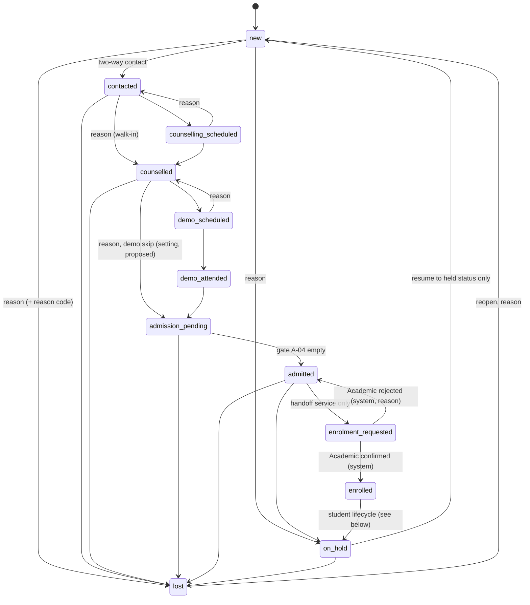
Every non-terminal status from `new` to `admitted` can go to `lost` or `on_hold`; only the sources above are drawn once. `enrolment_requested` cannot be lost or held. Lifecycle names used in the brief map onto these statuses (see `requirements/REQUIREMENTS.md`, OPS-070). After `admitted` and `enrolled` the student lifecycle below applies (A-69, 20 Oct 2026).

### Enrolment handoff attempt (A-19, table `enrolment_attempts`)
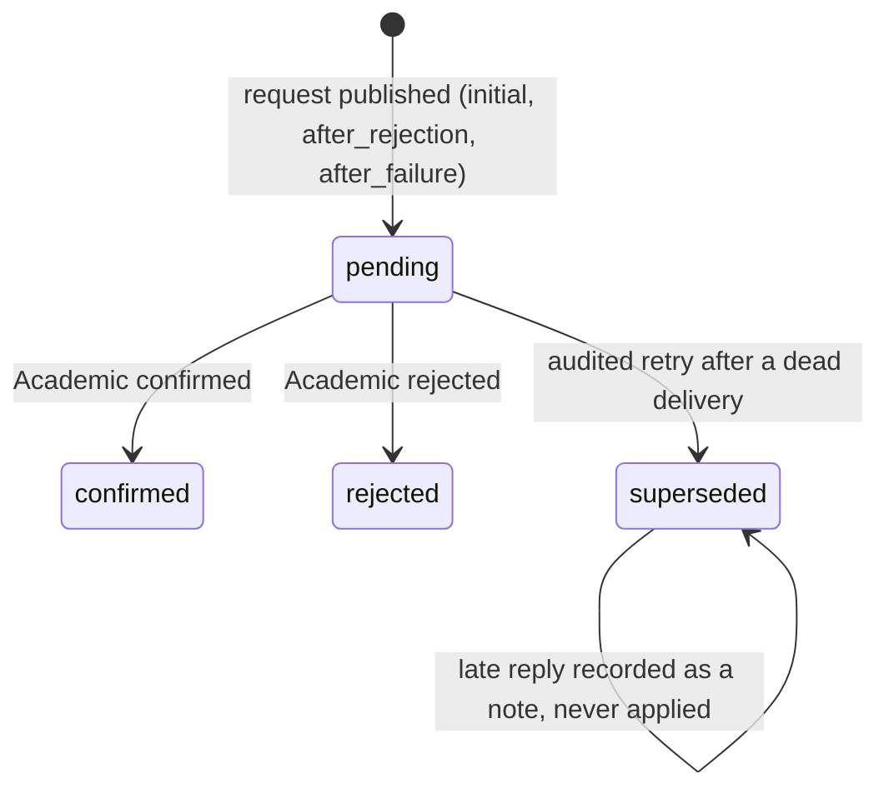
A new attempt is allowed only when the earlier request can no longer create an enrolment: Academic rejected it, or its delivery is `dead` (reason required). It is refused while the delivery is missing, `failed` (Academic retries) or `processed` (apply the reply). A late confirmation of a superseded attempt notifies operations managers.

### Fee record (A-17, table `fee_records`)
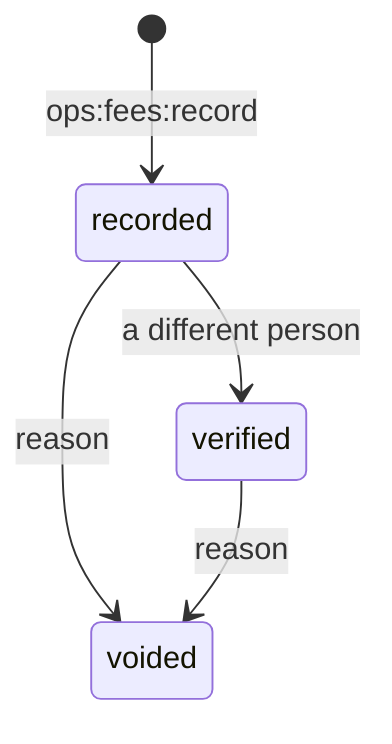
Verified and voided are final. Entries are manual records, never verified payments.

The HR records, recruitment and lifecycle, HR time and Operations workflows (tasks, SOPs, policies, risks) were removed by the owner on 2026-10-20 (D-032); recoverable from git commit 63da4e4.

---

## Admissions workspace (added 20 Oct 2026)

Rules behind each diagram: `docs/ALGORITHMS.md` A-57 … A-84. Requirements: OPS-080 … OPS-121.

### Demo outcome (A-62, A-67; column `demos.outcome`)
```mermaid
stateDiagram-v2
  [*] --> open: booked with 3 demo days (admissions.demo.day_count, D-038); identity created
  open --> converted: Convert to admission (A-67 only), sets converted_admission_id
  open --> declined: reason
  open --> withdrawn: reason
  open --> not_converted: reason
  open --> cancelled: reason
  open --> no_show: reason
  no_show --> [*]
  converted --> [*]
  declined --> [*]
  withdrawn --> [*]
  not_converted --> [*]
  cancelled --> [*]
```
Closing a demo cancels future pending sessions and marks past unrecorded ones `not_recorded`. `cancelled` and `not_converted` send a case still at `demo_scheduled` back to `counselled`. There is no reopen. Tabs: Upcoming and Current are `open` demos split by the first session's IST day (A-58); every other outcome is Previous.

### Demo session attendance (A-60, A-61; column `demo_sessions.attendance`)
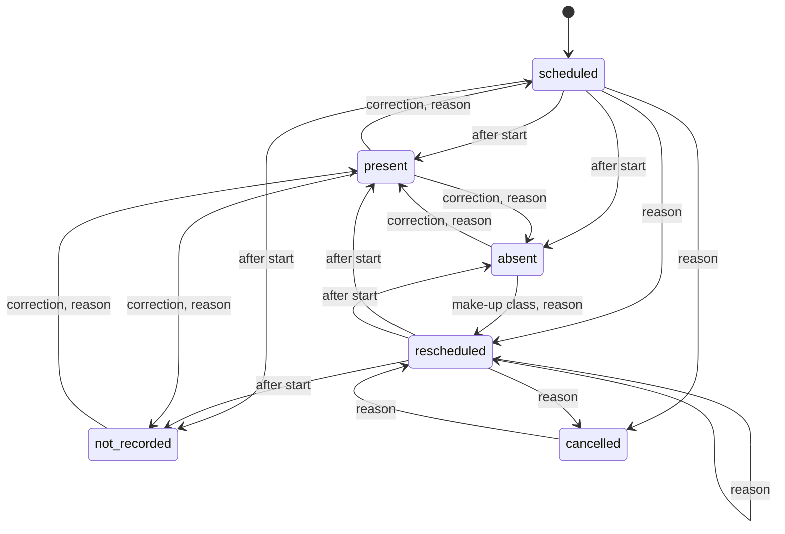
Since 21 Oct 2026 attendance also has `late` (counts as attended) and `excused` (does not); the same edges apply. Every change appends to `demo_session_changes`. Progress counts attended DAYS (a day with a present or late class, A-57). A present session cannot be rescheduled. Reschedule and cancel are refused once the demo is closed; corrections are still allowed.

### Conversion (A-65, A-66, A-67)
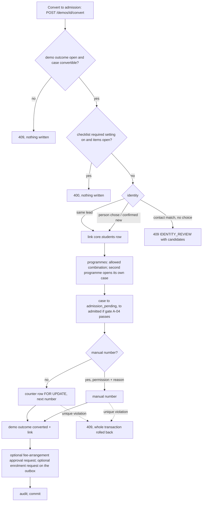
A retry with the same `Idempotency-Key` replays the stored response; a second conversion of the same demo is 409. **Changed 21 Oct 2026:** the identity already exists from booking; conversion creates the application and stops at `admission_pending` — no number, no enrolment request, no `admitted` (see "Admission end to end" below).

### Student lifecycle (A-69; column `admissions.status` after admission)
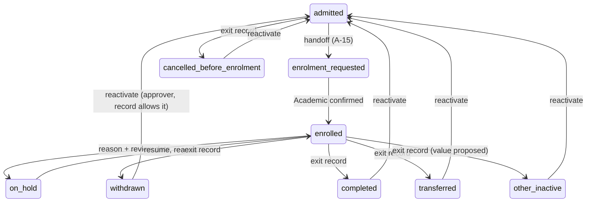
A student on hold from `enrolled` can also exit directly (same edges as from `enrolled`); on hold from `admitted` can be cancelled before enrolment. Every move needs a reason and is audited; reactivation needs `ops:students:reactivate`, an exit record with `reactivation_allowed`, and someone other than the person who recorded the exit. After reactivation, enrolment must be requested again. Since 21 Oct 2026 the recommended path back is **readmission** (below): a new case and application; reactivation is refused while a readmission is open. Nothing is deleted. Lists: Active = `enrolled`; On hold = `on_hold` held from `enrolled`; Former = exit statuses or `lost` after admission (A-68).

### Appointment status (A-73, A-74; column `appointments.status`)
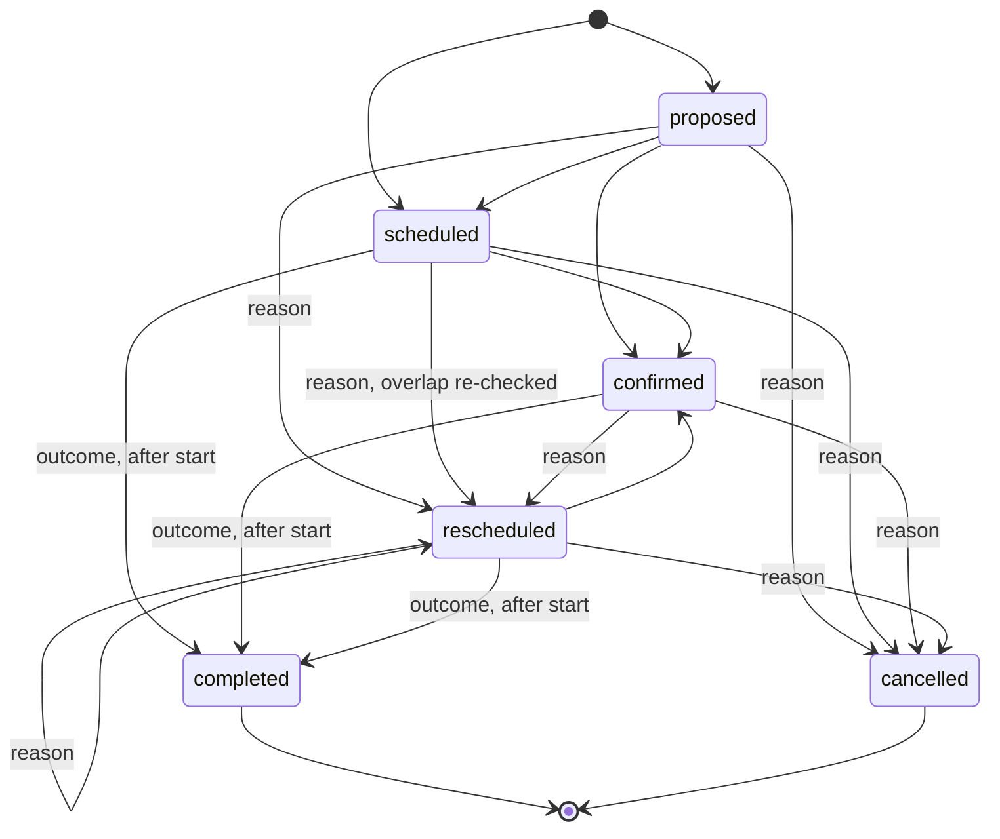
`proposed`, `scheduled`, `confirmed` and `rescheduled` block the staff member's time (A-73). Each change writes `appointment_changes` and notifies the teacher in-app; email/SMS are "simulated — not sent".

### Feedback (A-75)
Teacher → student (`teacher_student_feedback.status`):
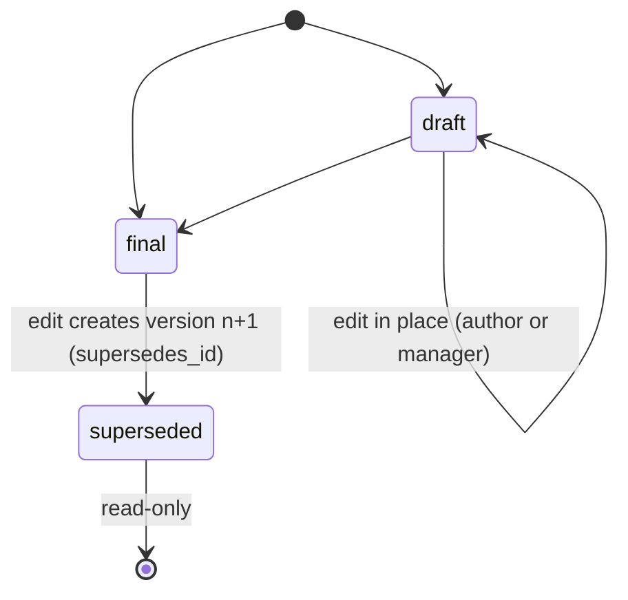
"superseded" is not a stored status: a final row that another row supersedes is read-only (409 on edit).

Student or guardian → teacher (`student_teacher_feedback.moderation_status`):
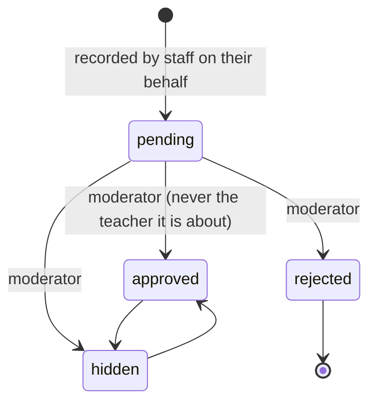
No edit path exists for this table; the teacher can read approved rows shared with them (`visibility = teacher_and_staff`).

### Marketing lead handoff receipt (A-81; column `lead_handoff_receipts.status`)
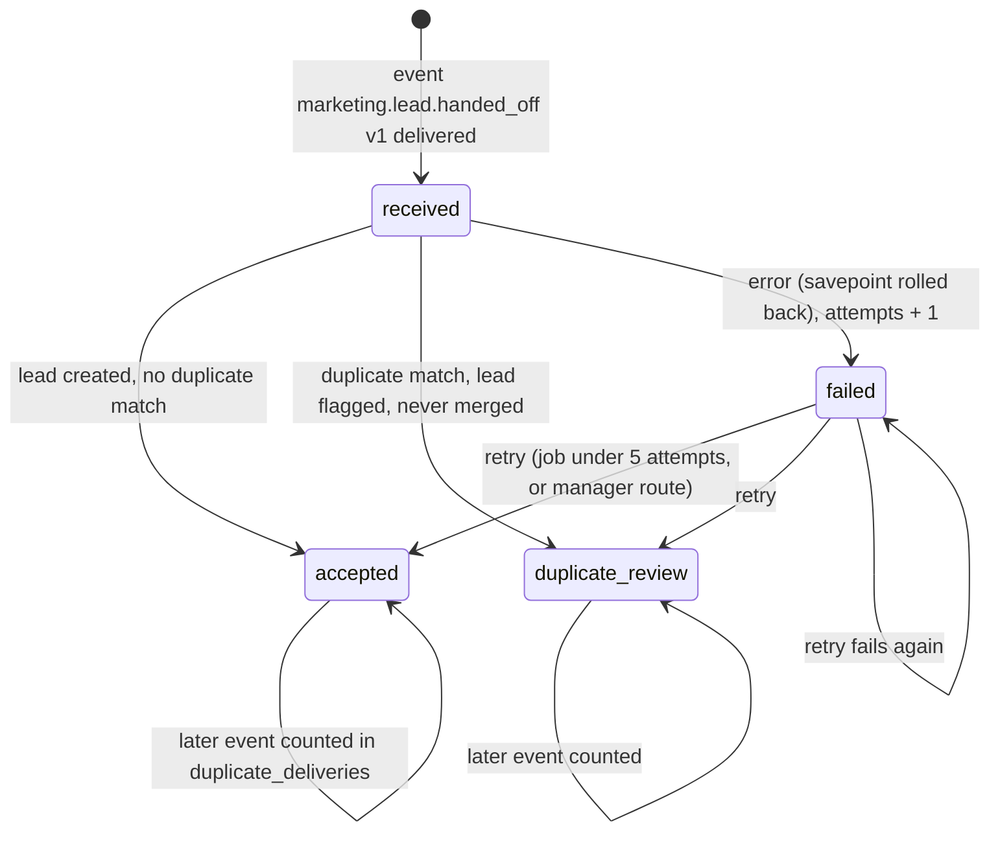
Live Marketing events do not exist yet; tests and seeds use a mock publisher and the UI says "Live sync with Marketing OS: not configured".

### Annual fee agreement (A-FEE-1 … A-FEE-8; column `fee_plans.status`, 21 Oct 2026)
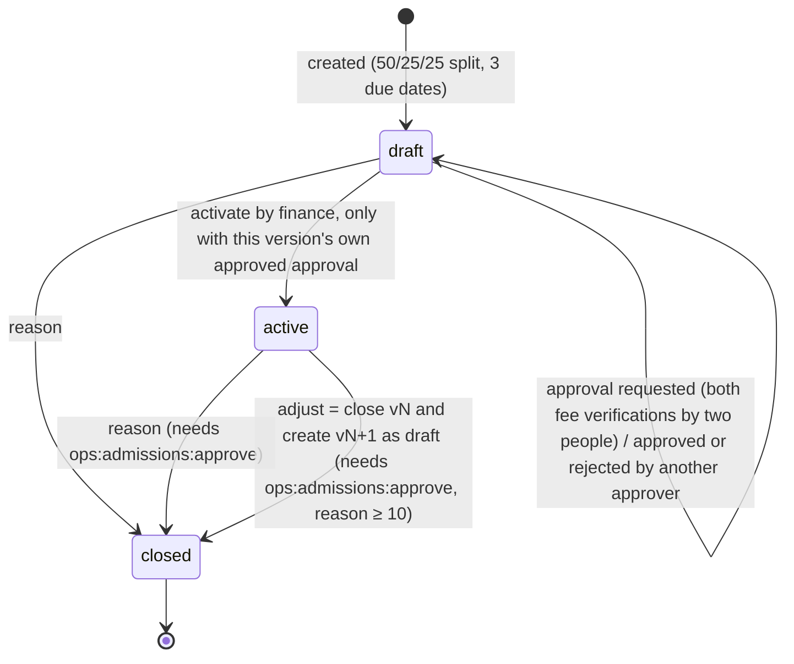
One agreement per student and academic year. Ledger rows are append-only; corrections are reversals or refunds linked to their row. The CHECK `fee_plans_approved_check` now applies to `active` rows only, so closing a draft works (the 20 Oct defect note is resolved).

---

## Admissions lifecycle (added 21 Oct 2026)

Rules: `ALGORITHMS.md` "Added on 21 Oct 2026". Status: Implemented, Tested; nothing is Deployed.

### Admission end to end
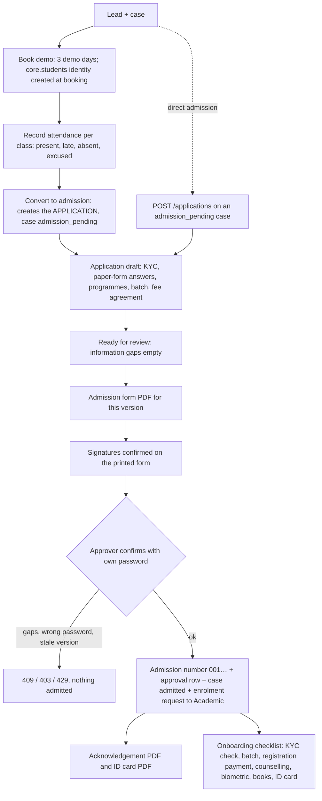
Where each gap is fixed: student phone/email and a guardian taken from the lead → the lead's "Edit contact details" (`/ops/leads/{id}?act=details`); no counsellor → "Assign owner" on the lead (the lead owner counts unless the case names a counsellor); the other details → "Edit application details". A guardian already on a student profile is edited there. Before admission there is no student profile (`hasStudentRecord` in `domain/student-lifecycle.ts`: admitted, or the case has left the pipeline), so the admission case shows the annual fee agreement section itself; once the profile exists the case links to its Fees tab. A demo can be booked only for a counselled case with no open demo; the booking form says so and points to the case to record counselling.

A material change at any step makes a new application version: back to draft, signatures invalidated. Legacy admissions (before migration 0007) show "Legacy — verification required" until an approver records the reconciliation.

### Application (A-APP-1; column `applications.status`)
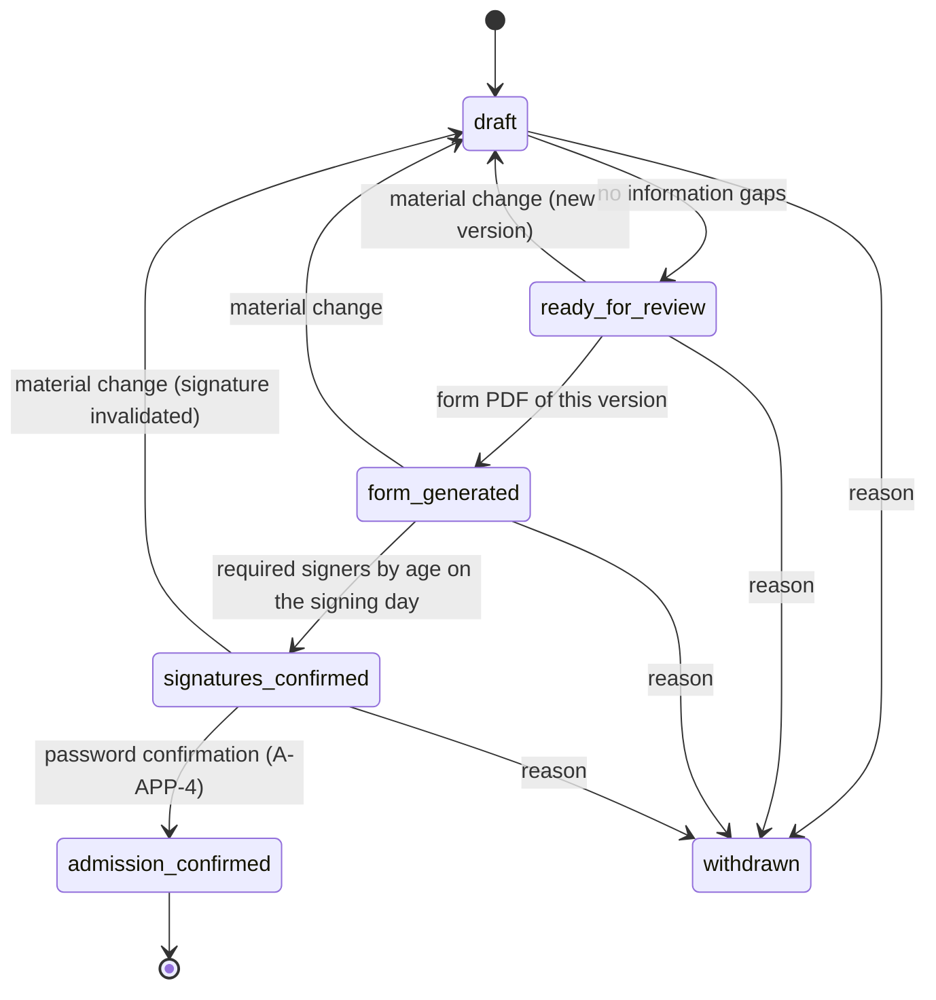

### Exit and readmission (A-STU-7)
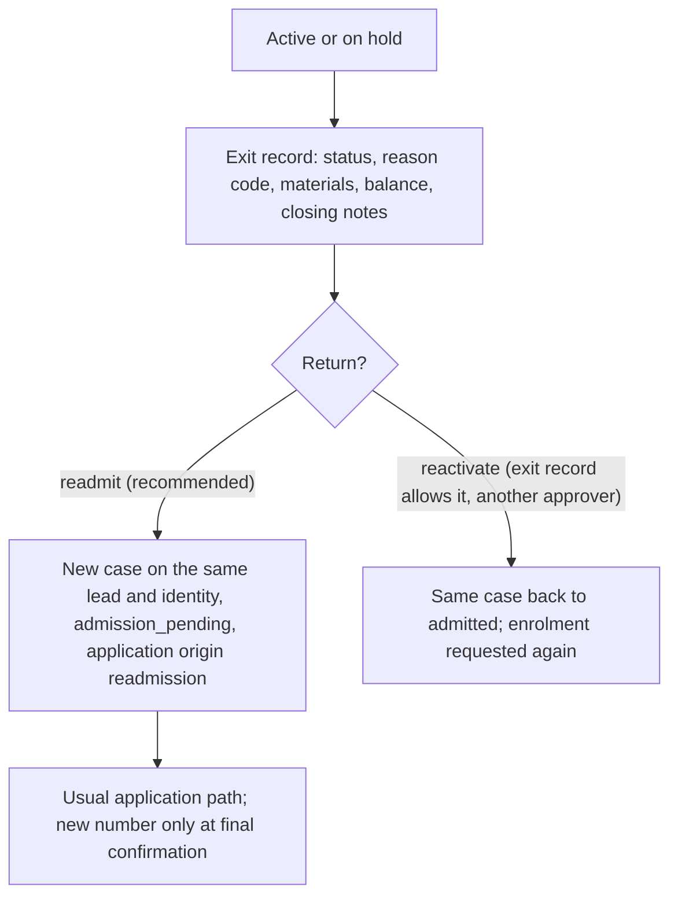
The closed case, its number and its exit record never change. One live case per student and programme.

### Staff task (A-TSK-5; column `staff_tasks.status`, D-052, D-069)
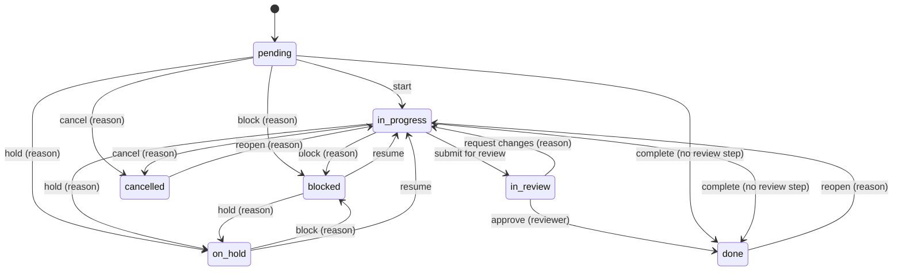
Acknowledge and request clarification are events, not statuses (any open status). Blocked, on hold and cancelled may also be reached from the other open statuses as listed in the action table. Every change appends an `ops.task_events` row; work time is recorded as `ops.task_updates`; dependencies refuse cycles. Who may take each action, and the review-step / cancel / reassign authority: `ALGORITHMS.md` A-TSK-5 to A-TSK-7. Routes: `API.md` (staff tasks).

### End-of-day report (A-TSK-8; columns `eod_reports.status`, `eod_report_versions`)
Draft → submitted (a frozen version 1 built from that day's events and updates, `eod-facts/1`) → the recipient views, comments, asks for clarification, asks for a revision (the author submits version n+1, linked to the previous one) or acknowledges; a follow-up task can be created from the report. Versions never change after submit. The recipient is the author's active manager; with no manager the author chooses an `ops:eod:review` holder. Nothing is sent outside Elevate OS: "Copy summary" and PDF only ("External delivery not configured"). Detail: `ALGORITHMS.md` A-TSK-8.
