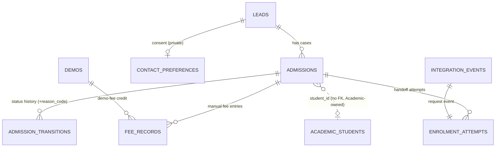

# Business Ops OS — admissions administration (part for merging)

Area: admissions, student administration, enrolment handoff. Built 19 Oct 2026 on branch `feature/business-ops-hr-admissions` (D-028). The orchestrator merges this file into `README.md`, `requirements/REQUIREMENTS.md`, `docs/{DOMAIN_MODEL,API,ALGORITHMS,KPI_DEFINITIONS,TEST_PLAN,INTEGRATION_REQUESTS}.md`. Status words follow D-013; nothing is Deployed. "Tested" means a passing automated test named in the Evidence column (commands and results at the end).

## 1. Requirements

| ID | Title | Status (D-013) | Evidence (test file → case) |
|---|---|---|---|
| OPS-070 | Lifecycle mapping (enquiry → counselling → demo → application → review → offer/decision → accepted → handoff) onto the A-03 state machine, no new states; admission owner = counsellor; admission date (IST) stored | **Tested** | `tests/integration/admissions-students.test.ts` → "profile …" (owner/date returned); `admissions-fixtures.ts` walks the lifecycle; mapping constant `LIFECYCLE_MAPPING` in `domain/pipeline.ts` |
| OPS-071 | Reason-coded closure/withdrawal (`→ lost` with a code from setting `admissions.closure_reasons`, proposed); "withdrawn after admission" only from admitted; merge sets `duplicate_merged`; reason codes visible in status history | **Tested** | unit `admissions-students-kpis.test.ts` → "closure reason codes"; integration `admissions-students.test.ts` → "reason-coded closure (withdrawal)" |
| OPS-072 | Manually recorded fee records per admission: due / received / refund / adjustment (credit/debit, demo-fee link), integer paise, INR, pricing reference, receipt reference, payment/due date, method, recorded by, optional check by a different person, void with reason; computed due/received/balance; always labelled "manually recorded — not a verified payment transaction" | **Tested** | unit `admissions-fees.test.ts` (all); integration `admissions-fees.test.ts` (all) |
| OPS-073 | Student directory `/ops/students`: admitted / awaiting Academic / enrolled / withdrawn after admission; search, status/programme/handoff filters, sort, pagination; no private fields | **Tested** (API) · **Implemented** (screen) | `admissions-students.test.ts` → "lists admitted students only…" |
| OPS-074 | Student profile `/ops/students/[id]`: admission history with coded reasons, enquiries, counselling, demos, programme, fee summary (with `ops:fees:read`), handoff status + errors + rejection reason, link to `/academic/students/{studentId}` | **Tested** (API) · **Implemented** (screen) | `admissions-students.test.ts` → "profile: 404 before admission; 403 …" |
| OPS-075 | Handoff hardening: idempotent request (one event per attempt, key `enrolmentKeys.request`), attempt history table, explicit audited **retry after a dead delivery** (same admission, attempt + 1), refused while Academic still retries, superseded attempt's late reply flagged to operations managers | **Tested** | `admissions-students.test.ts` → "handoff retry …"; `apps/platform/tests/integration/enrolment-handoff.test.ts` (6 cases) |
| OPS-076 | Student identity linkage: Ops stores Academic's `studentId`/`enrolmentId`/`existingStudent`/enrolled course+batch; for a second admission of the same person Ops sends the known `existingStudentId` (new optional contract field) | **Tested** (Ops side) · Academic side **Proposed** (IR-OPS-ADM-1) | `enrolment-handoff.test.ts` → "same person, second programme…"; `it.todo` for Academic reuse |
| OPS-077 | Private student data: contacts, guardian, city, school, consent only with `ops:student_private:read` (own scope for counsellors) on student AND lead DTOs and lead history; consent & communication preferences recorded (no channels without consent) | **Tested** | `admissions-students.test.ts` → "profile …", "lead contact masking (D-028, audit finding)", "contact consent and preferences" |
| OPS-078 | Admissions report `/ops/reports/admissions` + `GET /ops/api/v1/admissions/report` (11 KPIs, own scope for counsellors, missing ≠ 0) | **Tested** (API, domain) · **Implemented** (screen) | unit `admissions-students-kpis.test.ts` → "admissions KPIs"; integration `admissions-report.test.ts` |
| OPS-079 | Fictional sample admissions and fee records (`ops.admissions-samples`, idempotent) | **Tested** (seed runs twice) · registration pending | `admissions-seed.test.ts` |
| OPS-010 (ext.) | Confirmation gate unchanged; fee records shown beside `down_payment_verified` as information only | **Tested** (gate) | fixtures pass the gate; existing `admissions.test.ts` 8/8 |
| OPS-012 (ext.) | Attempts recorded on request and reply; confirmed reply stores existing-student flag and enrolled course/batch | **Tested** | `enrolment-handoff.test.ts`; existing `admissions.test.ts` |
| OPS-028 (ext.) | Lead contact data protection (field-level, not only record-level) | **Tested** | "lead contact masking" |

### Lifecycle mapping (OPS-070)
| Brief stage | A-03 status(es) | Notes |
|---|---|---|
| Enquiry | `new`, `contacted` | Lead + enquiries; `contacted` needs a two-way contact (BR-OPS-4). |
| Counselling | `counselling_scheduled`, `counselled` | Counselling sessions. |
| Demo | `demo_scheduled`, `demo_attended` | Demo terms (2 days, ₹1,000 adjusted against fees) stay settings: `demo.terms` approved (legacy, read-only), `demo.fee` **pending_verification** (OD-013), `demo.limits` open (OD-012). Not changed. |
| Application | `admission_pending` | Admission form + documents checklist. |
| Review | `admission_pending` | Two fee verifications by different people. |
| Offer / decision | `admission_pending` | Fee-arrangement approval (approved = offer made). No separate state was added. |
| Accepted | `admitted` | Gate A-04 passed; `admission_date` (IST) set once. |
| Enrolment handoff | `enrolment_requested` → `enrolled` | Enrolled only on Academic's confirmation. |
| Withdrawn / cancelled | `lost` (+ code), `on_hold` | After enrolment, withdrawal is Academic's record. |

Exceptions: the existing incidents register (`kind = exception`) covers admissions exceptions; no new exception type was added.

## 2. Data model (additive; `packages/database/src/schema/ops.ts`)

**New columns on `ops.admissions`:** `status_reason_code` text (format CHECK `^[a-z][a-z0-9_]{1,39}$`), `admission_date` date, `academic_existing_student` boolean, `enrolled_course_id` uuid, `enrolled_batch_id` uuid (Academic ids, no FK, D-005). **On `ops.admission_transitions`:** `reason_code` text. All nullable; existing rows unaffected.

**`ops.fee_records`** — id uuid PK; `code` `FEE-000001` unique; `admission_id` → admissions; `lead_id` → leads; `kind` ∈ due/received/refund/adjustment; `direction` ∈ credit/debit, present iff adjustment (CHECK); `amount_paise` bigint > 0 (CHECK); `currency` = 'INR' (CHECK); `pricing_reference`, `receipt_reference`, `method` ∈ cash/upi/bank_transfer/cheque/card_terminal/other; `payment_date`, `due_date` (IST dates); `demo_id` → demos; `status` ∈ recorded/verified/voided; `notes`; `recorded_by` → users, `recorded_at`; `verified_by` (≠ recorded_by, CHECK), `verified_at`, `verification_note`; `voided_by`, `voided_at`, `void_reason` (required when voided, CHECK); timestamps. Indexes: (admission_id, recorded_at), status. Never deleted.

**`ops.enrolment_attempts`** — id uuid PK; `admission_id` → admissions; `attempt` ≥ 1; `request_event_id` → core.integration_events (unique); unique (admission_id, attempt); `kind` ∈ initial/after_rejection/after_failure (after_failure needs `reason`, CHECK); `requested_by`, `requested_at`; `outcome` ∈ pending/confirmed/rejected/superseded; `outcome_at`; `reply_event_id`; `rejection_code`, `rejection_reason`; `note` (late-reply flags).

**`ops.contact_preferences`** — `lead_id` PK → leads; `consent_status` ∈ given/refused/withdrawn; `consent_by` ∈ student/guardian/both; `allowed_channels` text[] ⊆ {call, whatsapp, sms, email} and empty unless given (CHECKs); `preferred_contact` ∈ student/guardian; `note`; `recorded_by`, `recorded_at`. No row = not recorded.

## 3. Workflows and state machines
- **Fee record:** `recorded` → `verified` (a different person with `ops:fees:record`; the recorder gets 403) · `recorded|verified` → `voided` (reason required). Verified/voided are terminal. Conditional update on the previous status prevents double application.
- **Handoff attempt:** created `pending` with each published request · `pending` → `confirmed` / `rejected` (Academic reply) · `pending` → `superseded` (Ops retry after a dead delivery). A late reply to a non-current attempt is never applied: the attempt row gets `reply_event_id` + `note`; a late **confirmation** also notifies operations managers (`enrolment.duplicate_risk`).
- **New attempt rule (A-ADM-3):** allowed only when the previous request can no longer create an enrolment — Academic rejected it (`admitted` + `handoff_status = rejected` → "Request enrolment", kind `after_rejection`) or Academic's delivery is `dead` (→ "Send a new enrolment request", kind `after_failure`, reason required). Refused while the delivery is missing (not picked up), `failed` (Academic retries automatically) or `processed` (apply the reply).
- **Closure:** `→ lost` takes an optional `reasonCode` (setting `requireCode`, default off, proposed); uncoded closures are reported as "not coded".

## 4. API (all `defineRoute`; check order 401 → 403 → 400 → handler; services re-check)

| Method | Path | Permission | Body / query | Response | Errors |
|---|---|---|---|---|---|
| POST | `/ops/api/v1/admissions/{id}/transitions` | `ops:admissions:write` (own) | `{ to, reason?, reasonCode? }` | admission row | 400 reason/reasonCode, 403 scope, 409 illegal/gate |
| GET | `/ops/api/v1/admissions/{id}/fees` | `ops:fees:read` (own) | — | `{ admission, records[] (manuallyRecorded: true, recorder/checker names), summary, disclaimer, settings }` | 403, 404 |
| POST | `/ops/api/v1/admissions/{id}/fees` | `ops:fees:record` | `{ kind, direction?, amountPaise? \| amountRupees?, pricingReference?, receiptReference?, method?, paymentDate?, dueDate?, demoId?, notes? }`; `Idempotency-Key` optional | 201 record + `disclaimer` | 400 per field (non-integer/≤0/over limit, future date, missing reference, refund > received, demo mismatch), 403, 404 |
| POST | `/ops/api/v1/fees/{id}` | `ops:fees:record` | `{ action: 'verify', note? }` or `{ action: 'void', reason }` | record | 400, 403 (self-check / scope), 404, 409 (state) |
| GET | `/ops/api/v1/fees` | `ops:fees:read` (own) | `?status=&limit=&cursor=FEE-…` | `{ items, disclaimer }`, `meta.page.nextCursor` | 400, 403 |
| GET | `/ops/api/v1/students` | `ops:students:read` (own) | `?q=&state=admitted\|awaiting_enrolment\|enrolled\|withdrawn&programme=&handoff=&sort=newest\|oldest\|name&limit=&cursor=` | items (no private fields) + `meta.page` | 400, 403 |
| GET | `/ops/api/v1/students/{admissionId}` | `ops:students:read` (own) | — | profile; `person.privateFields: visible\|hidden` | 403, 404 (not admitted) |
| PUT | `/ops/api/v1/admissions/{id}/contact-preferences` | `ops:admissions:write` + `ops:student_private:read` (both own) | `{ consentStatus, consentBy, allowedChannels[], preferredContact?, note? }` | row | 400 channels without consent, 403, 404 |
| POST | `/ops/api/v1/admissions/{id}/enrolment-retry` | `ops:admissions:write` (own) | `{ reason }`; `Idempotency-Key` optional | 201 `{ admission, eventId, attempt }` | 400, 403, 409 (not dead / not awaiting) |
| GET | `/ops/api/v1/admissions/report` | `ops:admissions:read` (own) | `?from=&to=` (IST dates) | `{ asOf, window, scope, cohort, kpis, bySource, byStatus, closures }` | 400, 403 |
| GET | `/ops/api/v1/leads/{id}` (changed) | `ops:leads:read` | — | `lead` without contact fields and `privateVisible: false` unless `ops:student_private:read` covers the lead; history `before/after` stripped likewise | unchanged |

Contract change: `ops.admission.enrolment_requested` v1 gained optional `existingStudentId` (StudentId) in `packages/shared-contracts/src/events/enrolment.ts` — additive, non-breaking (INTEGRATION_CONTRACT §8), authorised by the orchestrator.

## 5. Algorithms (10-point format)

### A-ADM-1 Fee record validation and summary — OPS-072
1. **Purpose.** Accept only well-formed manual fee entries and show what they add up to without pretending to be accounting.
2. **Inputs.** New entry `{ kind, direction, amountPaise, paymentDate, dueDate, receiptReference }`, the admission's existing entries, today (IST), setting `fees.recording` (`domain/fees.ts`: `validateFeeRecord`, `summariseFees`, `parseRupeesToPaise`).
3. **Output.** List of `{ path, message }` issues; summary `{ duePaise, creditAdjustmentsPaise, receivedPaise, refundedPaise, netReceivedPaise, verifiedNetReceivedPaise, balancePaise | null, balanceState, counts, disclaimer }`.
4. **Preconditions.** Amount given as integer paise or as rupee text (parsed with a regex into integer paise — no floating point).
5. **Rules.** Amount: safe integer, > 0, ≤ 1,000,000,000 paise (₹1 crore). `direction` iff adjustment. Received/refund need a payment date ≤ today and (setting, default on, proposed) a receipt reference. Due has no payment date. Refund ≤ non-voided received − non-voided refunds. Demo link only on a credit adjustment of a demo of the same admission whose fee is paid/adjusted, ≤ the demo fee, once per demo. Summary ignores voided rows; due = due + debit adjustments; balance = due − credits − (received − refunds), **null when no due entry exists** (missing, not 0); state no_records / no_due_recorded / outstanding / settled / credit_balance.
6. **Steps.** Parse amount → lock admission → load entries → validate → demo checks → next `FEE-` code (advisory lock) → insert → audit `fee_record.created`.
7. **Edge cases.** Rupee text with 3 decimals, negative or letters → 400 on `amountRupees`; both amount fields → 400; voided entries stay visible; verified entries can still be voided (with reason).
8. **Permissions.** `ops:fees:read` (counsellor own via admission counsellor or lead owner; operations manager, director, auditor, finance officer all) · `ops:fees:record` (operations manager, finance officer). Check by a different person only.
9. **Tests.** Unit `admissions-fees.test.ts`; integration `admissions-fees.test.ts`.
10. **Limitations.** Not reconciled with any accounts system; no instalment plans; no fee schedule (setting `fees.schedule` open); the gate's `down_payment_verified` stays a manual check (the fee summary is a hint only).

### A-ADM-2 Student directory state and private-field redaction — OPS-073/077
1. **Purpose.** Decide who is a "student" in Ops and what each reader may see.
2. **Inputs.** Admission `status`, `admitted_at`; reader's scope for `ops:student_private:read`; owners (admission counsellor, lead owner).
3. **Output.** `directoryState` ∈ admitted / awaiting_enrolment / enrolled / withdrawn or null; redacted record with `privateFields`.
4. **Preconditions.** None.
5. **Rules.** admitted → admitted; enrolment_requested → awaiting_enrolment; enrolled → enrolled; lost with `admitted_at` → withdrawn; anything else → not a student (404 on the profile). Private fields: studentPhone, studentEmail, guardianName, guardianRelationship, guardianPhone, guardianEmail, city, previousSchool, consent — removed unless the reader holds `ops:student_private:read` with scope all, or own and is an owner. `stripPrivateKeys` removes the same keys deeply from audit payloads in lead history.
6. **Steps.** SQL filter for directory → map rows → redact per record.
7. **Edge cases.** The list never carries private fields, even for privileged readers. Students reached through a merged lead keep their own admission.
8. **Permissions.** `ops:students:read`: counsellor own, operations manager, director, auditor, academic coordinator. `ops:student_private:read`: counsellor own, operations manager only.
9. **Tests.** Unit "student identity and directory"; integration "student directory and profile", "lead contact masking".
10. **Limitations.** Audit rows themselves still contain lead contacts written by the existing lead services (redacted on read in Ops); a platform-level audit viewer would need the same rule.

### A-ADM-3 Handoff view and safe retry — OPS-075, IR-OPS-03
1. **Purpose.** Show the true handoff state and allow a new attempt only when Academic cannot enrol twice.
2. **Inputs.** Admission status, `handoff_status`, attempt, Academic delivery of the current request (`core.event_deliveries`, consumer `academic.enrolment-intake`).
3. **Output.** `deriveHandoffView` → not_requested / awaiting_pickup / academic_retrying / failed_needs_action / awaiting_reply / rejected / enrolled / closed; `retryDecision` → allowed kind or reason.
4. **Preconditions.** Requests are published only through `requestEnrolment` / `retryEnrolmentHandoff` (outbox, same transaction).
5. **Rules.** See §3. Every request is keyed `admission:<id>:attempt:<n>`; the admission id is the business identity across attempts. A dead delivery means each try rolled back and `processEvents` never reselects it. Replies apply only when `request_event_id` equals the admission's `last_request_event_id`.
6. **Steps (retry).** Check permission + reason → lock admission → read delivery → decide → build payload (incl. `existingStudentId`) → publish attempt + 1 → conditional update (`status = enrolment_requested AND attempt = n`) → old attempt `superseded` with note → insert attempt row → audit `enrolment.handoff_retried`.
7. **Edge cases.** Double click → second call sees `failed/none` delivery for the new attempt → 409. Someone re-driving the dead event inside Academic would create a second enrolment; Ops flags the late confirmation (notification + note) but cannot prevent it — IR-OPS-ADM-2.
8. **Permissions.** `ops:admissions:write` (own).
9. **Tests.** `admissions-students.test.ts` "handoff retry …"; `apps/platform/tests/integration/enrolment-handoff.test.ts`.
10. **Limitations.** No scheduler (IR-OPS-02); Ops cannot reset another consumer's delivery.

### A-ADM-4 Admissions KPIs — OPS-078
1. **Purpose.** Period and point-in-time admissions figures with stated definitions.
2. **Inputs.** Enquiries, leads, admissions + latest fee-arrangement approval, counselling sessions, demos, request events + replies + Academic deliveries, follow-ups, `→ lost` transitions; window (default IST Monday–Sunday week), now; setting `kpi.conversion`.
3. **Output.** Metrics (`ok`/`missing`) and tables (by source, by status, closures by reason).
4. **Preconditions.** Own scope filters every row set to the counsellor's leads (owner) and admissions (counsellor or lead owner); follow-ups by owner.
5. **Rules.** See §6. Rates with denominator 0 → `missing`. Conversion reuses `leadToAdmissionConversion` (`domain/kpis.ts`, unchanged).
6. **Steps.** Load rows in parallel → pure functions in `domain/admissions-kpis.ts`.
7. **Edge cases.** IST boundary (18:30 UTC); merged leads excluded from status counts; uncoded closures reported as `not_coded`.
8. **Permissions.** `ops:admissions:read`.
9. **Tests.** Unit "admissions KPIs"; integration `admissions-report.test.ts`.
10. **Limitations.** Loads all request events (fine at current volume); no targets (OD-027).

## 6. KPI definitions (Asia/Kolkata; source = `ops.*` unless stated; permission `ops:admissions:read`, own scope for counsellors)

| KPI | Definition | Numerator / denominator | Period | Missing-data behaviour | Test |
|---|---|---|---|---|---|
| K-ADM-01 New enquiries | Enquiries received in the window (every enquiry, `ops.enquiries.received_at`) | count | selected window | always ok; 0 is a real 0 | unit "enquiries count…", report test |
| K-ADM-02 New leads by first source | Leads whose earliest enquiry is in the window, grouped by that enquiry's `source_code` (UNKNOWN stays UNKNOWN) | count per source | window | empty table "No new leads" | same |
| K-ADM-03 Admission cases by status | Current status of every admission case, merged leads excluded | count per status | point in time | always ok | unit "pipeline snapshot", report test |
| K-ADM-04 Counselling pending | `scheduled` sessions from now on; and past `scheduled` sessions without an outcome | counts | point in time | ok | unit "counselling and demos" |
| K-ADM-05 Upcoming demos | `scheduled` demos with a day in [today, today + 6] | count | next 7 days | ok | same |
| K-ADM-06 Applications awaiting decision | `admission_pending` cases without an approved fee arrangement (split: approval pending) | counts | point in time | ok | unit "pipeline snapshot" |
| K-ADM-07 Offers awaiting response | `admission_pending` with an approved fee arrangement (nearest state to "offer made") | count | point in time | ok | same |
| K-ADM-08 Lead → admission conversion | Existing BR-OPS-8 cohort KPI (`kpi.conversion` window, proposed) | admitted within N days / cohort leads | latest elapsed cohort week | missing when window not elapsed or no cohort leads | existing `kpis.test.ts`, report test |
| K-ADM-09 Handoff outcomes + success rate | Request events published in the window: confirmed, rejected, failed (dead without reply), awaiting; rate = confirmed ÷ (confirmed + rejected + failed) | see definition | window | rate missing when no attempt has a final outcome | unit "handoff success rate", report test |
| K-ADM-10 Overdue follow-ups | Open follow-ups with due date before today | count | point in time | ok | unit "overdue follow-ups…" |
| K-ADM-11 Closures by reason | `→ lost` transitions in the window by `reason_code` (null → not coded) | count per code | window | empty table | same |

Owner (accountable role, proposal until OD-009): admissions lead for K-ADM-01…07/10/11; operations manager for K-ADM-08/09.

## 7. Policies (settings, all non-approved) and owner decisions
| Setting | Default | State | Owner decision |
|---|---|---|---|
| `admissions.closure_reasons` | 11 codes, `requireCode: false` | proposed | **OD-ADM-1 (new)**: confirm the list and whether a code is mandatory |
| `fees.recording` | `requireReceiptReference: true` | proposed | OD-013 (fee-data scope) |
| `fees.schedule` | `scheduleReference: null` | **open** | OD-013: no approved fee schedule exists |
| (existing) `demo.fee` ₹1,000 | unchanged | pending_verification | OD-013 |
| (existing) `demo.limits` | unchanged | open | OD-012 |
New owner decisions to number: OD-ADM-1 (above); OD-ADM-2 who may *check* fee records (today: anyone with `ops:fees:record` other than the recorder); OD-ADM-3 whether the director/auditor should see student contacts (today: no, D-028).

## 8. Limitations / not built
- No payment gateway, no card data, no reconciliation with the accounts system; fee figures are manual.
- No fee schedule, instalment plan, discounts approval workflow or receipts PDF.
- Academic does not yet honour `existingStudentId` (IR-OPS-ADM-1) or dedupe enrolments per admission (IR-OPS-ADM-2).
- Seed registration, NAV entries and barrel exports wait for the orchestrator (shared files).
- Screens are type-checked and use the shared components but have no browser test (Playwright deferred, D-007); `next build` not run by this agent (shared `.next`).
- Lead audit rows written by existing services still contain contacts (masked on read in Ops only).

## 9. Integration requests
- **IR-OPS-ADM-1 (Academic OS, `services/intake.ts`)**: when `existingStudentId` is present and refers to an active student, reuse it (reply `existingStudent: true`) instead of creating a new `academic.students` row; today intake dedupes only by `source_admission_id`, so the same child admitted to a second programme gets a second student. Test placeholder: `it.todo` in `apps/platform/tests/integration/enrolment-handoff.test.ts`.
- **IR-OPS-ADM-2 (Academic OS)**: business-identity guard — before inserting an enrolment, look for an active `admission_event` enrolment with the same `source_admission_id`; if found, reply confirmed with it (or reject `DUPLICATE_ENROLMENT`), and add a partial unique index on `academic.enrolments(source_admission_id) WHERE status = 'active' AND source = 'admission_event'`. Today a re-driven old request without a batch would create a second enrolment.
- **IR-OPS-ADM-3 (Integration)**: declare `@elevate/business-ops-os` and `@elevate/academic-os` as devDependencies of `apps/platform` (the E2E test resolves them through workspace links today) and re-export `retryEnrolmentHandoff` from `@elevate/business-ops-os/server` (the test imports it by relative path until then).

## 10. Commands run (results recorded by the agent; see the final report for the exact lines)
`npx vitest run` on the new and existing Ops test files and the platform E2E test; `npx tsc --noEmit -p apps/business-ops-os` and `-p apps/platform` (no errors in admissions files); `npx eslint <admissions files> --max-warnings=0` (clean).
