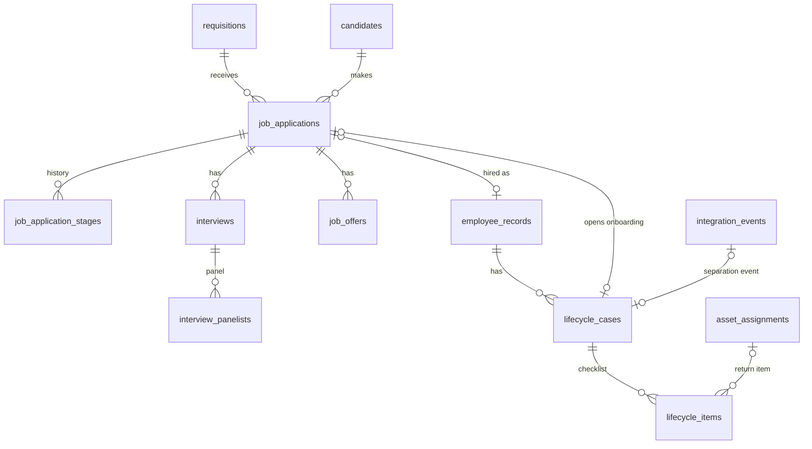

Merged into `README.md`, `requirements/REQUIREMENTS.md`, `docs/{API,ALGORITHMS,DOMAIN_MODEL,DATA_MODEL,WORKFLOWS,PERMISSIONS,KPI_DEFINITIONS,TEST_PLAN}.md` (algorithms HL-A1..10 are now A-29 to A-38) on 19 Oct 2026.

# Business Ops OS — HR lifecycle: recruitment, onboarding, offboarding (part for merging)

Area: OPS-040 … OPS-049. Built 19 Oct 2026 on branch `feature/business-ops-hr-admissions` (D-028, D-029). The orchestrator merges this file into `README.md`, `requirements/REQUIREMENTS.md`, `docs/{DOMAIN_MODEL,API,ALGORITHMS,KPI_DEFINITIONS,TEST_PLAN,INTEGRATION_REQUESTS}.md`. Status words follow D-013; nothing is Deployed. "Tested" means a passing automated test named in the Evidence column (commands and results in §9).

## 1. Requirements

| ID | Title | Status (D-013) | Evidence (test file → case) |
|---|---|---|---|
| OPS-040 | Job requisitions (REQ-####): title, department, role description, openings, employment type, location, recruiter, hiring manager; `draft → open → on_hold → filled \| cancelled`; opening needs `ops:recruitment:decide` and not the requester; filled automatically when hires reach openings | **Tested** (API, domain) · **Implemented** (screens) | unit `hr-lifecycle-domain.test.ts` → "requisition …"; integration `hr-lifecycle-recruitment.test.ts` → "opening needs a decider who is not the requester", "a recruiter works only their own requisitions"; `… conversion is idempotent` (filled) |
| OPS-041 | Candidates (CAND-#####) with minimal data; email/phone normalised (domain/contacts.ts) and duplicates refused; privacy-notice time and consent note; contacts only for recruitment managers covering the candidate; never in lists or audit payloads | **Tested** | `hr-lifecycle-recruitment.test.ts` → "normalises contacts…", "lists never include contact details; auditor and director see no contacts…" |
| OPS-042 | Applications (candidate × requisition, unique) with the stage table `applied → screening → interview → offer → hired`, `rejected` / `withdrawn` from any open stage (reason required), append-only stage history | **Tested** | unit "application …" (table); integration "allows the table and refuses everything else", "a recruiter cannot select or reject…" |
| OPS-043 | Interviews (UTC instant, mode, length, room/reference) with a panel of staff; feedback (recommendation + notes) only by assigned interviewers; interviewers see only the applications they interview for; notes only for recruitment managers covering the application and the author | **Tested** | unit "interview feedback rule"; integration "interviewers see only what they interview for…", "feedback notes are masked for auditor and director…" |
| OPS-044 | Offers `draft → approved (not by the preparer) → extended (marked by hand; nothing is sent) → accepted \| declined \| withdrawn \| expired`; one live offer per application; no salary (reference text only) | **Tested** | unit "offer …"; integration "an offer is never approved by the person who prepared it" |
| OPS-045 | Candidate → employee conversion from an accepted offer: `insertEmployee` in the same transaction, application → hired with the employee link, onboarding case opened; idempotent | **Tested** | "conversion is idempotent: two calls → one employee, one onboarding case" |
| OPS-046 | Onboarding cases (HRC-#####): checklist from the proposed template setting (documents, policy acknowledgements, department/manager confirmed, assets, system-access *request*, induction) with assignee, due date, required flag, status, evidence; overdue reminders once per IST day; final approval (not the employee) → `active` with an employment-history row | **Tested** (API) · **Implemented** (screens) | `hr-lifecycle-cases.test.ts` → "gates completion on required items…", "overdue items get one reminder per IST day", "department managers read cases in their reporting chain only" |
| OPS-047 | Offboarding cases: separation record (type, notice date, last working day, restricted reason); checklist = a return per open asset assignment (completes from the asset register), a hand-over per open task / lead with an open admission / open admission / active responsibility (the hand-over reassigns the record), login revocation, final settlement reference, optional exit interview | **Tested** | "generates asset returns and ownership transfers…", "refuses a last working day before the employment start date" |
| OPS-048 | Separation: approval (not self) → `on_notice`; the day after the last working day `runSeparations` → `separated`, staff `inactive`, `ops.employee.separated` v1 published once in the same transaction; platform consumer disables the login and deletes sessions exactly once; Ops completes the access item from the delivery; retraction before it applies; history retained | **Tested** | "approval puts the employee on notice; separation publishes one event and history survives", "an employee without a login…", "an approved separation can be retracted…"; platform `access-revocation.test.ts` (3); journey test |
| OPS-049 | Lifecycle metrics for the HR dashboard (pipeline by stage, open requisitions, unfilled openings, onboarding completion, pending offboarding items, separations) — values or `missing`, never 0 for missing; unsuccessful-candidate anonymisation (audited, confirmed, keeps stage history); retention period **open** | **Tested** (function, anonymisation) · dashboard tile wiring **Proposed** | `hr-lifecycle-metrics.test.ts` (2 metric cases); "unsuccessful-candidate anonymisation" |
| — | End-to-end journey requisition → … → separation | **Tested** | `hr-lifecycle-employee-journey.test.ts` (attendance/leave step is a marked TODO for the HR time slice) |

## 2. Data model (`packages/database/src/schema/ops-lifecycle.ts`)

All `ops.*`, UUID PKs, codes in unique columns, rows never deleted (status columns; anonymisation in place).

| Table | Purpose / key columns |
|---|---|
| `requisitions` | `code` REQ-####, title, `department_id`→core.departments, role_description, openings 1–500, employment_type, location, status, status_reason, `recruiter_staff_id`, `hiring_manager_staff_id`, approved_by/at (both or neither), created_by (= requester) |
| `candidates` | `code` CAND-#####, full_name, email (lower-case, unique), phone (E.164, unique), source, source_detail, recruiter, privacy_notice_at, consent_note, status `active \| anonymised` (anonymised ⇒ no contacts), anonymised_at/by. **Sensitive:** email, phone, source_detail, consent_note |
| `job_applications` | candidate × requisition (unique), stage, stage_reason, stage_changed_at, closed_at (set iff closed), `employee_staff_id`→employee_records (unique; required when hired) |
| `job_application_stages` | append-only stage history (from, to, reason, actor, at) |
| `interviews` | application, scheduled_at (UTC), duration 5–480, mode, location, status `scheduled \| completed \| cancelled \| no_show` |
| `interview_panelists` | (interview, staff) PK + that interviewer's recommendation, feedback_notes (**sensitive**), submitted_by/at |
| `job_offers` | application, status, offered_title, proposed_start_date, valid_until, compensation_reference (text only, no amount), notes, prepared_by, approved_by (≠ prepared_by, CHECK), extended_by/at, responded_at; one live offer per application (partial unique) |
| `lifecycle_cases` | `code` HRC-#####, kind, `staff_id`→employee_records, status `open \| approved \| completed \| cancelled`, application (onboarding from conversion, unique), separation_type, notice_date ≤ last_working_day, separation_reason (**sensitive**), settlement_reference, approval fields, separated_at, `separation_event_id`→core.integration_events; one live case per employee and kind |
| `lifecycle_items` | case, item_key (unique per case: `template:<k>`, `asset:<assignmentId>`, `transfer:<type>:<id>`, `access_revocation`, `final_settlement`, `exit_interview`, `custom:<n>`), kind, title, required, assignee, due_date (IST), status `pending \| done \| not_applicable \| blocked`, evidence, notes, `asset_assignment_id`→asset_assignments, transfer entity + target, completed_by/at, last_reminded_on |

**Relation to wave 2 `ops.onboarding_items`:** unchanged and still used by `/ops/staff/[id]` (a simple per-staff document checklist). HRC onboarding cases are a separate, richer process; neither reads the other. Merging them is a proposal for the owner, not done.

## 3. State machines (domain/hr/recruitment.ts, domain/hr/lifecycle.ts)

One generic edge table + checker (`checkEdge`) serves requisitions, applications and offers. Each edge names the authority it needs: `manage`, `decide` or `conversion` (only the conversion service).

- **Requisition:** draft→open (decide, not requester) · draft→cancelled (manage, reason) · open⇄on_hold (manage, reason) · open→filled (manage; automatic on conversion) · open/on_hold→cancelled (decide, reason).
- **Application:** applied→screening→interview (manage) · interview→screening (manage, reason) · interview→offer (decide = selection) · offer→interview (decide, reason; only with no live offer) · offer→hired (conversion) · any open→rejected (decide, reason) · any open→withdrawn (manage, reason).
- **Offer:** draft→approved (decide, not preparer) · draft→withdrawn (manage, reason) · approved→extended (manage) · approved→withdrawn (decide, reason) · extended→accepted (manage) · extended→declined (manage, reason) · extended→withdrawn (decide, reason) · extended→expired (manage).
- **Interview:** scheduled → completed | cancelled (reason) | no_show (reason).
- **Lifecycle case:** onboarding open→completed (approve; all required items resolved) | cancelled. Offboarding open→approved (approve; all required items resolved except login revocation) → completed (runSeparations / approval when due) ; open→cancelled (manage) ; approved→cancelled (approver; on_notice→active).
- **Employment status** changes go through the HR records helper `changeEmploymentStatus` (history row + audit): onboarding→active, active→on_notice, on_notice/onboarding→separated (end date = last working day, effective the day after), on_notice→active on retraction.

## 4. API (`/ops/api/v1/hr/…`, JSON, permissions checked in route and service)

| Method & path | Permission | Notes |
|---|---|---|
| GET/POST `requisitions` | recruitment:read / manage | `?q&status&sort=code\|title\|status\|updated&dir&page&pageSize`; recruiter create forces self as recruiter |
| GET/PATCH `requisitions/{id}` | read / manage | detail incl. applications in scope, allowed targets, history |
| POST `requisitions/{id}/transitions` | manage or decide | `{to, reason}` |
| GET/POST `candidates` | read / manage | list has no contact fields; `?retention=due` |
| GET/PATCH `candidates/{id}` | read / manage | `contacts` null unless a covering manager |
| POST `candidates/{id}/anonymise` | decide | `{confirm: true}` |
| GET/POST `applications` | read / manage | `?view=all\|interviewing_me&stage&requisitionId&q&sort` |
| GET `applications/{id}` | read | interviewer-only viewers: no offers, no others' notes |
| POST `applications/{id}/transitions` | manage or decide | `{to, reason}` |
| POST `applications/{id}/convert` | decide | `{managerStaffId?, workEmail?, workLocation?}`; 201 first time, 200 `{created:false}` after |
| GET/POST `interviews` | read / manage | GET = interviews I sit on; POST `{applicationId, scheduledAt, durationMinutes, mode, location, interviewerStaffIds[] \| interviewer1..3}` |
| PATCH `interviews/{id}` | manage | `{status?, scheduledAt?, reason?}` |
| POST `interviews/{id}/feedback` | read + assigned interviewer | `{recommendation, notes}` |
| POST `offers` · POST `offers/{id}/transitions` | manage · manage or decide | |
| GET/POST `lifecycle-cases` | lifecycle:read / manage | POST `{kind:'onboarding', staffId}` or `{kind:'offboarding', staffId, separationType, noticeDate?, lastWorkingDay, reason?}` |
| GET `lifecycle-cases/{id}` | lifecycle:read (HR scope) | reason null unless approver/HR |
| POST `lifecycle-cases/{id}/items` · PATCH `…/items/{itemId}` · POST `…/items/{itemId}/transfer` | lifecycle:manage (all) | |
| POST `lifecycle-cases/{id}/approve` | lifecycle:approve, not self | `{confirm: true, comment?}` |
| POST `lifecycle-cases/{id}/cancel` · `…/refresh` | lifecycle:manage | retraction of an approved separation also needs approve |
| POST `lifecycle-cases/jobs` | lifecycle:approve (all) | `{job: 'lifecycle-reminders' \| 'separations'}` |

## 5. Algorithms

**HL-A1 Edge tables.** 1 Purpose: explicit legal transitions. 2 Inputs: from, to, `{canDecide, reason, viaConversion, actorIsRequester/Preparer}`. 3 Output: ok + edge, or a code. 4 Steps: no-change → lookup → authority → reason → self-approval. 5 Codes: NO_CHANGE/ILLEGAL (409), REASON_REQUIRED (400), NOT_AUTHORISED/SELF_APPROVAL (403). 6 Server adds coverage for `manage` edges. 7 Pure. 8 Edge cases: hire only via conversion. 9 Tests: unit tables. 10 Owner input: none (our proposal).

**HL-A2 Conversion.** 1 Accepted offer → employee. 2 Application id, manager/email/location. 3 `{created, staffId, employeeCode, onboardingCaseId}`. 4 Lock application FOR UPDATE; if linked return it; require stage offer + accepted offer + active candidate; `insertEmployee` (status onboarding, start = proposed start, title = offered designation, department/type from requisition, manager = input or hiring manager); stage → hired; open onboarding case; requisition → filled when hires ≥ openings. 5 One transaction. 6 Idempotency: lock + unique `employee_staff_id`. 7 Audit `candidate.converted`. 8 Work-email clash → 409. 9 Test: twice → one employee, one case. 10 —

**HL-A3 Feedback rule.** Only an assigned panelist (scope irrelevant), interview scheduled/completed, application open. Notes visible to covering managers and the author; recommendations to all readers of the application.

**HL-A4 Minimisation.** Eligible when ≥1 application and all rejected/withdrawn, no live offer, not hired. Removes name (→ "Anonymised candidate (CAND-x)"), email, phone, source detail, consent note, interview notes, offer notes/reference; keeps stage history and recommendations. Retention flag `due` only when the open setting `hr.candidate_retention` gets a value; nothing is removed automatically.

**HL-A5 Onboarding checklist.** Template items, due = base + offset (base = employment start date, else case date), assignee hr = case opener, manager, or employee.

**HL-A6 Offboarding checklist.** Per open assignment (due LWD), per owned record (due LWD − N days, setting), access revocation (due LWD+1, system), final settlement (required per setting), exit interview (optional). `refresh` adds new ones idempotently by item key.

**HL-A7 Item rules.** asset_return/access_revocation never manually done; ownership_transfer done only via transfer; not_applicable/blocked need a note; settlement needs evidence.

**HL-A8 Gating and separation.** Gaps = required unresolved items (offboarding excludes access revocation). Separation due when IST today > LWD. `applySeparation`: employment → separated, staff → inactive, `publishSeparation`, case completed; no login ⇒ access item done at once.

**HL-A9 Access revocation sync.** Processed delivery for `platform.access-revocation` + platform audit `user.access_revoked` (metadata.eventId, sessionsDeleted) ⇒ item done with evidence; dead delivery ⇒ blocked with the error.

**HL-A10 Reminders.** Unresolved item, due < today, case live, `last_reminded_on ≠ today` ⇒ one notification to the assignee (or HR managers) and stamp today.

## 6. KPIs (`src/server/reports/hr-lifecycle-metrics.ts → hrLifecycleMetrics(db, actor, {from,to})`)

Pipeline count per stage; open requisitions; unfilled openings; onboarding completion % (required items resolved on open onboarding cases; **missing** when there are no open cases); open onboarding cases; pending offboarding items; separations in window. All **missing** for users without all-scope read.

## 7. Policies (settings in `domain/policies.ts`) and owner decisions

| Key | State | Default | Owner decision |
|---|---|---|---|
| `hr.candidate_retention` | **open** | `retainUnsuccessfulDays: null` (nothing flagged) | D-028 retention period |
| `hr.onboarding_template` | proposed | 6 items (documents, policy ack, org confirmation, assets (optional), system-access request, induction +7d) | D-028 approve the checklist |
| `hr.offboarding_checklist` | proposed | exit interview on, settlement reference required, transfers due 2 days before LWD | D-028 exit process |

Other proposals the owner may change: requisition auto-filled at openings; decide authority for selection/rejection; separation effective the day after the LWD.

## 8. Limitations / not built

No scheduler (jobs run from `/ops/hr/onboarding` / `/ops/hr/offboarding` or the jobs route); no platform job route for `processAccessRevocations`; no email/calendar/offer sending (by design); no salary on offers; department managers cannot act as interviewers until granted `own('ops:recruitment:read')`; journey attendance/leave step is a TODO; HR dashboard tiles not wired (function provided); no browser E2E.

## 9. Commands and results

Run 19 Oct 2026 (Windows, Git Bash, repo root):

| Command | Result |
|---|---|
| `npx vitest run apps/business-ops-os/tests/unit/hr-lifecycle-domain.test.ts apps/business-ops-os/tests/integration/hr-lifecycle-{recruitment,cases,employee-journey,metrics}.test.ts apps/platform/tests/integration/access-revocation.test.ts` | Test Files 6 passed (6), Tests 64 passed (64) |
| `npx vitest run apps/business-ops-os apps/platform packages/shared-contracts` | Test Files 47 passed (47), Tests 581 passed, 1 todo (whole tree incl. other slices, at that moment) |
| `npx tsc --noEmit -p apps/business-ops-os` / `apps/platform` / `packages/shared-contracts` / `packages/database` | 0 errors each |
| `npx eslint <all HR lifecycle files> --max-warnings=0` | clean |
| `npx prettier --check <all HR lifecycle files>` | All matched files use Prettier code style |

Not run (by instruction): `db:generate`, `db:migrate`, seeds against a database, `next build`, dev servers.
