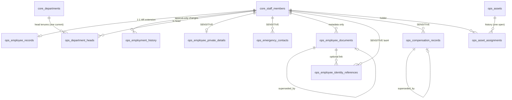

Merged into `README.md`, `requirements/REQUIREMENTS.md`, `docs/{API,ALGORITHMS,DOMAIN_MODEL,DATA_MODEL,WORKFLOWS,PERMISSIONS,KPI_DEFINITIONS,TEST_PLAN}.md` (algorithms renumbered A-21 to A-28) on 19 Oct 2026.

# Business Ops OS — HR records (OPS-030 … OPS-039)

Part document for the HR records slice (D-028). The orchestrator merges it into the
module README, `requirements/REQUIREMENTS.md`, `docs/API.md`, `docs/DOMAIN_MODEL.md`,
`docs/ALGORITHMS.md` and `docs/KPI_DEFINITIONS.md`.

**Not a payroll system and not an HRIS.** No payroll run, payslips, deductions, tax,
PF, ESI or gratuity (D-028). No biometric devices. No document files are stored while
storage is not configured (D-014).

## 1. Requirements and status (D-013)

"Tested" below means automated tests passed in this agent's run on 19 Oct 2026
(commands and output in §9). They still have to be recorded in `IMPLEMENTATION_STATUS.md`
at integration. Screens are **Implemented**: they typecheck and lint, but no `next build`
or browser check was run (the shared `.next` folder was off-limits while other agents worked).

| ID | Requirement | Status | Evidence |
|---|---|---|---|
| OPS-030 | Create employees with a unique, never-reused `EMP-####` code. Normalised unique work email. Register an existing staff member as an employee. One shared `insertEmployee` used by all slices. | Tested | `hr-records-employees.test.ts` → "employee creation" (401/403/400/201, concurrent creation gives 4 distinct codes, email normalised + 409 on duplicate, archived department and inactive manager refused, audit written without private fields) |
| OPS-031 | Employee directory and profile. Search, filters (department, location, plus status and type for HR), sorting and pagination, all on the server. Detail page with work details, employment, reports, roles (read-only), onboarding/offboarding status (guarded), documents, assets and history. | Tested (API) / Implemented (screens) | "directory search, filter, sort and pagination run on the server"; screens `/ops/hr/employees`, `/ops/hr/employees/[id]` |
| OPS-032 | Organisation structure. Department heads with succession history (one current head). Reporting lines validated (self, loop, inactive manager). Org chart. | Tested | "refuses self-management and circular hierarchies", "keeps department-head history", "org chart lists reports under their manager"; unit "org tree and head succession" |
| OPS-033 | Append-only employment history: department, designation, manager, employment type and status, each with effective date, reason and actor. Written by `insertEmployee`, `registerExistingStaff`, `updateEmployee`, `changeEmploymentStatus` **and** the existing staff-directory `updateStaff`. | Tested | "writes a history row for every tracked change, including creation and the staff screen"; "validates employment-status transitions" |
| OPS-034 | Private HR fields: legal name, personal contacts, address, emergency contacts, identity-document references (last four characters only). Employees read and edit their own. | Tested | `hr-records-private-documents.test.ts` → "private HR fields" (4 tests) |
| OPS-035 | Employment document metadata. `DocumentStorage` adapter with a mock that reports `not_configured`. Reference-only documents. Permission-checked download through short-lived URLs only. Retention hold. Two-person deletion (metadata kept). | Tested | "employee documents" (5 tests: 503 on stored upload and download, 409 reference-only, fake connected adapter issues a 300 s URL, identity documents hidden from the HR contributor, deletion by a second person) |
| OPS-036 | Compensation records. Effective-dated draft → approved (by a different person; never one's own pay) → superseded. At most one approved record. Exactly one record effective on a date. CSV export for payroll with an audited reference. | Tested | `hr-records-compensation-assets.test.ts` → "compensation records" (5 tests); unit "compensation" |
| OPS-037 | Field-level protection across roles. Private and sensitive fields are never in directory DTOs, lists, exports or audit payloads. | Tested | "field-level protection on employee records" (5 tests), private-field refusals, compensation visibility test |
| OPS-038 | Work assets: register (`AST-#####`), assign, record the return with its condition, history per asset and per employee, one open assignment per asset. | Tested | "assets" (2 tests); unit "assets" |
| OPS-039 | HR records metrics for the HR dashboard (active employees, employees by department, upcoming joining dates). Missing is never zero. | Tested (functions) | `hr-records-metrics.test.ts` (missing before any record; counts; department manager scope). The dashboard screen belongs to the reporting slice. |

**Cut or not built (Proposed):** teams (sub-department groups) · bulk import of
employees · photo or ID-card generation · document file upload and download (blocked on
storage, D-014) · retention-period enforcement (setting `hr.document_retention` is open) ·
audit of read access to private fields (only writes and download requests are audited) ·
compensation draft editing in the UI (the API `PATCH` exists; the screen offers cancel and
re-draft) · a UI for linking an identity reference to a document record (the API accepts
`documentId`).

## 2. Who sees what (A-HR-01, OPS-037)

| Tier | Fields | Who |
|---|---|---|
| Directory | code, display name, department, designation, manager, work email/phone, location, time zone | `ops:employees:read` (employee role: everyone; department manager: own chain) |
| Record | employment type, status, start/end dates, sign-in linked, application roles (read-only), onboarding/offboarding status, employment history, assets | the employee themself; `ops:employees:manage` (HR manager, HR contributor, operations manager); `ops:lifecycle:read` within HR scope (director, auditor, department manager for the chain) |
| Private | legal name, personal email/phone, address, emergency contacts, identity references | `ops:employee_private:read` — HR manager (all), employee (**self only**) |
| Documents | document metadata, downloads | `ops:employee_documents:read` — HR manager, HR contributor (all), employee (self only). Identity documents also need private access. |
| Compensation | pay records, export | `ops:compensation:read/manage` — HR manager, finance officer. Export: finance officer only. No `own` grant exists. |

Decisions taken in code, to be confirmed by the owner:
- **The legal name is gated by `ops:employee_private:read`**, not by the employee permissions. HR contributors, operations managers, the director and the auditor do not see it.
- **For private fields and documents, `own` means the user's own record only.** `hrScope` widens `own` to the reporting chain for department managers. `server/hr/access.ts → selfOrAllScope` narrows it again, so a department manager who also holds `employee` never reads a report's private data (tested).
- Separated employees are hidden from directory-tier callers. Record-tier filters and sorts (status, type, start date) answer 403 for callers who cannot see record fields of every row.
- Work email and work phone are directory data (work contacts). Audit payloads of edits list the changed field **names** in `metadata.fieldsChanged`, not the contact values.

## 3. Data model (`packages/database/src/schema/ops-hr.ts`)

Existing (extended, not renamed): `ops.employee_records`, `ops.assets`, `ops.asset_assignments`.
New: `employment_history`, `department_heads`, `employee_private_details`, `emergency_contacts`,
`employee_documents`, `employee_identity_references`, `compensation_records`.

| Table | Key columns and constraints |
|---|---|
| `employment_history` | `staff_id` (restrict), `field` ∈ department·title·manager·employment_type·employment_status, `from_value`/`to_value` (ids or enum values as text; names resolved on read), `effective_on` date, `reason`, `changed_by`, `changed_at`. Never updated or deleted. |
| `department_heads` | `department_id`, `staff_id`, `starts_on`, `ends_on` (null = current), `reason`, `assigned_by`, `ended_by`. Unique partial index: one row with `ends_on IS NULL` per department. Check `ends_on ≥ starts_on`. |
| `employee_private_details` | PK `staff_id`. Personal email (lower case), personal phone (E.164), address lines, city, state, postal code, country. **No date of birth** (not needed). |
| `emergency_contacts` | name, relationship, phone (E.164), `is_primary` (unique partial: one primary per employee). At most 5 (service). Removal deletes the row (data minimisation); the audit keeps the fact only. |
| `employee_documents` | `kind` (9 kinds), `title`, `storage_kind` reference/stored, `storage_key` (unique), `external_reference`, content type, size, `sha256` (64 hex), `retention_class` (4 classes), `status` active·superseded·retention_hold·deletion_requested·deleted, `expires_on`, `superseded_by_id`, deletion requester/decider and timestamps. Check: a reference document has `external_reference` and no key; a stored document has key and sha256. |
| `employee_identity_references` | `kind` (aadhaar, pan, passport, voter_id, driving_licence, other), `last4` (check `^[A-Z0-9]{1,4}$`), optional `document_id`, status active/retired. |
| `compensation_records` | `basis` monthly/annual/hourly, `amount_paise` bigint ≥ 0, `currency` = INR, `components` jsonb `[{kind: earning|allowance, label, amountPaise}]`, `effective_from`, `effective_to`, `status` draft·approved·superseded·cancelled, `created_by`, `approved_by/at`, `superseded_by_id`. Unique partial index: one `approved` per employee. Check: approved/superseded ⇔ `approved_by` set. |

## 4. Workflows

1. **Hire or register.** HR uses *Add employee* (→ `insertEmployee`: staff row + staff profile + employee record + history + audit), or *Register an existing staff member* (→ `registerExistingStaff`). Candidate conversion (lifecycle slice) calls `insertEmployee` inside its own transaction.
2. **Change.** *Edit employee* (`PATCH /hr/employees/[id]`) takes an effective date and a reason. Tracked fields write history. A status change goes through `changeEmploymentStatus` (A-HR-02). You cannot change your own status.
3. **Separation and deactivation hook.** `changeEmploymentStatus(… 'separated' …)` and `updateStaff(status: 'inactive')` both call `runDeactivationHook(tx, actor, { staffId, source, effectiveOn, requestId })`. It always audits `employee.deactivated` with `accessRevocation: 'handled' | 'not_wired'`, then runs the handlers registered with `registerDeactivationHandler(fn)`. **Access revocation is not wired yet:** the integration step must register the lifecycle slice's separation publisher or session revocation.
4. **Documents.** *Record document* (reference only while storage is not configured) → optional *Replaces document* supersedes the old record. *Place retention hold* / *Release hold*. *Request deletion* (reason; other HR managers are notified) → a **different** HR manager chooses *Approve deletion* (tick to confirm) or *Reject deletion* (reason). A deleted document keeps its metadata row.
5. **Compensation.** *Save draft* (HR manager or finance officer; not for oneself) → another holder chooses *Approve these terms* (tick to confirm). The current approved record becomes `superseded` with `effective_to = new start − 1`. Approvals must go forward in time. *Cancel draft* needs a reason. *Download CSV* (finance officer) exports the terms in effect on a date, with reference `CMPX-YYYYMMDD-XXXXXX` in the file, the `X-Export-Reference` header and the audit log.
6. **Assets.** *Register asset* → *Assign asset* (only `available` assets, only to non-separated employees with a record; the holder is notified) → *Record return* with its condition (good/worn → available, damaged → in repair, lost → lost). Manual status changes: repair, retire, lost, found.
7. **Department heads.** *Appoint head* from a date (the current head ends the day before; same person or an earlier date is refused) · *End current head's tenure* (reason).

## 5. API (`/ops/api/v1`, JSON, D-012 envelope)

Every route checks its permission in `defineRoute` and again in the service (HR scope + field tier).

| Method | Path | Permission | Notes |
|---|---|---|---|
| GET | hr/employees | ops:employees:read | `q, departmentId, location, status*, employmentType*, includeSeparated*, sort (name, code, department, start_date*, status*), dir, page, pageSize ≤ 100` (* record tier only, otherwise 403) → `{items, total, page, pageSize, recordTier}` |
| POST | hr/employees | ops:employees:manage (all) | create (`fullName` …) or `existingStaffId` → 201 `{id, staffId, employeeCode}`; 409 duplicate work email |
| GET | hr/employees/[id] | ops:employees:read | `{employee (tiered), reports, roles\|null, lifecycle\|null, access}` |
| PATCH | hr/employees/[id] | ops:employees:manage | fields + `effectiveOn`, `reason`; 409 on loop or illegal status change, 400 on missing reason or end date |
| GET | hr/employees/[id]/history | ops:employees:read + record tier | append-only history, names resolved |
| GET / PUT | hr/employees/[id]/private | ops:employee_private:read / :manage (own = self) | legal name, personal details, emergency contacts, identity references |
| POST | hr/employees/[id]/emergency-contacts | ops:employee_private:manage | max 5; the first becomes primary |
| PATCH / DELETE | hr/employees/[id]/emergency-contacts/[contactId] | ops:employee_private:manage | |
| POST | hr/employees/[id]/identity-references | ops:employee_private:manage | `last4` > 4 characters → 400 |
| PATCH | hr/employees/[id]/identity-references/[refId] | ops:employee_private:manage | `{status:'retired'}` |
| GET / POST | hr/employees/[id]/documents | ops:employee_documents:read / :manage | POST `stored` while not configured → **503** `{stored:false, connection:'not_configured'}`, nothing written |
| POST | hr/documents/[id]/status | ops:employee_documents:manage | `action` hold · release_hold · request_deletion · approve_deletion (`confirm:true`) · reject_deletion |
| GET | hr/documents/[id]/download | ops:employee_documents:read | 200 `{url, expiresAt}` (≤ 300 s) or 302 with `?redirect=1`; 503 storage not configured; 409 reference-only or deleted. Audited. |
| GET / POST | hr/compensation | ops:compensation:read / :manage | POST takes `amountPaise` or `amountInr` ("45000.50") |
| PATCH | hr/compensation/[id] | ops:compensation:manage | drafts only |
| POST | hr/compensation/[id]/approve | ops:compensation:manage | `{confirm:true}`; 403 drafter or subject; 409 not forward in time |
| POST | hr/compensation/[id]/cancel | ops:compensation:manage | `{reason}` |
| GET | hr/compensation/export?asOf= | ops:compensation:export | `text/csv`, header `X-Export-Reference`; 409 if approved windows overlap |
| GET / POST | hr/assets | ops:assets:read / :manage | list: `q, status, category, page, pageSize` |
| GET / PATCH | hr/assets/[id] | ops:assets:read / :manage | |
| POST | hr/assets/[id]/assign | ops:assets:manage | 409 already assigned / not available / separated |
| POST | hr/assets/[id]/return | ops:assets:manage | `condition` good · worn · damaged · lost |
| GET | hr/employees/[id]/assets | ops:assets:read (HR scope) | |
| POST / PATCH | departments/[id]/heads | ops:organisation:manage | appoint / end tenure |
| GET | organisation/chart | ops:organisation:read | depth-first rows, `detached` flag |

## 6. Algorithms (format of docs/ALGORITHMS.md)

### A-HR-01 Field tiers and projection — OPS-037
1. **Purpose.** Return only the employee fields the caller may see.
2. **Inputs.** Row, `{isSelf, canManage, lifecycleCovers, privateCovers}` (`server/hr/access.ts → employeeVisibility`).
3. **Output.** `EmployeeView`: directory fields always; `record` object or null; `legalName` key present only for the private tier (`domain/hr/employees.ts → employeeFieldTiers, projectEmployee`).
4. **Preconditions.** `ops:employees:read` held and HR scope covers the row.
5. **Rules.** record = self ∨ manage-scope covers ∨ lifecycle-read scope covers. private = private-read scope (self only when `own`) covers. Projection builds a new object and never copies a hidden field.
6. **Steps.** hrScope → visibility → per-row tiers → project.
7. **Edge cases.** A separated employee is 404 for directory-tier callers. List filters and sorts on record fields → 403 unless every listable row is record-visible.
8. **Permissions.** As §2.
9. **Tests.** Unit "field tiers and projection"; integration "field-level protection …".
10. **Limitations.** Uses `ops:lifecycle:read` as the signal for "may see employment facts"; a dedicated permission is requested (§8).

### A-HR-02 Employment-status transitions — OPS-033
1. **Purpose.** Keep the employment status meaningful and auditable.
2. **Inputs.** from, to, reason, end date (`checkEmploymentStatusChange`).
3. **Output.** ok, or `NO_CHANGE | ILLEGAL | REASON_REQUIRED | END_DATE_REQUIRED`.
4. **Preconditions.** Employee record row locked.
5. **Rules.** onboarding → active | separated; active → on_notice | separated; on_notice → active | separated; separated is final (a re-hire is a new record). Reason always required; separation needs an end date. Nobody changes their own status.
6. **Steps.** check → update record (end date on separation; cleared when notice is withdrawn) → history row → audit `employee.status_changed` → on separation `runDeactivationHook`.
7. **Edge cases.** ILLEGAL/NO_CHANGE → 409; missing reason or date → 400.
8. **Permissions.** `ops:employees:manage`; the lifecycle slice calls `changeEmploymentStatus` after its own approval.
9. **Tests.** Unit "employment status transitions"; integration "validates employment-status transitions".
10. **Limitations.** Notice period and last-day rules are not modelled (owner policy).

### A-HR-03 Employment history diff — OPS-033
1. **Purpose.** One history row per tracked field that actually changed.
2. **Inputs.** `before` (null for a new employee) and a partial `after` (`historyChanges`).
3. **Output.** `[{field, fromValue, toValue}]` in fixed field order.
4. **Preconditions.** None (pure).
5. **Rules.** Absent keys are unchanged; null counts as a value; on creation only non-null values are written.
6. **Steps.** Compare each tracked key → emit → `writeHistory` inserts with effective date, reason and actor.
7. **Edge cases.** Setting the same value writes nothing.
8. **Permissions.** Called by services that already checked permission.
9. **Tests.** Unit "employment history diff"; integration "writes a history row for every tracked change …".
10. **Limitations.** Department and manager names are resolved at read time (today's names).

### A-HR-04 Department-head succession — OPS-032
1. **Purpose.** One current head per department, with history.
2. **Inputs.** Current tenure, new `{staffId, startsOn}` (`planHeadSuccession`).
3. **Output.** ok + `endCurrentOn` (start − 1 day), or a message.
4. **Preconditions.** Department row locked; the new head is active staff; the department is not archived.
5. **Rules.** The same person → refused. The new start must be after the current head's start.
6. **Steps.** plan → close the current tenure → insert the new one → audit.
7. **Edge cases.** Ending a tenure before its start → 400.
8. **Permissions.** `ops:organisation:manage`.
9. **Tests.** Unit "org tree and head succession"; integration "keeps department-head history".
10. **Limitations.** Acting or co-heads are not modelled.

### A-HR-05 Document status and deletion — OPS-035
1. **Purpose.** Keep document records honest and deletions deliberate.
2. **Inputs.** status, action, actor, requester, reason (`checkDocumentAction`).
3. **Output.** New status, or `ILLEGAL | SELF_DECISION | REASON_REQUIRED`.
4. **Preconditions.** Row locked; manage scope; identity kinds need private manage.
5. **Rules.** hold: active/superseded → retention_hold (reason). release_hold → active. request_deletion: active/superseded → deletion_requested (reason; blocked by a hold). approve: → deleted, by a different user, `confirm:true`, not the subject. reject → active (reason).
6. **Steps.** check → update → audit `employee_document.<action>` → notify the other HR managers on request.
7. **Edge cases.** A deleted record keeps its title and metadata; downloads answer 409.
8. **Permissions.** `ops:employee_documents:manage`.
9. **Tests.** Unit "document actions"; integration "deletion: requested by one person …".
10. **Limitations.** No automatic expiry or retention processing (setting open).

### A-HR-06 Compensation approval and effective dating — OPS-036
1. **Purpose.** Exactly one set of terms in effect on any date, approved by a second person.
2. **Inputs.** Draft, the employee's other records, approver `{userId, staffId}` (`planCompensationApproval`).
3. **Output.** ok + the record to supersede and its end date, or `ILLEGAL | SELF_APPROVAL | CONFLICT`.
4. **Preconditions.** All the employee's records locked `FOR UPDATE`.
5. **Rules.** Only drafts. Approver ≠ drafter and ≠ subject. No approved or superseded record may start on or after the draft's date. The current approved record gets `effective_to = start − 1` and status `superseded`. Unique index: one `approved` per employee.
6. **Steps.** plan → supersede → approve → audit (no amounts) → notify the drafter.
7. **Edge cases.** An earlier-dated correction → cancel and re-draft (the 409 explains). Overlaps are reported, never silently resolved (`effectiveRecordAt.conflict`).
8. **Permissions.** `ops:compensation:manage` (a separate approve permission is requested).
9. **Tests.** Unit "compensation"; integration "approval by a different person …", "cannot approve their own pay".
10. **Limitations.** No pay-revision workflow beyond draft/approve; no arrears or proration (payroll is out of scope).

### A-HR-07 Compensation validation and export — OPS-036
1. **Purpose.** Record only earnings and allowances, and hand them over exactly.
2. **Inputs.** basis, amount (paise or rupee string), components, effective date.
3. **Output.** Validation issues; CSV rows of the terms in effect on `asOf`.
4. **Preconditions.** Export permission.
5. **Rules.** Integers ≥ 0, ≤ ₹10 crore. Component kinds are earning or allowance only. Labels naming deductions or statutory items (tax, TDS, PF, EPF, ESI, LWF, professional tax, payslip, net pay) are refused. Labels are unique. Listed components must add up to the amount. Rupee strings are converted exactly. CSV cells are quoted and `=`, `+`, `-`, `@` prefixes neutralised.
6. **Steps.** Load approved and superseded records → effective per employee → refuse on overlap → CSV → audit `compensation.exported` (reference, as-of date, row count).
7. **Edge cases.** Employees with no terms on the date are omitted (not zero rows).
8. **Permissions.** `ops:compensation:export` (finance officer).
9. **Tests.** Unit "formats paise exactly and neutralises CSV formulas"; integration "export …".
10. **Limitations.** File download only; no push to a payroll provider.

### A-HR-08 Asset assignment and return — OPS-038
1. **Purpose.** Know who holds each asset.
2. **Inputs.** Asset status, open assignment, employee status, dates (`checkAssignment`, `statusAfterReturn`, `checkAssetStatusChange`).
3. **Output.** ok or message; status after return.
4. **Preconditions.** Asset row locked.
5. **Rules.** Assign only `available` assets with no open assignment, to employees with a record who are not separated or inactive; due date not before the hand-over. Return: good/worn → available, damaged → in_repair, lost → lost. Manual changes: available ↔ in_repair, → retired, → lost, lost → available (found). An assigned asset changes only by return.
6. **Steps.** check → insert assignment → set status → audit → notify the holder. Return: close the assignment → set status → audit.
7. **Edge cases.** The unique index refuses a second open assignment under a race.
8. **Permissions.** `ops:assets:manage` (all). Read: `ops:assets:read` with HR scope (employees see their own assets, department managers their chain).
9. **Tests.** Unit "assets"; integration "assets".
10. **Limitations.** No depreciation, purchase or warranty data.

## 7. KPIs (`src/server/reports/hr-records-metrics.ts`, permission `ops:hr_reports:read`, HR scope)

| ID | Function | Definition | Missing when |
|---|---|---|---|
| K-HR-01 | `activeEmployeesMetric(db, actor, now?)` | Employee records with status `active` on the day (onboarding, on notice and separated excluded). | No employee record exists in scope. |
| K-HR-02 | `employeesByDepartmentMetric(db, actor, now?)` | Current (not separated) employee records per non-archived department, plus a "No department recorded" row. | No employee record exists in scope (every department `missing`, never 0). |
| K-HR-03 | `upcomingJoiningDates(db, actor, {days=30, now?})` | Onboarding or active employees whose recorded start date falls in [today, today + days], listed; plus a count of onboarding employees with **no** start date (never guessed). | No employee record exists in scope. |

## 8. Policies, owner decisions, requests

- **Setting added:** `hr.document_retention` (state `open`, owner decision OD-014 / D-028). Years per retention class, all null; nothing enforced.
- **Open owner decisions:** retention periods (above); identity documents stored or reference-only (OD-014; reference-only today); whether the operations manager, director or auditor may see legal names (no, today); whether ordinary employees see colleagues' work phone numbers (yes, today: work contacts are directory data); a document storage provider (D-014).
- **Permission requests** (`packages/authorization/src/permissions/ops.ts`, not edited here): (1) `ops:compensation:approve`, separate from `:manage`; (2) `ops:employee_records:read` for employment facts, instead of reusing `ops:lifecycle:read`; (3) consider `ops:compensation:export` for `hr_manager` if HR runs the hand-over (today only the finance officer exports).

## 9. Tests run (19 Oct 2026, this agent)

See the final report of the HR records build agent for the exact commands and result lines.
