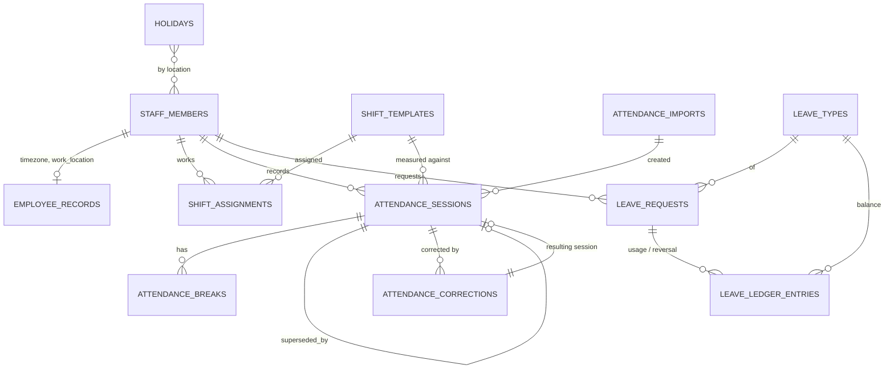

# Business Ops OS — staff attendance, shifts, leave and timesheets (part for merging)

Area: `hr-time` — OPS-050 … OPS-059. Built 19 Oct 2026 on branch `feature/business-ops-hr-admissions` (D-028, D-029). The orchestrator merges this file into `README.md`, `requirements/REQUIREMENTS.md`, `docs/{DOMAIN_MODEL,API,ALGORITHMS,KPI_DEFINITIONS,TEST_PLAN,INTEGRATION_REQUESTS}.md`. Status words follow D-013; nothing is Deployed. "Tested" means a passing automated test named in the Evidence column (commands and results in §9).

This is **staff** attendance. Academic OS class/student attendance is never read, stored or duplicated. Attendance figures are operational signals and are never presented as a performance measure on their own. Every attendance, shift and leave rule is a setting or a row with a decision state (`proposed`/`open`), owner decision **OD-026**.

## 1. Requirements

| ID | Title | Status (D-013) | Evidence (test file → case) |
|---|---|---|---|
| OPS-050 | Self clock-in / clock-out, breaks (start/end), work date = clock-in day in the employee's timezone, one open session per person, several sessions per day only if `attendance.rules.multipleSessionsPerDay` | **Tested** (API, domain) · **Implemented** (screen `/ops/hr/attendance/me`) | integration `hr-time-attendance.test.ts` → "clock in, break, clock out; second clock-in on the same day is refused"; unit `hr-time-domain.test.ts` → "attendance hour calculations" |
| OPS-051 | Manual entries (`ops:attendance:manage`): mandatory reason (API + DB CHECK), audited, employee notified, overlap / one-per-day / future checks | **Tested** | `hr-time-attendance.test.ts` → "manual entries need a reason, are audited, and late/early is measured against the shift" |
| OPS-052 | Late arrival / early departure vs the assigned shift with proposed grace minutes; "not measured" when no shift; missing clock-out job (flags once, notifies the employee) | **Tested** | unit → "late / early flags with grace", "missing clock-out"; integration → "a day without a shift is not measured", "flags an open session past shift end + grace once, and notifies the employee"; `hr-time-jobs-seed.test.ts` → "needs ops:jobs:run" |
| OPS-053 | Corrections ATC-###### never overwrite: approval supersedes the original (kept) and creates a new `correction` session; rejection keeps the original; no self-decision (user or staff record); department-manager chain scope; requester-only withdraw; missed-day corrections | **Tested** | unit → "decision checks (corrections and leave)"; integration → "corrections never overwrite" (3 cases) |
| OPS-054 | CSV import: own RFC 4180 parser (quotes, `""`, CRLF/LF/CR, BOM, blank lines), per-row validation (code exists and in scope, date/time, overnight, timezone, break, future, duplicates in file and against existing sessions), preview, commit valid rows in one transaction, idempotent per file (sha256), batch with counts and actor | **Tested** | unit → "CSV parser (RFC 4180)", "attendance CSV validation"; integration → "CSV import" (3 cases) |
| OPS-055 | Attendance provider adapter: interface + mock reporting `not_configured` (D-014); UI says "No attendance device or provider is connected; manual and CSV only." | **Tested** | `hr-time-attendance.test.ts` → "provider adapter reports not_configured" |
| OPS-056 | Shift templates (local start/end, crosses midnight, unpaid break, working weekdays, location, department; proposed → approved → retired; changed approved timings revert to proposed), assignments with from/to and conflict detection (split shifts only by policy and only without time overlap), holiday calendar per location with decision state | **Tested** (API, domain) · **Implemented** (screens `/ops/hr/shifts`, `/ops/hr/shifts/[id]`) | unit → "shifts"; integration `hr-time-leave.test.ts` → "shift templates and assignments" (4 cases), "holidays" |
| OPS-056a | Shift change requests with approval | **Proposed** (not built) | — |
| OPS-057 | Leave types (proposed, OD-026), requests LVR-###### with half-day parts, overlap detection (half-day aware, own pending/approved), working-day counting (shift weekdays else proposed default week; holidays by location), approval within scope and never self, cancellation rules (requester before start; approver with reason after start) | **Tested** | unit → "leave" (6 cases); integration → "leave requests" (7 cases) |
| OPS-058 | Leave balance ledger (allocation, adjustment, usage on approval, reversal on cancellation; "not configured" without allocation; no self-allocation); team availability report (chain/department, ≤ 31 days) | **Tested** (API) · **Implemented** (screens `/ops/hr/leave/balances`, `/ops/hr/leave/availability`) | integration → "balance: not configured until an allocation, then a ledger", "cancellation …", "team availability …"; unit → "balance ledger", "availability grid" |
| OPS-059 | Timesheets per employee / department (scheduled vs worked, late/early, missing clock-outs, unresolved exceptions, approved leave days, "unapproved difference"), employee-level CSV export with `ops:hr_reports:export` (audited), HR dashboard metrics (values or missing) | **Tested** (API, domain) · **Implemented** (screen `/ops/hr/timesheets`) | unit → "timesheet summary"; integration → "timesheets, export and metrics" (3 cases) |
| OPS-059a | Approved overtime records | **Proposed** (not built; the difference is shown as "unapproved") | — |
| OPS-059b | Monthly attendance summary per employee (self-service) | **Tested** | `hr-time-attendance.test.ts` → "monthly summary: worked vs scheduled for self; colleague summary forbidden" |

## 2. Data model (`packages/database/src/schema/ops-time.ts`, schema `ops`)

| Table | Purpose | Key rules |
|---|---|---|
| `shift_templates` | Shift definitions | `code` unique (`^[A-Z0-9][A-Z0-9_-]{1,23}$`); `start_time`/`end_time` `HH:MM` CHECKs; midnight consistency CHECK; break 0–600; `working_weekdays` jsonb int[]; `status` proposed/approved/retired; never deleted |
| `shift_assignments` | Employee ↔ template for `from_date`…`to_date` (null = open) | `to ≥ from`; `status` active/cancelled (+ `cancel_reason`); overlap refused in service under an advisory lock |
| `holidays` | Company holiday calendar | unique (date, lower(location)) among non-withdrawn rows; `status` proposed/approved/withdrawn; `location` null = all |
| `attendance_sessions` | Clock-in → clock-out | `work_date` in employee tz; `timezone`; `break_minutes`; `source` self/manual/csv_import/provider/correction; `status` open/closed/superseded; one `open` per staff (partial unique); clock-out > clock-in; manual ⇒ reason; `late_minutes`/`early_departure_minutes` (null = not measured); `missing_clock_out_flagged_at`; `import_id`; `correction_id`; `superseded_by_id` (self FK) + `superseded_at` |
| `attendance_breaks` | Self-recorded breaks | one running break per session; end > start |
| `attendance_corrections` | ATC-###### requests | `session_id` null = missed day; proposed instants + break; reason; `status` pending/approved/rejected/withdrawn; one pending per session; decided ⇔ `decided_by`; approved ⇔ `resulting_session_id` |
| `attendance_imports` | CSV batches | `file_sha256` unique (idempotency); counts CHECK `valid + invalid = total`; `row_errors` jsonb; `imported_by` |
| `leave_types` | Leave types | `code` unique; paid, half_day_allowed, requires_document; `status` proposed/approved/retired |
| `leave_requests` | LVR-###### | start/end dates + parts with consistency CHECK; `working_days` numeric(6,1); status pending/approved/rejected/cancelled; decided/cancelled columns |
| `leave_ledger_entries` | Balance ledger | `entry_type` allocation/adjustment/usage/reversal with sign CHECK; usage/reversal need `leave_request_id`; unique (request, entry_type) → idempotent |

All staff references are `core.staff_members` (restrict); users are `core.users`. Employee timezone and work location come from `ops.employee_records` (HR records slice).

## 3. State machines

- **Attendance session:** `open` → `closed` (clock-out, manual close via correction) · `open|closed` → `superseded` (only by an approved correction; the row is kept, values unchanged). Nothing is deleted or edited in place apart from closing an open session and the missing-clock-out flag.
- **Correction:** `pending` → `approved` | `rejected` (decider holds `ops:attendance:approve` covering the employee; not the requester, not the employee; rejection needs a note) · `pending` → `withdrawn` (requester only). Final otherwise (409 `INVALID_STATE_TRANSITION`).
- **Leave request:** `pending` → `approved` (usage entry) | `rejected` (note) · `pending|approved` → `cancelled` (reversal entry if it was approved). Before the start date the requester/employee or an approver may cancel; once approved leave has started only an approver who is not the employee may cancel, with a reason.
- **Shift template / leave type:** `proposed` ⇄ `approved`, → `retired` (template: only without active assignments). Editing an approved template's timing makes it `proposed`.
- **Holiday:** `proposed` ⇄ `approved` → `withdrawn` (final).
- **Shift assignment:** `active` → end date set (`end`) or `cancelled` (reason).

## 4. API (`/ops/api/v1/hr/…`, JSON bodies, D-022 basePath)

| Method & path | Permission (route + service) | Notes |
|---|---|---|
| GET `attendance` | `ops:attendance:read` (HR scope) | filters `staffId, from, to, status (open/closed/superseded/missing_clock_out), source, page`; 50 per page |
| POST `attendance` | `ops:attendance:manage` | manual entry `{staffId, workDate, clockIn HH:MM, clockOut?, clockOutDate?, breakMinutes, reason}` → 201 |
| GET `attendance/{id}` | `ops:attendance:read` | session, breaks, corrections, replacedBy/replaces, `canRequestCorrection` |
| POST `attendance/clock-in` · `clock-out` | `ops:attendance:record` (self) | 201 / 200; 409 when already in / not in |
| POST `attendance/breaks` | `ops:attendance:record` | `{action: start|end}` |
| GET `attendance/me` | `ops:attendance:record` | self-service status |
| GET `attendance/summary` | `ops:attendance:read` | `?staffId&month=YYYY-MM` (self by default) |
| GET `attendance/provider` | `ops:attendance:read` | mock: `not_configured` |
| POST `attendance/missing-clock-out-check` | `ops:jobs:run` | runs the job now (no scheduler) |
| GET/POST `attendance-corrections` | read / `ops:attendance:record` | create `{sessionId?, workDate, clockIn, clockOut, clockOutDate?, breakMinutes, reason}` |
| GET `attendance-corrections/{id}` | `ops:attendance:read` | `canDecide`, `canWithdraw` |
| POST `attendance-corrections/{id}/decision` | `ops:attendance:approve` | `{decision: approve|reject, note}`; self → 403 |
| POST `attendance-corrections/{id}/withdraw` | `ops:attendance:record` | requester only |
| GET/POST `attendance-imports` | `ops:attendance:manage` | POST `{csv, fileName?, commit}`; preview by default; repeat file → `alreadyImported: true` |
| GET/POST `shifts`, GET/PATCH `shifts/{id}` | `ops:shifts:read` / `ops:shifts:manage` | PATCH also `status` |
| GET/POST `shift-assignments`, PATCH `shift-assignments/{id}` | `ops:shifts:read` (scoped) / `ops:shifts:manage` | PATCH `{action:'end', toDate}` or `{action:'cancel', reason}`; conflicts → 409 with `details.conflicts` |
| GET/POST `holidays`, PATCH `holidays/{id}` | `ops:shifts:read` or `ops:leave:read` / `ops:leave:manage` | |
| GET/POST `leave-types`, PATCH `leave-types/{id}` | `ops:leave:read` / `ops:leave:manage` | |
| GET/POST `leave-requests` | `ops:leave:read` / `ops:leave:request` | `view=mine|to_decide|all`; create returns `perDate`, `countBasis`; overlap → 409 |
| GET `leave-requests/{id}` | `ops:leave:read` | day-by-day, ledger, `canDecide`, `canCancel` |
| POST `leave-requests/{id}/decision` | `ops:leave:approve` | self → 403 |
| POST `leave-requests/{id}/cancel` | `ops:leave:request` or `ops:leave:approve` | rules in §3 |
| GET `leave-requests/availability` | `ops:leave:read` | `?from&to&departmentId`, ≤ 31 days |
| GET/POST `leave-balances` | `ops:leave:read` / `ops:leave:manage` | POST `{staffId, leaveTypeId, entryType: allocation|adjustment, days (0.5 steps), effectiveDate, periodLabel?, note}`; own balance → 403 |
| GET `leave-balances/ledger` | `ops:leave:read` | `?staffId` |
| GET `timesheets` | `ops:hr_reports:read` (HR scope) | `?from&to&staffId&departmentId`, ≤ 62 days; daily rows for one employee |
| GET `timesheets/export` | `ops:hr_reports:export` | `text/csv`, audited `timesheet.exported` |

Check order everywhere: 401 → 403 → 400 → handler; services re-check permission and HR scope (pages call services directly).

## 5. Algorithms

### A-HT-1 Attendance calculations
1. **Purpose.** Hours worked and the work date of a session. 2. **Inputs.** clock-in/out instants (UTC), break minutes, employee timezone. 3. **Output.** `workedMinutes` (null while open), `workDate`. 4. **Preconditions.** clock-out > clock-in. 5. **Rules.** worked = elapsed − unpaid break, never < 0; work date = calendar day of clock-in in the employee's IANA zone (an overnight session belongs to the day it started); max session length (`attendance.rules.maxSessionHours`, proposed 16) and break < session for manual/CSV/correction input. Timezone conversion uses `Intl` with two offset refinements (`domain/hr/calendar.ts`). 6. **Steps.** convert local inputs → instants → validate → store. 7. **Edge cases.** open session = null (not 0); DST gaps resolve to the earlier offset; break records are summed on clock-out. 8. **Permissions.** record (self), manage (manual). 9. **Tests.** unit "attendance hour calculations", "calendar and timezones". 10. **Limitations.** No sub-minute precision; zones with DST are handled but only IST is in use.

### A-HT-2 Late / early flags and missing clock-out
1. **Purpose.** Flag deviations from the assigned shift. 2. **Inputs.** session, shift window (template + work date + tz), grace minutes. 3. **Output.** `lateMinutes`, `earlyDepartureMinutes` (0 within grace, the full difference beyond it, null = not measured); missing clock-out flag. 4. **Preconditions.** a shift applies on the work date (assignment active, working weekday, not a holiday). 5. **Rules.** late if clock-in − shift start > `lateGraceMinutes`; early if shift end − clock-out > `earlyDepartureGraceMinutes`; missing clock-out when still open after shift end + `missingClockOutGraceMinutes`, or after clock-in + max session length when no shift applies or the clock-in was after the shift ended. 6. **Steps.** late at clock-in; early at clock-out; job `runMissingClockOutCheck(db, now)` claims each session atomically (`missing_clock_out_flagged_at IS NULL`), audits and notifies once. 7. **Edge cases.** no shift → "not measured", never "on time"; flags cleared on clock-out. 8. **Permissions.** job: `ops:jobs:run`. 9. **Tests.** unit "late / early flags with grace", "missing clock-out"; integration "missing clock-out job". 10. **Limitations.** No scheduler (manual button / jobs route).

### A-HT-3 Overlap detection (sessions, assignments, leave)
1. **Purpose.** Refuse double records. 2. **Inputs.** candidate vs existing rows of the same employee. 3. **Output.** conflicts. 4. **Preconditions.** per-employee advisory lock. 5. **Rules.** sessions overlap when intervals intersect (open = until now); one session per work date unless allowed. Assignments overlap on inclusive date ranges; with split shifts allowed they conflict only if the shifts overlap in local time on a shared weekday (week-minute model incl. overnight spill). Leave overlaps per half day with the employee's own pending/approved requests. 6. **Steps.** lock → load → compare → 409 with details. 7. **Edge cases.** cancelled/rejected/withdrawn rows ignored; superseded sessions ignored. 8. **Permissions.** as the write. 9. **Tests.** unit "overlap detection…", "assignment conflicts…", "overnight shift overlaps…", "detects overlap with own pending/approved leave"; integration conflicts. 10. **Limitations.** Leave does not check other people's leave (team availability shows it instead).

### A-HT-4 Working-day counting (leave)
1. **Purpose.** Days a leave request costs. 2. **Inputs.** span with parts, employee assignments, `leave.rules`, holidays for the employee's location. 3. **Output.** days (0.5 steps) + per-date breakdown with exclusions. 4. **Preconditions.** valid parts. 5. **Rules.** a date counts when it is a working weekday of the covering shift (or of the proposed default week Mon–Sat when no shift covers it) and not a holiday (approved, plus proposed if `countProposedHolidays`); start/end parts count 0.5. 6. **Steps.** iterate dates → classify → sum; a total of 0 is refused. 7. **Edge cases.** Sunday-only request → 400; location-specific holidays apply only to matching employees. 8. **Permissions.** request. 9. **Tests.** unit "counts working days…"; integration "counts working days (Sunday and the Sikar holiday excluded, half days)". 10. **Limitations.** Count fixed at request time; later holiday changes do not recount.

### A-HT-5 Balance ledger
1. **Purpose.** Balances without inventing entitlements. 2. **Inputs.** ledger rows per employee + type. 3. **Output.** `not_configured` or `{allocated, adjusted, used, reversed, balance}`. 4. **Preconditions.** none. 5. **Rules.** no allocation row → not configured (never 0); balance = allocation + adjustment − usage + reversal; usage written on approval, reversal on cancellation of approved leave (unique per request → idempotent); allocations/adjustments only by `ops:leave:manage`, never for oneself; accrual/carry-forward/encashment are `open` settings and nothing runs them. 6–7. Requests are not blocked by balance (entitlements open). 8. **Permissions.** read/manage. 9. **Tests.** unit "balance ledger…"; integration balance + cancellation cases. 10. **Limitations.** No leave year boundaries (period label is free text).

### A-HT-6 CSV import
1. **Purpose.** Bulk staff attendance from a file. 2. **Inputs.** CSV text, actor scope, existing sessions, rules. 3. **Output.** per-row results; on commit a batch. 4. **Preconditions.** `ops:attendance:manage`. 5. **Rules.** RFC 4180 parser; columns `employee_code, date, clock_in, clock_out` + optional `break_minutes, timezone, note`; `clock_out` `HH:MM` or `YYYY-MM-DD HH:MM`; ≤ 5000 rows, ≤ 2 MB; every row validated independently; file sha256 unique. 6. **Steps.** hash → already imported? return batch → parse → validate → preview, or (commit) lock → re-check hash → re-validate inside the transaction → insert batch + valid sessions → audit. 7. **Edge cases.** BOM, CRLF, lone CR, blank lines, quoted commas/newlines, malformed quotes (file error with line). 8. **Permissions.** manage + HR scope per row. 9. **Tests.** unit CSV suites; integration "CSV import". 10. **Limitations.** Changing one byte makes a new file (duplicate rows are then row errors).

### A-HT-7 Timesheet summary
1–3. Per day: schedule (scheduled minutes / not scheduled with reason), worked minutes of closed non-superseded sessions, flags, leave, pending corrections; per period: totals as measured values. 5. **Rules.** scheduled is missing when no day in the period has an assignment; worked is missing when no closed session exists; unapproved difference only when both are known. 9. **Tests.** unit "timesheet summary"; integration "timesheets…". 10. **Limitations.** ≤ 62 days per request; computed on read.

## 6. KPIs (HR dashboard, `src/server/reports/hr-time-metrics.ts → hrTimeMetrics(db, actor, window)`)

| Key | Definition | Unit | Source | Scope | Missing when |
|---|---|---|---|---|---|
| `attendanceExceptionsOpen` | Sessions flagged missing clock-out and still open + correction requests pending, now | count | attendance_sessions, attendance_corrections | `ops:hr_reports:read` HR scope | actor's scope has no staff records |
| `leaveRequestsAwaitingApproval` | Leave requests in `pending`, now | count | leave_requests | same | same |
| `scheduledHours` | Paid scheduled hours from shift assignments in the window (holidays/non-working days excluded) | hours | shifts + holidays | same | nobody in scope has an assignment in the window |
| `recordedHours` | Hours worked in closed, non-superseded sessions in the window, breaks excluded | hours | attendance_sessions | same | no closed session in the window |

Counts are `metric.ok` (0 open is a known fact); hours are `metric.ok` or `metric.missing` — never 0 for missing. Not performance measures.

## 7. Policies (settings in `domain/policies.ts`, all OD-026) and open decisions

| Key | Default | State |
|---|---|---|
| `attendance.rules` | one session/day; late grace 10 min; early grace 10 min; missing clock-out grace 60 min; max session 16 h | proposed |
| `shifts.rules` | split shifts not allowed | proposed |
| `leave.rules` | default working weekdays Mon–Sat (from the recorded online office week); proposed holidays excluded from leave counts | proposed |
| `leave.entitlements` | leave year, entitlements, accrual, carry-forward, encashment all null — recorded only, never enforced | open |

Also owner decisions: actual shift timings (templates start proposed), leave types (start proposed), the holiday calendar (entries start proposed), whether HR may approve leave/corrections as well as line managers (the grants allow both today).

## 8. Screens (NAV entries requested in §10)

`/ops/hr/attendance/me` (My attendance & leave: Clock in / Start break / End break / Clock out, this month vs shift, sessions, missed-day correction request, my leave, Request leave, my balances) · `/ops/hr/attendance` (filters, pagination, manual entry, missing clock-out check) · `/ops/hr/attendance/[id]` (session, breaks, corrections, supersede chain, Request correction) · `/ops/hr/attendance/corrections` + `/[id]` (Approve correction / Reject correction / Withdraw) · `/ops/hr/attendance/import` (Check file → Import N valid rows; earlier imports) · `/ops/hr/shifts` + `/[id]` (templates, assignments, holidays; approve/retire, end/cancel) · `/ops/hr/leave` (Mine / Waiting for my decision / All) + `/[id]` (Approve leave / Reject leave / Cancel leave) · `/ops/hr/leave/types` · `/ops/hr/leave/balances` · `/ops/hr/leave/availability` · `/ops/hr/timesheets` (Download employee CSV). The device/provider notice is shown on the attendance screens. No `loading.tsx`; every page uses `gate()` + `Frame` + `Section` + `load`.

## 9. Tests and commands (run 19 Oct 2026)

- `npx vitest run tests/unit/hr-time-domain.test.ts tests/integration/hr-time-attendance.test.ts tests/integration/hr-time-leave.test.ts tests/integration/hr-time-jobs-seed.test.ts` (in `apps/business-ops-os`) → **Test Files 4 passed (4), Tests 73 passed (73)**.
- `npx vitest run` (whole app, other slices included) → **Test Files 42 passed (42), Tests 555 passed (555)**.
- `npx tsc --noEmit -p apps/business-ops-os` → no errors in hr-time files (other slices' in-progress files had errors at the time).
- `npx eslint <hr-time files> --max-warnings=0` → clean. `npx prettier --write <hr-time files>` done.

## 10. Integration requests (shared files not edited)

- **NAV (`src/ui/frame.tsx`):** `{ key: 'my-time', label: 'My attendance & leave', href: '/ops/hr/attendance/me', permission: 'ops:attendance:record' }`, `{ key: 'attendance', label: 'Attendance', href: '/ops/hr/attendance', permission: 'ops:attendance:read' }`, `{ key: 'shifts', label: 'Shifts', href: '/ops/hr/shifts', permission: 'ops:shifts:read' }`, `{ key: 'leave', label: 'Leave', href: '/ops/hr/leave', permission: 'ops:leave:read' }`, `{ key: 'timesheets', label: 'Timesheets', href: '/ops/hr/timesheets', permission: 'ops:hr_reports:read' }`.
- **Jobs route:** add `attendance-missing-clock-out` → `runMissingClockOutCheck(db, new Date(), { actor: user, requestId })` from `server/hr/attendance` (+ `jobParams` enum in `server/schemas.ts`).
- **Seeds (`seed/index.ts`):** add `...hrTimeSeeds` from `./hr-time`.
- **Server barrel:** `runMissingClockOutCheck` (`./hr/attendance`), `hrTimeMetrics` (`./reports/hr-time-metrics`), `getAttendanceProvider, MockAttendanceProvider` (`./adapters/attendance-provider`). Domain barrel: optional `export * from './hr/{calendar,csv,attendance,shifts,leave,timesheets}'` (check name clashes: `weekday`, `LEAVE_STATUSES`).
- **Academic (ACD-012, OD-026):** teacher-on-leave conflicts could consume approved leave via a summary contract later; not built.

## 11. Limitations / not built

Shift change requests; approved overtime; accrual/carry-forward/encashment (open policy); scheduler for the missing clock-out job; provider/device integration (D-028 out of scope; mock only); leave counts are not recomputed when holidays change; timesheet range ≤ 62 days, availability ≤ 31 days; holiday location matching is by exact (case-insensitive) work-location text.
