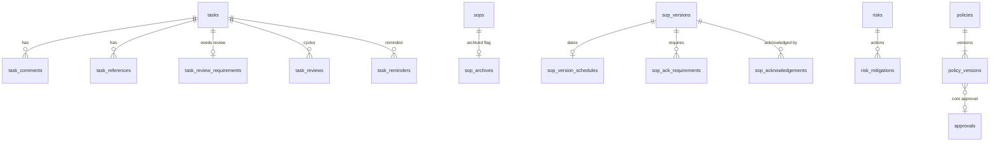

# Business Ops OS — operations work (OPS-060 … OPS-069)

Tasks, approvals, SOPs, operations registers, the company policies & compliance register and the operations dashboard. This part extends OPS-016/017/019/021–025 (see `requirements/REQUIREMENTS.md`). Status words follow D-013: **Tested** = an automated test passes (commands at the end); nothing is Deployed. Dates are Asia/Kolkata calendar days (`YYYY-MM-DD`); instants are UTC.

## 1. Requirements

| ID | Requirement | Status | Evidence |
|---|---|---|---|
| OPS-060 | Task comments: append-only; "delete" = hidden with a reason by the author or an operations manager; audited. Unified activity history (status, reassignment, edits, dependencies, comments, references, escalations, reviews, reminders) from the audit log | **Tested** | `ops.task_comments`; `server/tasks.ts`; `operations-tasks.test.ts` "task comments…", "activity history"; unit "comment hiding", "task activity lines" |
| OPS-061 | Document / evidence **references** on tasks (label + link or location; no file storage); soft removal with a reason | **Tested** | `ops.task_references`; "task document references" |
| OPS-062 | Supervisor review: a task flagged "review required" goes completed → awaiting review (side table; BR-OPS-10 statuses unchanged). Accept, or return (reopens with a note). Completer and owner never review | **Tested** | `ops.task_review_requirements`, `ops.task_reviews`; "supervisor review…" (2 tests); unit "supervisor review decision" |
| OPS-063 | Reminders before the due date and when overdue (`runTaskReminders`, setting `tasks.reminders` — proposed); department / person (owner, accountable, backup) filters, search, awaiting-review view, page-based pagination | **Tested** | `ops.task_reminders`; `POST /jobs/task-reminders`; "reminder job…", "views, filters and pagination"; unit "task reminders" |
| OPS-064 | SOP effective date and next review date per approved version; "published" derived; review-due flags; archive flag for retired SOPs; change history | **Tested** | `ops.sop_version_schedules`, `ops.sop_archives`; `operations-sops.test.ts` "SOP effective date…", "archive only after retirement" |
| OPS-065 | Required acknowledgements of an approved SOP version by a department or role; append-only, version-specific; outstanding report | **Tested** | `ops.sop_ack_requirements`, `ops.sop_acknowledgements`; "required acknowledgements" (2 tests) |
| OPS-066 | Policies & compliance register: company-entered policies/obligations, area, source reference, owner decision, linked setting keys (validated), effective / review dates, accountable person, draft → proposed → approved (not by the proposer) → retired, append-only versions | **Tested** | `ops.policies`, `ops.policy_versions`; `/ops/settings/policies`; `operations-registers.test.ts` "policies & compliance register" (3 tests) |
| OPS-067 | Risk mitigation actions (owner, due date, status, outcome); blocked-projects view | **Tested** | `ops.risk_mitigations`; `GET /projects/blocked`; "risk mitigations", "blocked projects" |
| OPS-068 | Incident resolution-target flags (setting `incidents.resolution_sla` — proposed); approvals inbox `/ops/operations/approvals` with a pluggable source registry | **Tested** | `server/approvals.ts`; `operations-approvals.test.ts` (4 tests); "incident resolution target flags" |
| OPS-069 | Operations dashboard `/ops/reports/operations` + panel on `/ops`; reports index `/ops/reports` | **Tested** (service) / **Implemented** (screens) | `server/reports/operations.ts`; "operations report"; unit "operations KPIs" |

Not built (Proposed): HR approval sources in the inbox (registration point ready, §6), routine task templates (OPS-018), vendor management (out of scope), a scheduler for the jobs (wave 3), a dedicated `ops:policies:approve` and `ops:sops:acknowledge` permission (requested, §8).

## 2. Data model (`packages/database/src/schema/ops-work.ts`)

All side tables; no column of `ops.ts` changed. FKs only into `ops` and `core`.

| Table | Key columns | Rules (CHECK / unique) |
|---|---|---|
| `task_comments` | task, author, body, created; hidden_at/by/reason | body non-blank; hidden fields all-or-none with a non-blank reason; body never updated (service) |
| `task_references` | task, kind (document/evidence/other), label, location, added_by; removed_at/by/reason | removal fields all-or-none; URL-looking locations must be http(s) (service) |
| `task_review_requirements` | task (PK), reviewer_staff (null = accountable or manager), note, required_by | one per task |
| `task_reviews` | task, cycle, status pending/accepted/returned, submitted_by/at, reviewer snapshot, decided_by/at, note | unique (task, cycle); one pending per task; decided ⇔ not pending; returned needs a note; decided_by ≠ submitted_by |
| `task_reminders` | task, kind due_soon/overdue, due_date, recipient_count | unique (task, kind, due_date) = idempotent job |
| `sop_version_schedules` | version (PK), effective_date, next_review_date, set_by | review ≥ effective |
| `sop_archives` | sop (PK), reason, archived_by/at | only for retired SOPs (service) |
| `sop_ack_requirements` | version, audience_type department/role, department / role, due_date, withdrawn_* | exactly one target; one active requirement per version and audience |
| `sop_acknowledgements` | version, user, staff, acknowledged_at, note | unique (version, user); append-only |
| `risk_mitigations` | risk, action, owner, due_date, status planned/in_progress/done/dropped, outcome, completed_at | done ⇒ completed_at; dropped ⇒ outcome |
| `policies` | code `POL-0001`, title, area (15 values), summary, accountable staff, owner_decision_ref `OD-xxx`, status, current/approved version, retired_* | code format; retired ⇔ retired fields; approved ⇒ approved version |
| `policy_versions` | policy, number, status draft/proposed/approved/rejected/superseded, requirement_text, source_reference, linked_setting_keys[], effective/review dates, change_note, approval, proposed_by/at, decided_by/at | unique (policy, number); review ≥ effective; non-draft ⇒ proposed_by; decided ⇒ decided_by; decided_by ≠ proposed_by |

## 3. State machines

- **Task review** (side table; the task keeps BR-OPS-10 statuses): `completed` + requirement → review `pending` ("awaiting review") → `accepted` | `returned` (task → `in_progress`, reason = the note) → next completion opens cycle n+1. While pending, the task cannot be reopened by its owner (409 `REVIEW_PENDING`).
- **SOP** statuses unchanged (draft / in_review / approved / retired). Brief mapping, all derived: Draft = draft; Review = in_review with pending approval; Approved = approved version in force; **Published** = approved AND `effective_date ≤ today IST`; Retired = retired; **Archived** = retired + `sop_archives` row. The imported online-coordinator SOP stays `draft` (OD-028) and cannot get dates or acknowledgement requirements (tested).
- **Policy entry**: draft → proposed (core approval requested) → approved (by someone other than the proposer) | rejected → draft; an approved entry keeps status `approved` while a newer version is drafted/proposed; approve supersedes the old version; retire from any non-proposed state; retired is read-only.
- **Mitigation**: planned → in_progress → done; planned/in_progress → dropped (outcome); done/dropped final.

## 4. API (all under `/ops/api/v1`, JSON; 401 → 403 → 400 → handler)

| Method & path | Permission | Notes |
|---|---|---|
| GET `/tasks?view&departmentId&staffId&role&q&page&pageSize` | tasks:read | views add `awaiting_review`; `meta {total,pageNumber,pageSize,pages}`; without page params all matches (≤1000) as before |
| GET/POST `/tasks/{id}/comments` | tasks:read / tasks:write | POST: owner/accountable/backup (own) or manager |
| POST `/tasks/{id}/comments/{commentId}/hide` | tasks:write | author or manager; reason required |
| POST `/tasks/{id}/references`, POST `/tasks/{id}/references/{referenceId}/remove` | tasks:write | |
| PUT / DELETE `/tasks/{id}/review-requirement` | tasks:write (all scope only) | reviewer ≠ owner, needs a login; DELETE refused while a review is pending |
| POST `/tasks/{id}/review` `{decision: accept\|return, note}` | tasks:write | domain rules §5.2 |
| GET `/tasks/{id}/activity` | tasks:read | own scope = participant |
| POST `/jobs/task-reminders` | jobs:run | static segment beside `jobs/[job]` |
| PUT `/sops/{id}/schedule` | sops:write | approved version in force only |
| POST `/sops/{id}/archive` | sops:write | retired only |
| GET/POST `/sops/{id}/acknowledgement-requirements`; POST `…/{requirementId}/withdraw` | sops:read / sops:write | names of outstanding people only for sops:write or dashboard:read |
| POST `/sops/{id}/acknowledge` | sops:read + audience member, not read-only role | 409 twice, 403 outside audience |
| GET `/sops/{id}/history`, GET `/sops/acknowledgements` | sops:read | |
| GET/POST `/risks/{id}/mitigations`; PATCH `/risks/{id}/mitigations/{mitigationId}` | risks:read / risks:write | |
| GET `/projects/blocked` | risks:read | |
| GET/POST `/settings/policies`; GET/PATCH `/settings/policies/{id}`; PUT `…/{id}/draft`; POST `…/{id}/workflow`; GET `…/{id}/history` | settings:read / settings:manage | approval gated by settings:manage + no self-approval (§8) |
| GET `/operations/approvals` | module:access | per-source items the user may decide |
| GET `/reports/operations` | dashboard:read | |

## 5. Algorithms (format: 1 Purpose · 2 Inputs · 3 Output · 4 Preconditions · 5 Rules · 6 Steps · 7 Edge cases · 8 Permissions · 9 Tests · 10 Limitations)

### 5.1 A-OPS-01 Comment hiding — OPS-060
1. Keep comments append-only while allowing mistakes to be withdrawn. 2. actor, author, manager flag, hidden flag, reason (`checkCommentHide`). 3. ok or `ALREADY_HIDDEN | NOT_ALLOWED | REASON_REQUIRED`. 4. Comment row locked. 5. Only author or all-scope task writer; reason required; once. 6. check → set hidden fields → audit `task.comment_hidden`. 7. Hidden body is withheld from own-scope readers; all-scope readers (manager, director, auditor) still see it. 8. tasks:write. 9. unit "comment hiding"; integration "only the author or a manager hides…". 10. No moderation workflow; text is never deleted.

### 5.2 A-OPS-02 Supervisor review — OPS-062
1. Second pair of eyes on selected completed tasks. 2. Review status, decision, note, decider, submitter, owner/reviewer/accountable logins, manager flag (`checkTaskReviewDecision`). 3. ok or `NOT_PENDING | SELF_REVIEW | OWNER_REVIEW | NOT_REVIEWER | NOTE_REQUIRED`. 4. Task and pending review locked. 5. Decider ≠ submitter; ≠ owner; = named reviewer, else accountable owner, or a manager; return needs a note. 6. completion with a requirement inserts cycle n+1 and notifies the reviewer(s); decision updates the review, a return reopens the task; both audited and the owner notified. 7. Owner cannot reopen while pending; requirement cannot be removed while pending. 8. Requirement: all-scope tasks:write; decision: tasks:write + rule. 9. unit table; integration 2 tests; inbox test. 10. One reviewer per cycle; no multi-step review.

### 5.3 A-OPS-03 Reminders and overdue handling — OPS-063
1. Tell owners before work falls due and when it is late. 2. Task status, due date, now, setting `tasks.reminders {leadDays: 1, notifyBackupWhenOverdue: true}` (proposed, OD-011), reminders already sent (`taskRemindersDue`). 3. `due_soon` / `overdue` kinds to send. 4. Open tasks with a due date. 5. due_soon when 0 ≤ days until due ≤ leadDays (IST); overdue when the due date has passed; each once per task + due date. 6. Job inserts a `task_reminders` row (unique) then notifies owner → else accountable → else operations managers, plus backup for overdue; audits `task.reminder_sent`. 7. Late UTC evening counts as the next IST day (tested); a changed due date is reminded again; tasks without due date are never reminded (they are flagged `missing_due`). 8. Route jobs:run; scheduler calls the function. 9. unit table (10 cases); integration "reminder job…". 10. No scheduler yet; escalations (A-09) remain the follow-up for long overdue work.

### 5.4 A-OPS-04 Activity history — OPS-060
1. One readable history per task. 2. Audit events `entityType = task` (`describeTaskActivity`). 3. `{kind, summary}` per event, newest first. 4. Every task change is audited in its transaction. 5. Reassignment = owner/accountable/backup change; other changed fields listed by label; unknown actions shown verbatim. 6. Load ≤ 300 events + staff names → map. 7. System jobs show "System job". 8. tasks:read with participant scope. 9. unit table; integration "activity history". 10. Comment text is not repeated in the activity line (it is in the comments panel).

### 5.5 A-OPS-05 SOP publication and review due — OPS-064
1. Say truthfully whether an SOP is in force. 2. status, approved version, schedule, archive flag, IST today; review window (`sopPublicationState`, `reviewDueFlag`, `sopScheduleProblems`). 3. publication state; review flag not_set/overdue/due_soon/ok. 4. —. 5. §3 mapping; dates only on the approved version in force of a live SOP; review ≥ effective; window = setting `registers.review_due.dueSoonDays` (30, proposed). 6. PUT schedule upserts and audits `sop.schedule_set`. 7. No effective date = "approved — not published"; a new draft keeps the approved version and its dates in force. 8. sops:write to set; sops:read to see. 9. unit tables; integration "SOP effective date…", coordinator test. 10. The register's legacy `next_review_date` is shown when no version date is set.

### 5.6 A-OPS-06 Required acknowledgements — OPS-065
1. Know who has read the procedure in force. 2. Requirements (department / role), audience members, acknowledgements (`inAckAudience`, `acknowledgementStatus`, `acknowledgeProblems`). 3. acknowledged / outstanding / no-login lists; may-acknowledge. 4. Approved version in force. 5. Department audience = active staff of the department; role audience = active users holding the role; a person counts once per version; staff without a login are reported separately, never counted as acknowledged; read-only (auditor-only) principals cannot acknowledge; once per version. 6. Requirement insert notifies the audience; acknowledgement insert audited `sop.acknowledged`. 7. A newly approved version needs new requirements and acknowledgements (version-specific). 8. sops:write to require/withdraw; sops:read + membership to acknowledge; names only for sops:write or dashboard:read. 9. unit tables; integration 2 tests. 10. Uses `ops:sops:read` for the acknowledgement write until `ops:sops:acknowledge` exists (§8).

### 5.7 A-OPS-07 Approvals inbox — OPS-068
1. One place for every decision waiting for me. 2. Actor, `APPROVAL_SOURCES` (each `{key, label, permission, list(db, actor)}`). 3. Per source: status ok/unavailable, count (null when unavailable), items with link, readiness and blockers; total (null when every source failed). 4. Session. 5. Sources the actor lacks permission for are omitted; each source applies its record rules (SOP: not requester, not SOP owner; reviews: assigned reviewer; fee arrangements: not requester; task reviews: A-OPS-02; policies: not proposer); the inbox drops any item requested by the actor as a second guard; the inbox decides nothing — links go to the record. 6. Run sources in order, catch failures. 7. An SOP waiting for its reviewer is shown "Not yet" with the reason (the approver may still reject). 8. module:access + per-source permission. 9. `operations-approvals.test.ts`. 10. HR sources not registered yet (registration point in `server/approvals.ts`).

### 5.8 A-OPS-08 Incident resolution targets — OPS-068
1. Flag incidents left open too long. 2. Status, severity, occurred/resolved instants, setting `incidents.resolution_sla {low 14, medium 7, high 2}` days (proposed, OD-011) (`incidentSla`). 3. state within/due_today/breached/resolved_within/resolved_late/unrated, target date, days open. 4. —. 5. Target = occurred date (IST) + N; compared on IST dates. 6. Computed on read. 7. Unknown severity → unrated. 8. incidents:read. 9. unit table; integration "incident resolution target flags". 10. Calendar days, not working hours (service hours are OD-011).

### 5.9 A-OPS-09 Blocked projects — OPS-067
1. Surface projects that cannot move. 2. Project status, milestones with dependencies, counts of blocked linked tasks and open linked issues/blockers (`projectBlockReasons`). 3. Reasons (empty = not blocked). 4. Live projects only (planned/active/on_hold). 5. on_hold; missed milestone; planned milestone depending on a missed or overdue planned milestone; blocked tasks; open blockers. 6. Load and evaluate. 7. Completed/cancelled projects are never listed. 8. risks:read. 9. unit table; integration "blocked projects". 10. —

### 5.10 A-OPS-10 Policies & compliance register — OPS-066
1. Let Elevate record its own policies and obligations with provenance and approval. 2. Entry, versions, settings catalogue (`nextPolicyStatus`, `policyProposalProblems`, `policyApprovalProblems`, `isSettingKey`). 3. New status / problems. 4. Entry row locked. 5. Text lives in versions; a draft is edited in place, anything else starts a new version; proposing needs requirement text and an accountable person; linked keys must be existing `SETTING_DEFINITIONS` keys; review ≥ effective; approval through core approvals policy `ops.policy.approve` (no self-approval) supersedes the previous approved version; retired entries are read-only. 6. As for SOPs (same pattern: request/decide/withdraw approval, audit each step). 7. Editing a proposed version → 409 (withdraw first). 8. settings:read / settings:manage (approval: §8). 9. integration 3 tests; unit tables. 10. **Seeded with nothing**; Elevate OS never supplies or checks policy text; nothing is legal advice.

### 5.11 A-OPS-11 Operations KPIs — OPS-069 (definitions §6)

## 6. KPI definitions (`domain/kpis.ts`, `server/reports/operations.ts`)

All are point-in-time as of the request (Asia/Kolkata "today"), read from Ops' own complete tables, visible to `ops:dashboard:read` (operations manager, director, auditor). Counts are `ok` and a real 0 is 0; rates with a 0 denominator are `missing` with a reason. No targets (OD-027); nothing is coloured good/bad; capacity tables are sorted by name and are not rankings. Tests: unit "operations KPIs: missing is not zero"; integration "operations report".

| KPI | Numerator | Denominator | Source | Missing-data behaviour |
|---|---|---|---|---|
| Open tasks | tasks with status not_started/in_progress/waiting/at_risk/blocked | — | `ops.tasks` | always ok |
| Overdue tasks | open tasks with due date < today | — | `ops.tasks` | tasks without due date excluded (flagged elsewhere) |
| Share of dated open tasks overdue | overdue open tasks | open tasks with a due date | `ops.tasks` | missing "No open task has a due date." |
| Tasks awaiting supervisor review | pending `task_reviews` | — | `ops.task_reviews` | always ok |
| Open tasks by department / by owner | open, overdue, blocked, due in 7 days per group | — | `ops.tasks` + names | "No department" / "No owner" rows last |
| SOP versions awaiting approval | pending core approvals of policy `ops.sop.approve` | — | `core.approvals` | always ok |
| Outstanding SOP acknowledgements | audience members with a login who have not acknowledged the version in force (once per person per SOP) | — | `ops.sop_ack_requirements`, `sop_acknowledgements`, staff, roles | staff without a login reported separately |
| SOP acknowledgement coverage | acknowledged | required (with a login) | same | missing "No SOP version currently requires acknowledgement." |
| Unresolved incidents | incidents open or in progress | — | `ops.incidents` | always ok |
| Incidents past resolution target | unresolved incidents in state `breached` (A-OPS-08) | — | `ops.incidents` + setting | setting is proposed (shown) |
| Blocked projects | live projects with ≥ 1 block reason (A-OPS-09) | — | projects, milestones, tasks, risks | always ok |
| Approvals waiting for you | inbox total (A-OPS-07) | — | approval sources | missing when every source failed; partial failures flagged |
| Deadlines in the next 7 days | open tasks, planned milestones, SOP/policy review dates, acknowledgement due dates with people outstanding, due today … today+7 | — | several | list, soonest first |
| Unresolved integration errors | `core.event_deliveries` with status failed/dead whose consumer is `ops.*` or whose event producer is `ops` | — | `core.event_deliveries`, `core.integration_events` (read-only) | always ok |

## 7. Proposed policies and open owner decisions

| Setting / rule | Default | State | Owner decision |
|---|---|---|---|
| `tasks.reminders` | 1 day before; backup told when overdue | proposed | OD-011 |
| `incidents.resolution_sla` | low 14 / medium 7 / high 2 calendar days | proposed | OD-011 |
| `registers.review_due` | 30 days "due soon" window | proposed | OD-027 |
| Who reviews a task when no reviewer is named | accountable owner or an operations manager | proposed (code rule, documented here) | OD-009 |
| Hidden comment text visible to all-scope readers (manager, director, auditor) | yes | proposed | — |
| Policy approval authority | holders of `ops:settings:manage` other than the proposer | proposed until `ops:policies:approve` exists | owner to decide who approves company policies |

## 8. Limitations and requests

- **Permission requests** (`packages/authorization/src/permissions/ops.ts`, not edited): `ops:policies:approve` for director and hr_manager (approval is gated by `ops:settings:manage` + no self-approval meanwhile, so today only operations managers approve and a second operations manager is needed); `ops:sops:acknowledge` for every staff role (acknowledging uses `ops:sops:read` + audience membership + "not read-only" meanwhile).
- HR approval sources are not in the inbox until registered in `APPROVAL_SOURCES`.
- Approvals inbox and reports index need NAV entries in `src/ui/frame.tsx` (orchestrator).
- The reports index lists the HR report as "not available yet" until `src/app/reports/hr/page.tsx` exists (flip `available`).
- The task-reminder job route is a static `jobs/task-reminders` route; `jobs/[job]` and its `jobParams` are unchanged.
- No seed data was added for this area: nothing goes into the policy register (owner rule) and no sample SOP is approved.
- Policies and SOPs share the approval pattern (core approvals per version) but keep separate services; SOP approval has extra reviewer rules.
