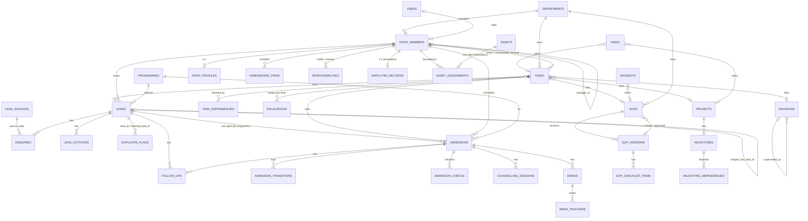

# Business Operations OS — baseline audit (19 Oct 2026)

> **Superseded.** The HR and Operations features this audit measured were removed by the owner on 20 Oct 2026 (D-032; recoverable from commit `63da4e4`). The current audit is `apps/business-ops-os/docs/BUSINESS_OPERATIONS_AUDIT.md`.

Status words follow D-013: Proposed, Approved, Implemented, Tested, Deployed. **Nothing is Deployed.** Everything below describes the repository at the end of the foundation commit `6ae40ad` ("Business Ops HR foundation: roles, permissions, schema split (D-028, D-029)"), on top of the wave 2 baseline `78c6d15`. Line references are to `6ae40ad` unless stated. Where the docs and the code disagree, the code is treated as the truth and the doc is named as stale.

The measuring stick is the owner's Business Operations brief (HR, staff attendance, admissions, tasks/approvals, SOPs, departments, assets/incidents/risks/projects, dashboards, compensation records only, security matrix).

---

## 1. Scope and method

### 1.1 What was read
- Root docs: `AGENTS.md`, `README.md`, `ARCHITECTURE.md`, `INTEGRATION_CONTRACT.md`, `DATABASE_DESIGN.md`, `IMPLEMENTATION_STATUS.md`.
- `docs/`: `EXISTING_PROJECT_AUDIT.md` (§9, OD-001 to OD-028), `PRODUCT_REQUIREMENTS.md` (§4 Business Ops), `SECURITY_AND_PERMISSIONS.md`, `DECISIONS.md` (D-001 to D-029), `BUILD_PLAN.md`, `DATABASE_MIGRATION_PLAN.md`.
- `apps/business-ops-os/`: `README.md`, `requirements/REQUIREMENTS.md`, `docs/{ALGORITHMS,API,ARCHITECTURE,DOMAIN_MODEL,INTEGRATION_REQUESTS,KPI_DEFINITIONS,TEST_PLAN}.md` (the first four skimmed, the last three read), all of `src/domain`, `src/server`, `src/ui`, the page and route trees, `seed/`, `tests/`.
- Schema: `packages/database/src/schema/{ops,ops-hr,ops-columns,ops-lifecycle,ops-time,ops-work,core,index}.ts` and `academic.ts` (students, enrolments, enrolment_intake_log, attendance).
- `packages/authorization/src/permissions/{ops,platform}.ts`, `roles.ts`; `packages/shared-types/src/roles.ts`; `packages/shared-contracts/src/modules/{ops,academic}.ts` and `events/enrolment.ts`; `packages/server-kit`, `shared-ui`, `notifications` export lists.
- `apps/academic-os/src/server/services/intake.ts` and `src/domain/intake.ts` (enrolment intake).
- The not-working register `C:\OPENBOT\Elevate-Not-Working\items\ops.json` (49 items).
- `git diff --stat 78c6d15 6ae40ad`: 15 files, +828/-19. The baseline tree was extracted with `git archive 6ae40ad` into a scratch folder outside the repo; no git state was changed and no file other than this one was written in the repo.

### 1.2 Commands run and real output
| Command | Real output |
|---|---|
| `git status --short` (working tree, before the test run) | empty (clean) |
| `npx vitest run apps/business-ops-os` | `Test Files  16 passed (16)` / `Tests  174 passed (174)` / `Duration  13.54s` |
| `npx vitest run packages/authorization packages/database` | `Test Files  2 passed (2)` / `Tests  17 passed (17)` |
| `npm run docs:permissions -- --check` | `docs:permissions — docs/SECURITY_AND_PERMISSIONS.md is out of date; run npm run docs:permissions` |
| `ls packages/database/migrations` | `No such file or directory` (no migration exists) |
| `find apps -name loading.tsx` | 8 files, all in `apps/academic-os/src/app/*/` (assessments, batches, curriculum, intake, progress, students, teaching, timetable); none in Ops |
| `find apps/business-ops-os/src/app/api -name route.ts` | 61 route files (the Ops docs say "71 API handlers", which counts exported handlers, not files) |

Known from the owner's brief and not re-run: baseline `npm run validate` = 58 test files / 506 tests passed, secret scan OK (659 files), exit 0, on 19 Oct 2026. Not run, by instruction: `db:*`, dev servers, `next build`, typecheck, lint. Because those were not run, "no type errors" and "builds" are **not verified** in this audit.

### 1.3 Limits
- Five other agents are editing the working tree; this audit describes `6ae40ad`. The test runs above were on a clean tree, so they describe the foundation commit.
- Nothing was exercised in a browser. "Screen works" means the page file, its permission gate and its tests were read, not that it was seen rendering.

---

## 2. Existing functionality that works

Evidence is `Implemented` unless a passing automated test is named (then `Tested` under D-013). All 16 Ops test files pass (174 tests): integration `admissions`, `dashboard`, `leads`, `organisation-planning`, `routes`, `seeds`, `sops`, `tasks`; unit `admission-followups`, `contacts`, `domain`, `kpis`, `legacy`, `pipeline`, `sops-staff-policies`, `tasks-escalation`.

| Slice | What works | Where | Evidence |
|---|---|---|---|
| Leads and enquiries | Lead capture with normalised Indian numbers (`+91…`) and lower-cased emails, enquiries with their own source, configurable source list (12 seeded), owner assignment and handoff acceptance, contact attempts (only a two-way contact counts as first contact), history. | `/ops/leads`, `/ops/leads/[id]`; `server/leads.ts`; API `/ops/api/v1/leads/**`, `lead-sources` | `tests/integration/leads.test.ts` (10), `tests/unit/contacts.test.ts` (24) |
| Duplicate handling | Exact/possible duplicate flags, warn-and-acknowledge on create, explicit audited merge, dismissal, merge-review queue. Never merges automatically. | `leads.ts:252` (`checkDuplicates`), `:1020` (`mergeLeads`), `:1145`, `:1182`; `/ops/leads` queue | `leads.test.ts`, `contacts.test.ts` |
| Admission pipeline | 12 statuses, a legal-transition table (`TRANSITIONS`, `domain/pipeline.ts:97`), reasons required on the right edges, on-hold resume to held status, reopen of a lost case, first-attainment times from `admission_transitions`. Demo skip is an explicit reasoned edge controlled by a proposed setting. | `/ops/admissions`, `/ops/admissions/[id]`; `server/pipeline.ts`, `admissions.ts`; API `/admissions/[id]/transitions` | `tests/unit/pipeline.test.ts` (13), `admissions.test.ts` (8) |
| Admission confirmation gate | Two fee verifications by different people, an authorised approval through core approvals (`ops.admission.fee_arrangement`, no self-approval), documents verified, down payment verified; a demo fee alone never makes an admission. Status and reference only, no amounts or files. | `domain/admission-readiness.ts`; `admissions.ts:516` (`feeApprovalAction`); `approval-policies.ts` | `admission-followups.test.ts` (19), `admissions.test.ts` |
| Counselling and demos | Counselling appointments; demo classes with subjects, day dates, teachers booked and notified, fee status enum, terms copied from settings with their decision state. Demo terms seed: 2 days, separate from main batch, not refundable if not joining, adjusted against fees on joining (state `approved`, from legacy D-003/D-004); amount ₹1,000 as `pending_verification` under OD-013; limits `open` (OD-012), not enforced. | `/ops/schedule`; `server/schedule.ts:50, :252` (`bookDemo`), `:231` (`validateDemoPlan`); `domain/policies.ts:111-150` | `admissions.test.ts`, `sops-staff-policies.test.ts` |
| Follow-ups | Due rules, IST calendar days, closed weekdays, overdue flags, daily reminders through `notify`. | `server/follow-ups.ts`; job `POST /ops/api/v1/jobs/follow-up-reminders` | `admission-followups.test.ts`, `dashboard.test.ts` |
| Enrolment handoff (Ops side) | `requestEnrolment` moves `admitted` to `enrolment_requested` and publishes `ops.admission.enrolment_requested` v1 in the same transaction (key `admission:<id>:attempt:<n>`); double submit gives one event; consumer `ops.enrolment-replies` applies `academic.enrolment.confirmed` (to `enrolled`, stores `enrolmentId`, `studentId`) and `.rejected` (back to `admitted` with reason code); stale or repeated replies are ignored and audited. | `server/enrolment.ts:114, :210, :250, :288`; API `/admissions/[id]/enrolment-request`, `/jobs/enrolment-replies` | `admissions.test.ts` (hand-published reply events) |
| Tasks and escalation | Owner, accountable owner and backup, BR-OPS-10 statuses, dependencies with cycle detection (`domain/graph.ts`), completion needs evidence and no open blockers unless overridden with a reason, escalation L2 to L4 along reporting lines with configurable thresholds, escalation acknowledge/resolve, "my work". | `/ops/tasks`, `/ops/tasks/[id]`; `server/tasks.ts`, `escalations.ts`; `tasks_completed_needs_evidence` CHECK | `tasks.test.ts` (7), `tasks-escalation.test.ts` (16) |
| Staff directory and departments | Directory of `core.staff_members` and `core.departments` (13 provisional), create/update staff and departments, reporting-line loop check (`checkReportingLine`, `domain/staff.ts:16`), employment type and role labels, responsibilities with holder/backup and a gap report, per-person onboarding checklist with document references only. | `/ops/staff`, `/ops/staff/[id]`; `server/organisation.ts:37, :112, :152, :201, :281, :393` | `organisation-planning.test.ts` (9), `sops-staff-policies.test.ts` |
| SOPs | Register with code, owner, reviewer, backup, department; draft/in_review/approved/retired; immutable versions with content hash; checklist items; approval of a specific version through core approvals; owner cannot approve own SOP; reviewer must recommend first; 51 legacy SOPs imported, none approved, coordinator SOP as draft (OD-028). | `/ops/sops`, `/ops/sops/[id]`; `server/sops.ts` | `sops.test.ts` (5), `legacy.test.ts` (7) |
| Registers | Incidents/exceptions, decision log (24 legacy decisions with original states), risks/issues/blockers, projects and milestones with dependencies, 25-row work inventory. | `/ops/incidents`, `/decisions`, `/risks`, `/projects`; `server/incidents.ts`, `planning.ts` | `organisation-planning.test.ts`, `legacy.test.ts` |
| Settings (policy register) | Values carry a decision state; edits stay `proposed`; approved/locked values are read-only. Keys: `demo.terms`, `demo.fee`, `demo.limits`, `pipeline.demo_skip`, `admission.confirmation`, `followups.due_rules`, `tasks.escalation`, `kpi.conversion`, `office.online_hours`. | `/ops/settings`; `domain/policies.ts` | `sops-staff-policies.test.ts` |
| Dashboard | Six KPIs (new leads, cohort lead-to-admission conversion, counselling/demo follow-up compliance, task completion rate, overdue work, unresolved blockers), workload per staff member sorted by name (never ranked), Academic and Marketing panels via `fetchInternal` that show "source unavailable" instead of zeros. Denominator 0 is `missing`, never 0 %. | `/ops` (dashboard or "My work"); `server/dashboard.ts:125, :178`; `docs/KPI_DEFINITIONS.md` | `kpis.test.ts` (14), `dashboard.test.ts` (7) |
| Cross-cutting | Server-side permission checks in pages, routes and services; same-transaction audit; Asia/Kolkata dates; fictional seeds; optional `Idempotency-Key` on lead create and enrolment request; CRM adapter interface with a `not_configured` mock. | `server/context.ts`, `ui/frame.tsx`, `server/adapters/crm.ts` | `routes.test.ts` (401/403), `seeds.test.ts` |

Foundation commit `6ae40ad` additionally delivered (all **Implemented, not Tested, no screen or route uses them yet**): 6 new role keys; 33 new `ops:*` permissions (58 `ops:` keys in total); `server/hr-scope.ts` (HR record scope, `assertNotSelf`); `server/hr/employee-core.ts` (`insertEmployee`); 3 new tables (`employee_records`, `assets`, `asset_assignments`); 8 new business-code formats in `domain/registers.ts`. `hr-scope.ts` has no test in the 16 passing files; `insertEmployee` has no caller.

---

## 3. Existing functionality that is incomplete

| # | Gap | Evidence (file:line at `6ae40ad`) |
|---|---|---|
| 3.1 | **Sensitive permissions are declared but enforced nowhere.** `ops:student_private:read`, `ops:employee_private:*`, `ops:employee_documents:*`, `ops:compensation:*` appear only in `permissions/ops.ts`. Lead and guardian phones/emails are returned to anyone with `ops:leads:read` (director, auditor, operations manager, counsellor `own`), so D-028's promise that the auditor "does not see student contact data" is not true for lead data. | grep of `apps/business-ops-os/src` finds no use of those keys; `server/leads.ts:553` (`getLead`) returns the whole lead row; `permissions/ops.ts:212` (`reads` keeps `ops:leads:read`) |
| 3.2 | **Two ways to create staff, only one makes an employee record.** `createStaff` writes `staff_members` and `staff_profiles` only; `insertEmployee` (the D-028 path that also creates `employee_records` with `EMP-####`) has no caller, so staff created in the UI have no employee record. | `organisation.ts:112`; `hr/employee-core.ts:153`; `server/index.ts` does not export it |
| 3.3 | **No organisation history.** Manager, department or title changes overwrite `core.staff_members`; the only trace is the audit event. No effective-dated assignment table exists. | `organisation.ts:152` (`updateStaff`) |
| 3.4 | **Deactivating or separating staff does not remove access.** `updateStaff` can set `status: 'inactive'` but never touches `core.users.status`, `core.sessions` or `core.user_roles`. No grep hit for revoke/disable in Ops. | `organisation.ts:152-200` |
| 3.5 | **Stale scope comments contradict D-028.** Schema, domain and docs still say no leave/HR records. | `ops.ts:868` ("No payroll, biometrics, leave or HR records (D-015, OD-026)"), `domain/staff.ts:6`, `README.md` slice 3, `requirements/REQUIREMENTS.md` OPS-014, `PRODUCT_REQUIREMENTS.md:56, :323`, `DECISIONS.md` D-015 text (D-028 narrows it but D-015 is not marked as amended) |
| 3.6 | **Navigation has no HR entries and no module-switcher entry for several roles.** `NAV` lists 12 Ops items; none for employees, attendance, leave, recruitment. Teacher still lacks `ops:module:access` (IR-OPS-01); `employee`, `recruiter`, `hr_*` profiles do have it. | `ui/frame.tsx:20-46`; `permissions/ops.ts:246` |
| 3.7 | **`department_manager` scope is role-name based.** `hrScope` widens `own` to the reporting chain only if `actor.roles.includes('department_manager')`; any other role with an `own` HR grant sees only itself. A user without a staff record sees nothing (intended, but silent). | `server/hr-scope.ts:58` |
| 3.8 | **No fee records.** Admissions store check status and an approval, and demos store a fee status plus an optional amount/reference; there is no table for amounts due/received, instalments, receipts or refunds. Permissions `ops:fees:read/record` and code format `FEE-######` exist with nothing behind them. | `ops.ts:656-700` (demos); `ops.ts:533` (`admission_checks`); `domain/registers.ts` `feeRecord` |
| 3.9 | **No student administration and no application/decision entities.** `ops:students:read` exists, but no screen or query. "Application" and "admission decision" are only the `admission_pending` and `admitted` statuses; there is no application form record, decision record with reason, or consent record. | `permissions/ops.ts` (`students:read`); `domain/pipeline.ts:6-19` |
| 3.10 | **Student identity data is thin.** `ops.leads` has no date of birth, no consent field, no documents. Academic rejects a minor without guardian contact and falls back to the school stage to guess minority; Ops never sends a DOB. | `ops.ts:253-290` (columns); `academic-os/src/domain/intake.ts:67-69, :104`; `enrolment.ts:63-90` (payload) |
| 3.11 | **Ops admission page does not show the Academic student/enrolment ids** after `enrolled`, though they are stored. | `grep studentId` finds only `enrolment.ts:235-236` among Ops sources |
| 3.12 | **SOP review dates are captured but never flagged**; no acknowledgement records. | `server/sops.ts:223`, `app/sops/[id]/page.tsx:90`; `ops-work.ts` is an empty placeholder (`export {}`) |
| 3.13 | **Approvals exist for two policies only** (fee arrangement, SOP version). No Ops "approvals inbox" screen; fee exceptions (refund, waiver) are flagged, not routed (OPS-023-ROUTE, OD-013). Escalations apply to tasks only. | `server/approval-policies.ts`; register item `OPS-023-ROUTE` |
| 3.14 | **Tasks have no comments/activity, no recurring templates, no onboarding auto-tasks.** | `ops-work.ts` placeholder; OPS-013, OPS-018 Proposed |
| 3.15 | **Only six of the PRD's K-xx KPIs exist**; no HR, admissions-funnel (K-04 to K-09), or operations KPIs beyond those six; no target bands (OD-027). `ops:dashboard:read` is not held by any HR role. | `docs/KPI_DEFINITIONS.md` "Not built"; `permissions/ops.ts` |
| 3.16 | **No scheduler** for `runFollowUpReminders`, `runTaskEscalations`, `processEnrolmentReplies` (IR-OPS-02); they run by hand from `/ops/tasks` or the jobs route. | `docs/INTEGRATION_REQUESTS.md` |
| 3.17 | **Lead data protection (OPS-028) unbuilt:** no audited export, no retention. Admission checklist records references only; no document storage (OD-014). | register `OPS-028`; `REQUIREMENTS.md` |
| 3.18 | **Foundation tables are empty shells** (`ops-lifecycle.ts`, `ops-time.ts`, `ops-work.ts` are `export {}`). Employee records have no private-field, document, compensation or history tables yet; the schema comment in `ops-hr.ts` says such tables belong there. | `ops-lifecycle.ts:11`, `ops-time.ts:11`, `ops-work.ts:11` |
| 3.19 | **`EMP-####` is hard-coded** as a 4-digit CHECK, so the employee ID format is a schema decision, not configuration (see OD-039). | `ops-hr.ts` `employee_records_code_format` |
| 3.20 | **Core seed does not seed the six new roles**: the seed gives one fictional user per original role (9 users); no `hr_manager`, `employee` etc. user exists for development or tests. (From D-026 text; seed files themselves not re-read.) Not verified beyond that. | `docs/DECISIONS.md` D-006a, D-026 |

---

## 4. Existing database entities and relationships

Conventions: UUID primary keys, human codes in separate unique columns, all `ops.table(...)`, FKs only into `ops` or `core`; references to Academic ids are plain UUID columns with no FK (D-005). Rows that history depends on are never deleted (`ON DELETE RESTRICT`). The `ops` Postgres schema is split across `ops.ts` (29 tables, wave 2) and `ops-hr.ts` (3 tables, foundation). `ops-lifecycle.ts`, `ops-time.ts` and `ops-work.ts` define no tables yet. **No migration exists**; tests build the schema through `createTestDb()` (D-025). All three docs that describe the schema are partly stale (see 8.4).

### 4.1 Core tables Ops stewards or uses (`core.ts`)
| Table | Key columns | Constraints and vocabularies |
|---|---|---|
| `core.users` | `id`, `email` (lower-case), `display_name`, `password_hash`, `status` | unique `users_email_key`; status `active`/`disabled` |
| `core.user_roles` | PK (`user_id`, `role`), `granted_by` | role validated against `ROLE_KEYS` in code, 15 keys at `6ae40ad` |
| `core.sessions` | `user_id` (cascade), `token_hash`, `expires_at`, `revoked_at` | unique `token_hash` |
| `core.departments` (Ops stewards) | `code` (`^[A-Z][A-Z0-9_]{1,39}$`), `name`, `status` | unique code; `active`/`provisional`/`archived`; **no head/manager column** |
| `core.staff_members` (Ops stewards) | `user_id` (nullable, set null), `full_name`, `department_id` (restrict), `title`, `manager_id` (self FK, set null), `status` | unique partial `user_id` where not null; `active`/`on_leave`/`inactive`; CHECK not own manager |
| `core.programmes` (Academic stewards) | `code`, `name`, `status` | `active`/`planned`/`paused`/`retired` |
| `core.approvals` | `subject_module/type/id`, `policy`, `status`, `requested_by`, `decided_by` | unique pending per subject+policy; `pending`/`approved`/`rejected`/`withdrawn`; decision-consistency CHECK |
| `core.audit_events` | `actor_user_id`, `module`, `action`, `entity_type/id`, `before`, `after`, `request_id` | append-only by convention; module in platform/marketing/academic/ops |
| `core.integration_events`, `core.event_deliveries` | outbox: `type`, `version`, `producer`, `idempotency_key`, `payload`; deliveries per (`event_id`, `consumer`) | unique (`producer`, `idempotency_key`); delivery `processed`/`failed`/`dead` |
| `core.notifications`, `core.idempotency_keys` | in-app notifications (relative `link`); per-user HTTP idempotency | |

### 4.2 `ops` tables (wave 2 baseline unless marked)
| Table | Key columns | FKs | Unique / notable constraints | State vocabulary |
|---|---|---|---|---|
| `settings` | `key`, `value` jsonb, `decision_state`, `source`, `owner_decision` | `updated_by`→users | unique `key` | proposed, approved, locked, open, pending_verification, superseded |
| `lead_sources` | `code`, `label`, `sort_order` | — | unique `code` (referenced by enquiries) | active, retired |
| `leads` | `code` `LEAD-######`, `student_name`, student/guardian phone+email, `current_stage`, `school_board`, `city`, `programme_id`, `interest_mode`, `first_received_at`, `owner_staff_id`, `accepted_at`, `first_successful_contact_at`, `merged_into_lead_id` | programmes, staff, users, self | unique `code`; CHECK at least one contact, E.164 phones, lower-case emails; indexes on phones/emails | stage: class_9…graduate/other; relationship: mother/father/guardian/other |
| `enquiries` | `received_at`, `source_code`, `channel`, `campaign_ref`, `content_ref`, `programme_id`, `merged_from_lead_id` | leads, lead_sources.code, programmes | | interest: offline/online/undecided |
| `lead_activities` | `kind`, `outcome`, `occurred_at`, `note` | leads | | kinds call/whatsapp/sms/email/visit/note; outcomes include connected_two_way |
| `duplicate_flags` | `lead_id`, `matched_lead_id`, `level`, `signals[]`, `acknowledgement`, `reviewed_*` | leads ×2, users | unique pair | exact/possible; open/dismissed/merged |
| `admissions` | `code` `ADM-######`, `lead_id`, `programme_id`, `status`, `held_from_status`, `counsellor_staff_id`, `delivery_mode`, `intended_start_date`, `intended_course_id`, `intended_batch_id` (Academic refs, no FK), `demo_skipped`, `enrolment_attempt`, `handoff_status`, `last_request_event_id`, `enrolment_id`, `student_id` (Academic ids, no FK), `enrolled_at`, `rejection_code/reason` | leads, programmes, staff, integration_events | unique `code`; **unique partial (lead, programme) where status not in enrolled/lost**; CHECK `enrolled` requires `enrolment_id` and `student_id`; held-from consistency | 12 statuses; handoff not_requested/pending/enrolled/rejected |
| `admission_transitions` | `from_status`, `to_status`, `reason`, `actor_type`, `event_id`, `at` | admissions, users, integration_events | | |
| `admission_checks` | `item_key`, `status`, `reference`, `recorded_by` | admissions | unique (admission, item) (as built) | 10 items; done/not_done/not_applicable |
| `follow_ups` | `kind`, `title`, `due_date`, `owner_staff_id`, `status`, `outcome`, `source` | leads, admissions, staff, users | done requires `completed_at` | first_contact, counselling_followup, demo_followup, general; open/done/cancelled; manual/rule |
| `counselling_sessions` | `scheduled_at`, `counsellor_staff_id`, `mode`, `attendees`, `recommended_programme_id`, `objections`, `outcome`, `next_step` | admissions, leads, staff, programmes | | scheduled/completed/no_show/cancelled |
| `demos` | `subjects[]`, `day_dates[]`, `status`, `fee_status`, `fee_amount_inr` numeric, `fee_terms_state`, `fee_reference` | admissions, leads | CHECK ≥1 subject and ≥1 day | scheduled/attended/missed/cancelled; not_paid, paid_verified, adjusted_against_fees, retained_non_refundable |
| `demo_teachers` | PK (`demo_id`, `staff_id`), `notified_at` | demos (cascade), staff | | |
| `tasks` | `code` `TSK-#####`/`LEGACY-…`, `title`, `department_id`, `owner/accountable/backup_staff_id`, `due_date`, `priority`, `status`, `blocked_since`, `escalation_level`, `completion_note`, `evidence_link`, links to lead/admission/sop/decision/project | departments, staff, leads, admissions, sops, decisions, projects, users | unique `code`; completed needs evidence; escalation level 1–4 | 7 statuses; low/medium/high/critical |
| `task_dependencies` | PK (`task_id`, `blocked_by_task_id`) | tasks ×2 | cycles rejected in `domain/graph.ts` | |
| `escalations` | `task_id`, `level`, `trigger`, `reason`, `status`, `raised/acknowledged/resolved_*` | tasks, users | unique (task, level) | open/acknowledged/resolved; overdue/blocked/manual |
| `staff_profiles` | PK `staff_id` (cascade), `employment_type`, `role_labels[]`, `notes` | staff, users | | full_time, part_time, contract, visiting, not_recorded |
| `responsibilities` | `code` `RESP-####`, `accountable_role`, `holder_staff_id`, `backup_staff_id`, `critical` | departments, staff | unique `code` | active/retired |
| `onboarding_items` | `staff_id`, `seq`, `title`, `document_ref`, `status` | staff (cascade), users | unique (staff, title) | pending/done/not_applicable |
| `sops` | `code`, `title`, `process`, `department_id`, `owner/reviewer/backup_staff_id`, `risk_level`, `status`, `current_version_id`, `approved_version_id`, `next_review_date`, legacy refs | departments, staff, sop_versions ×2, users | unique `code` | not_drafted, draft, in_review, approved, retired |
| `sop_versions` | `version_number`, `version_label`, `content`, `content_hash`, `approval_id`, `reviewed_*`, `review_outcome`, `approved_*` | sops, approvals, users | unique (sop, number) | draft/in_review/approved/rejected/superseded |
| `sop_checklist_items` | `seq`, text | sop_versions (cascade) | unique (version, seq) | |
| `incidents` | `code` `INC-#####`, `kind`, `category`, `severity`, `status`, `department_id`, `sop_id`, `resolution` | departments, sops | unique `code` | exception/incident; open/in_progress/resolved/closed |
| `decisions` | `code`, `area`, `statement`, `state`, `source`, `owner_decision_ref`, `superseded_by_id`, legacy refs | self, users | unique `code` | open, proposed, confirmed, provisional, superseded |
| `risks` | `code`, `kind`, `likelihood`, `impact`, `mitigation`, `status`, `task_id`, `project_id` | tasks, projects | unique `code` | risk/issue/blocker; open, mitigating, resolved, closed, accepted |
| `projects` / `milestones` / `milestone_dependencies` | `code` `PRJ-####`; milestone `title`, `status`; dependency edge | projects, milestones | unique `code` | planned, active, on_hold, completed, cancelled; planned, done, missed, cancelled |
| `work_items` | `code`, `function`, `process`, `scope`, `proposed_role`, `status`, legacy refs | — | unique `code` | legacy inventory (25 rows) |
| `employee_records` (**foundation**) | PK `staff_id`, `employee_code` `EMP-####`, `legal_name`, `work_email`, `work_phone`, `work_location`, `timezone`, `employment_status`, `employment_start_date`, `employment_end_date` | staff (restrict), users | unique `employee_code`; unique partial `work_email`; end ≥ start | onboarding, active, on_notice, separated |
| `assets` (**foundation**) | `code` `AST-#####`, `name`, `category`, `serial_number`, `status` | — | unique `code`; unique partial `serial_number` | available, assigned, in_repair, retired, lost |
| `asset_assignments` (**foundation**) | `asset_id`, `staff_id`, `assigned_on`, `returned_at`, `condition_on_return` | assets, staff (restrict), users | unique partial one open assignment per asset | |

Not present at `6ae40ad` (needed by the brief): candidates, requisitions, applications, interviews, offers, onboarding/offboarding cases, employee private fields, employee documents, compensation records, organisation history, shifts, work calendars, holidays, attendance sessions and corrections, leave types/balances/requests, timesheets, SOP acknowledgements, task comments, fee records, student administration records, application/decision records.

### 4.3 ER diagram — `ops` schema as of the wave 2 baseline (plus the three foundation tables, marked)

`ops.settings` has no FK relationships (other than `updated_by`) and is omitted. `ADMISSIONS.student_id`, `enrolment_id`, `intended_course_id` and `intended_batch_id` point into `academic` with no FK by design.

---

## 5. Reusable components

### 5.1 Server-kit (`@elevate/server-kit`)
- `defineRoute({ permission, params, body, idempotency })` — JSON routes with auth, permission, zod validation, D-012 error envelope and optional `Idempotency-Key` (`withIdempotency`).
- `withTransaction`, `recordAudit` (same-transaction audit), `requestApproval` / `decideApproval` / `withdrawApproval` / `findPendingApproval` / `listApprovalHistory` with `defineApprovalPolicy` (no self-approval, comment on reject), `publishEvent` / `processEvents` / `getDelivery` (outbox and idempotent consumers), `defineInternalRoute` / `fetchInternal` (summaries; never throws, returns `unavailable`), `requirePageAccess`, `requireUser`, `currentRequestId`, `createHealthHandler`, `toAppPath`.
- `@elevate/notifications`: `notify` (in-app, same transaction), `listNotifications`, `countUnread`, `markNotificationsRead`; email is a mock adapter (`getEmailAdapter`, `ConnectionStatus`).

### 5.2 Shared UI (`@elevate/shared-ui`)
`AppShell`, `PageHeader`, `Card`, `DataTable`, `StatTile` + `formatMetricValue` (missing and estimated metrics), `StatusBadge`, `FeatureStatusBadge`, `Button`, `ButtonLink`, `Field`, `TextInput`, `Select`, `TextArea`, `Checkbox`, `Alert`, `EmptyState`, `ErrorState`, `LoadingState`, `LoginForm`, `Wordmark`.

### 5.3 Ops UI helpers (`apps/business-ops-os/src/ui`)
- `Frame` + `gate(permission, returnTo)` (`frame.tsx`): server-side `requirePageAccess` before any Suspense so signed-out visitors get a real 307 (D-022); filters `NAV` by permission.
- `Section` (Suspense with `LoadingState`) and `load(fn)` (returns data or a rendered `ErrorState` with request id). This is how loading states are shown without `loading.tsx`.
- `ActionForm` (`action-form.tsx`): generic JSON form (text, textarea, select, date, datetime, number, checkbox, list, json, hidden), posts to `/ops/api/v1`, shows field errors, refreshes or redirects. Every new HR screen can reuse it.
- `lead-create-form.tsx` (duplicate-warning pattern), `cross-module.tsx` (panels with "source unavailable"), `format.ts`.

### 5.4 Domain functions (pure, `src/domain`)
`checkReportingLine` (loop check), `ancestorChain` and cycle detection (`graph.ts`), `responsibilityGaps`, `workloadPerStaff` (sorted by name, never ranked), `DEFAULT_ONBOARDING_ITEMS`, `TRANSITIONS` / `findTransition` / `allowedUserTargets` (pipeline), `evaluateAdmissionReadiness`, contact normalisation and similarity (`contacts.ts`), IST date helpers (`dates.ts`), follow-up due rules, escalation levels, KPI calculators returning `Metric` (`ok|estimated|missing`), SOP rules (`sops.ts`), `CODE_FORMATS` / `formatCode` (now includes EMP, AST, REQ, CAND, HRC, LVR, ATC, FEE), the settings schema registry (`policies.ts`).

### 5.5 Server helpers
`accessScope` / `scopeCovers` / `assertScope` (record-level `own`), `nextCode` (advisory-locked, never reused), `activeStaff`, `programmeByCode`, `userIdsForStaff`, `userIdsWithRole`; **new** `hrScope` / `hrCovers` / `assertHrScope` / `hrScopeIds` / `assertNotSelf` / `reportsOf` (`hr-scope.ts`); **new** `insertEmployee` / `normaliseWorkEmail` (`hr/employee-core.ts`); `loadSettings` / `updateSetting`; `buildDashboard`; `createTestDb()` and `tests/integration/fixtures.ts` for tests.

---

## 6. Missing interfaces and screens, mapped to the brief

| # | Domain | Status | Notes |
|---|---|---|---|
| 1a | HR: employee directory | Partial | `/ops/staff` lists `core.staff_members` with employment type and role labels; no employee code, status, work location or filters; `employee_records` table exists with no service or screen. |
| 1b | HR: organisation structure | Partial | 13 provisional departments and manager chain exist; no org chart, no department head, no positions; no effective-dated history (3.3). |
| 1c | HR: employment history | Missing | Audit events only. |
| 1d | HR: recruitment | Missing | Permissions only (`ops:recruitment:*`); `ops-lifecycle.ts` empty. |
| 1e | HR: onboarding | Partial | Per-person checklist with document references (`onboarding_items`, `startOnboarding`); no case record, no approval, no auto-generated tasks (OPS-013). |
| 1f | HR: offboarding | Missing | No case, checklist, asset-return check or access revocation (3.4). |
| 1g | HR: employee documents | Missing | Permission only; no metadata table, no storage adapter; admissions document storage is also undecided (OD-014). |
| 2a | Staff attendance, working hours | Missing | `ops-time.ts` empty. Academic's `attendance` table is student attendance and must not be reused. |
| 2b | Shifts, calendars, holidays | Missing | Only `office.online_hours` setting (locked, online support hours). |
| 2c | Leave (types, requests, approvals, balances) | Missing | `core.staff_members.status` has `on_leave` but nothing sets it. |
| 2d | Timesheets, CSV import, provider adapter | Missing | Adapter pattern exists for the CRM (`adapters/crm.ts`); none for attendance. Biometrics out of scope (D-028); mock adapter only. |
| 3a | Admissions: leads, counselling, demos | Exists | Section 2. |
| 3b | Admissions: applications, decisions | Partial | Statuses only; no application or decision record (3.9). |
| 3c | Admissions: fee records (manual) | Partial | Status checks and one approval; no amounts/receipts/refunds table (3.8). Demo ₹1,000 documented, `pending_verification`, not approved policy. |
| 3d | Student administration | Missing | `ops:students:read` only. |
| 3e | Idempotent enrolment handoff | Exists | Section 2 and 7. Cross-module end-to-end test absent. |
| 4a | Tasks | Exists | No comments or templates. |
| 4b | Approvals | Partial | Two policies; no inbox; no HR approvals (leave, correction, offer, separation). |
| 4c | Escalations | Exists (tasks only) | |
| 5 | SOPs, versions, acknowledgements | Partial | Versions yes, acknowledgements and review-due flags no (OPS-020). |
| 6 | Departments and org structure | Partial | See 1b. |
| 7a | Assets | Partial | Tables only, no service or screen. |
| 7b | Incidents, decision log, risks, projects | Exists | |
| 8a | Dashboards: operations | Partial | Six KPIs. |
| 8b | Dashboards: admissions | Partial | Only conversion and follow-up compliance; K-04 to K-09 unbuilt. |
| 8c | Dashboards: HR | Missing | No HR KPI definitions in `KPI_DEFINITIONS.md`; no role holds `ops:dashboard:read` other than operations manager, director, auditor. |
| 9 | Compensation records | Missing | Permissions (`ops:compensation:read/manage/export`) held only by `hr_manager` and `finance_officer`; no table. No payroll by decision D-028. |
| 10 | Security matrix | Partial | Grants exist for all 12 roles in the brief (section 6.1) but enforcement of the sensitive sets is absent (3.1), no HR tests, matrix document stale. |

### 6.1 Permission matrix as coded in `permissions/ops.ts` at `6ae40ad`
Summarised from the grant lists (lines 222-370). ✓ = all records, `own` = scoped, blank = none. "Sensitive" = `employee_private`, `employee_documents`, `compensation`, `student_private`. The generated matrix in `SECURITY_AND_PERMISSIONS.md` does not contain any of this (8.4).

| Capability | platform_admin | director | hr_manager | hr_contributor | operations_manager | department_manager | employee | recruiter | admissions_counsellor | academic_coordinator | teacher | finance_officer | auditor |
|---|:-:|:-:|:-:|:-:|:-:|:-:|:-:|:-:|:-:|:-:|:-:|:-:|:-:|
| `ops:module:access` |  | ✓ | ✓ | ✓ | ✓ | ✓ | ✓ | ✓ | ✓ | ✓ |  | ✓ | ✓ |
| Leads / admissions read |  | ✓ |  |  | ✓ |  |  |  | own |  |  | admissions only | ✓ |
| Leads / admissions write |  |  |  |  | ✓ |  |  |  | own |  |  |  |  |
| Approve fee arrangement / SOP |  | ✓ |  |  | ✓ |  |  |  |  |  |  |  |  |
| Fees read / record |  | read |  |  | ✓ |  |  |  | read |  |  | ✓ | read |
| Students read (admin) |  | ✓ |  |  | ✓ |  |  |  | ✓ | ✓ |  |  | ✓ |
| `student_private:read` |  |  |  |  | ✓ |  |  |  | ✓ |  |  |  |  |
| Employees read / manage |  | read | ✓ | ✓ | ✓ | own read | read (directory) |  | read |  |  | read | read |
| `employee_private` read / manage |  |  | ✓ |  |  |  | own |  |  |  |  |  |  |
| `employee_documents` read / manage |  |  | ✓ | ✓ |  |  | own read |  |  |  |  |  |  |
| `compensation` read / manage / export |  |  | read, manage |  |  |  |  |  |  |  |  | ✓ |  |
| Recruitment read / manage |  | read | ✓ | ✓ | ✓ |  |  | own |  |  |  |  | read |
| Recruitment decide |  | ✓ | ✓ |  | ✓ |  |  |  |  |  |  |  |  |
| Lifecycle read / manage / approve |  | read, approve | ✓ | read, manage | ✓ | own read |  |  |  |  |  |  | read |
| Attendance read / manage / approve |  | read | ✓ / ✓ / ✓ | ✓ / ✓ / — | ✓ | own read / — / own | own record | — |  |  |  |  | read |
| Leave request (self) |  |  | own | own | ✓ | own | own |  |  |  |  |  |  |
| Leave approve |  |  | ✓ |  | ✓ | own |  |  |  |  |  |  |  |
| Shifts / holidays manage |  |  | ✓ | ✓ | ✓ |  |  |  |  |  |  |  |  |
| HR reports read / export |  | read | ✓ / ✓ | read | ✓ / ✓ | own read |  |  |  |  |  | read | read |
| Assets read / manage |  | read | ✓ | ✓ | ✓ | own read | own read |  |  |  |  |  | read |
| Tasks | | read | own | own | ✓ | own | own | own | own | | own | | read |
| `ops:dashboard:read` |  | ✓ |  |  | ✓ |  |  |  |  |  |  |  | ✓ |

Cell corrections to avoid misreading (the code is authoritative): `hr_contributor` holds `employee_documents:read/manage` and **not** `employee_private`; `hr_manager` holds `employee_private:read/manage`; the director holds `attendance:read`, `leave:read` and `employees:read` through the "all reads" baseline; the auditor holds the same read baseline (every non-sensitive `:read`/`:access`). `platform_admin` has **no** Ops permissions at all (least privilege, platform file only). A short list of review points from the matrix:

1. The operations manager holds every non-sensitive Ops permission, including `recruitment:decide`, `lifecycle:approve`, `leave:approve`, `attendance:approve` and `hr_reports:export` for all employees; whether that is intended is OD-040.
2. The director has no compensation or private-HR access by default (per D-028); the owner may want that widened (OD-037).
3. `recruitment:read` (candidate personal data) is not in the sensitive set, so director, auditor and operations manager read all candidates.
4. Auditor and director read all lead contacts through `ops:leads:read` (3.1).
5. `finance_officer` reads the whole admissions pipeline (`admissions:read`, all records), not only fee data.
6. `teacher` holds no `employee` profile, so a teacher has no self-service attendance, leave or document access unless given a second role (OD-042).
7. `hr_contributor` can import/enter attendance and edit leave policy (`leave:manage`) but cannot approve; `hr_manager` can do both. `assertNotSelf` exists to stop anyone deciding their own request, but no decision endpoint uses it yet.

---

## 7. Integration dependencies

### 7.1 Admission to enrolment (contract and events)
- Contract file: `packages/shared-contracts/src/events/enrolment.ts`. Events: `ops.admission.enrolment_requested` v1 (producer ops, consumer academic), `academic.enrolment.confirmed` v1 and `academic.enrolment.rejected` v1 (producer academic, consumer ops). Idempotency keys: request `admission:<admissionId>:attempt:<n>`, reply `enrolment-reply:<requestEventId>` with `correlationId` = request id. Consumers: `ops.enrolment-replies` (`OPS_ENROLMENT_REPLIES_CONSUMER`) and `academic.enrolment-intake`.
- Request payload carries student name, optional preferred name/DOB/stage/board/email/phone/city, optional guardian, programme code, optional course/batch/start date, counsellor staff id, requester user id. Fees and payments are **not** in the contract and stay in Ops.
- Rejection reasons: PROGRAMME_NOT_OFFERED, COURSE_NOT_FOUND, BATCH_NOT_FOUND, BATCH_FULL, DUPLICATE_ENROLMENT, INVALID_REQUEST, OTHER. A minor without guardian contact is rejected as INVALID_REQUEST (`academic-os/src/domain/intake.ts:104`).
- Ops side: `server/enrolment.ts`. Academic side: `academic-os/src/server/services/intake.ts` (`runEnrolmentIntake`, manual "Process intake" route, no scheduler: IR-ACD-02).
- `packages/shared-contracts/src/modules/ops.ts` has `opsEvents = []`: Ops publishes no events of its own. No `ops.lead.*` events, no `/ops/api/internal/v1/summary`, no `OpsSummaryV1` (register item OPS-P07). HR work will need at least decisions on whether Academic needs teacher leave/availability (IR-ACD-08, OD-026) via a read contract.

### 7.2 Canonical student identity
- **Academic OS owns the student.** `academic.students` (`code`, `full_name`, `date_of_birth`, guardian fields, `source_admission_id`, `source_lead_id`, `status`). Unique partial index `students_source_admission_key` on `source_admission_id`: one student per admission. `academic.enrolments` has `student_id`, `request_event_id` (unique), and `source_admission_id`.
- After handoff, an Ops admission references the student by `ops.admissions.student_id` and `enrolment_id` (UUIDs, no FK, set only by `applyEnrolmentConfirmed`, `enrolment.ts:210-246`), plus `enrolled_at`. The lead stays in Ops; Academic stores `source_lead_id`. The Ops UI does not show the student id (3.11).
- **Duplicate-identity risk (real, in code).** Academic reuses an existing student only when `source_admission_id` matches (`intake.ts:55`). The Ops unique index is per (lead, programme), so one child admitted to two programmes has two admissions and gets **two `academic.students` rows**. The contract comment on `existingStudent` ("same person enrolling again") promises more than the intake delivers. Ops also has no student record of its own beyond the lead (no DOB column, 3.10), and lead merge happens only in Ops. There is no cross-module matching rule (OD-044).
- Student administration inside Ops therefore needs to be a **view over Ops admissions plus the stored Academic ids**, not a second student table, unless the owner decides otherwise.

### 7.3 Summaries, platform, notifications
- Ops consumes `GET /academic/api/internal/v1/summary` and `GET /marketing/api/internal/v1/summary` (`server/summaries.ts`). Both routes **exist** (`callers: ['ops','platform']`), so IR-OPS-06 and IR-OPS-07 and the register items of the same names are **stale**; whether the panels return real data was not verified (no server run).
- Platform: single sign-in cookie; `modulesFor(role)` decides module tiles. The authorization test pins `teacher` to `['platform','academic']` (`authorization.test.ts:102`), which is why teachers cannot get `ops:module:access` (IR-OPS-01). Platform dashboard consumption of summaries is open (IR-ACD-07).
- Notifications: in-app only (`core.notifications`), used for assignments, reminders, escalations and enrolment replies; the notification UI is a platform item (IR-MKT-06). Email is a mock adapter.
- Marketing: `marketing.enquiry.captured` v1 (IR-OPS-07 / IR-MKT-05 / MKT-036) is not built; leads are entered manually.

### 7.4 Integration requests (IR-*) status
| ID | State per docs | State per code |
|---|---|---|
| IR-OPS-01 teacher module access | Open | Still open. |
| IR-OPS-02 scheduler | Open | Open. |
| IR-OPS-03 cross-module E2E | Open | **Open and confirmed absent**: `runEnrolmentIntake` is referenced only in `apps/academic-os` tests, `processEnrolmentReplies` only in `apps/business-ops-os` tests; no test file uses both. Each side is tested with hand-published events. |
| IR-OPS-04 permission matrix | Open | Open; `docs:permissions --check` fails (output in 1.2). |
| IR-OPS-06 / 07 summary endpoints | Open | Endpoints exist; docs stale. |
| IR-OPS-05, 08, 09 | Open (low) | Unchanged. |
| IR-ACD-06 (Ops to implement `ops.enrolment-replies`) | Open | Implemented in Ops (`enrolment.ts:288`); doc stale. |
| IR-ACD-08 teacher availability | Open | Needs OD-026 and the new leave data. |
| IR-ACD-09, IR-MKT-02 baseline migration | Open | No migration exists. |

---

## 8. Test failures and build issues

### 8.1 Observed test state
Ops: 16 files / 174 tests pass. Authorization + database: 2 files / 17 tests pass. Baseline `validate` (brief): 58 files / 506 tests, secret scan OK. No failing test was observed. (IMPLEMENTATION_STATUS.md line 152 records a historical `dashboard.test.ts` failure on 18 Oct; it passes now.)

### 8.2 Gaps in tests
There is no test for `hr-scope.ts` (`reportsOf`, `hrScope`, `assertNotSelf`), `insertEmployee`, the new permission grants (for example "auditor does not hold sensitive keys", "operations manager lacks compensation"), the new role keys' module access, or the code-format additions. Existing authorization tests pin the pre-foundation module lists only for roles they list.

### 8.3 Build and environment issues
- **No migrations**: `packages/database/migrations` does not exist. The baseline migration must be generated centrally after all schema work (DATABASE_MIGRATION_PLAN stage 3); it will now include the new `ops-*.ts` files. `drizzle.config.ts` was updated by the foundation to list every file; not exercised in this audit.
- **Permission matrix document stale**: `SECURITY_AND_PERMISSIONS.md` (output in 1.2). It lists 9 roles and about 17 Ops permissions; the code has 15 roles and 58 Ops permissions. The role table in that file also omits the six new roles.
- **`loading.tsx` in Academic**: eight nested files remain (list in 1.2), contrary to D-022's corrected rule (they turn auth redirects into a streamed 200). Ops has none, and uses `Section`/`load` instead. Fixing Academic is an Integration-wave task, not an Ops one.
- **Stale scope text** (3.5) and **stale ops schema section**: `DATABASE_DESIGN.md:58` still says "no tables yet" for `ops`.
- **Not verified**: typecheck, lint, `next build`, any dev-server behaviour, the cross-module summary panels with live endpoints, `db:seed` on the new roles.
- **Process note**: `npm run docs:permissions` without `--check` rewrites a Foundation-owned file; it was not run.

### 8.4 Documents that are stale or inconsistent with the code
| Document | Problem |
|---|---|
| `docs/SECURITY_AND_PERMISSIONS.md` | Matrix and roles table out of date (above). |
| `DATABASE_DESIGN.md:58` | Says the ops schema has no tables. |
| `docs/DECISIONS.md` D-015 | Not marked as narrowed by D-028 inside D-015. |
| `docs/PRODUCT_REQUIREMENTS.md:56, :323` | Still list HRIS and staff leave as out of scope; no OPS-030 or later requirement IDs exist anywhere, although code formats and schema comments cite "OPS-030…", "OPS-040…", "OPS-050…", "OPS-060…", "OPS-070…". |
| `apps/business-ops-os/README.md`, `requirements/REQUIREMENTS.md` | Role table lists 5 roles; no HR; "17 screens", "71 API handlers" (61 route files). |
| `apps/business-ops-os/docs/INTEGRATION_REQUESTS.md` | IR-OPS-06/07 stale. |
| `apps/academic-os/docs/INTEGRATION_REQUESTS.md` IR-ACD-06 | Says Ops must implement the replies consumer; it exists. |
| `C:\OPENBOT\Elevate-Not-Working\items\ops.json` | Lists IR-OPS-06/07 as not built; has no HR items (the register predates D-028). |
| `docs/DECISIONS.md` D-028 | Refers to this audit for the owner decisions it lists (section 9 below). |

---

## 9. Decisions that need business-owner approval

### 9.1 Existing owner decisions that affect Business Ops
| ID | Question (short) | Current state in code | Blocks |
|---|---|---|---|
| OD-009 | Staff to roles; named holders and backups | Roles are profiles; nobody holds them; responsibilities have no holders; HR profiles are unassigned | Real go-live of RBAC, responsibility reports, who is `hr_manager` |
| OD-010 | Lead system of record (replace or import from CRM) | Manual entry; CRM adapter mock `not_configured` | Lead import (OPS-026), duplicate rules |
| OD-011 | Service hours, SLAs, escalation thresholds | `followups.due_rules`, `tasks.escalation` are `proposed` | SLA timers, KPI K-02 |
| OD-012 | Demo limits | `demo.limits` `open`, not enforced | Demo eligibility validation |
| OD-013 | Fee data scope (amounts and instalments or status only), exception authority | Status + approval only; `demo.fee` ₹1,000 `pending_verification` | Fee records (`ops:fees:record`), exception routing, down-payment definition |
| OD-014 | Identity documents: store or reference | Checklist only; no storage | Admission document upload; employee document storage design shares this |
| OD-021 / OD-025 | Programme and batch catalogue; CLAT 2027 offer | Programmes seeded, CA_FOUNDATION planned | Admission programme choices, enrolment rejections `PROGRAMME_NOT_OFFERED` |
| OD-026 | Staff leave and availability in scope? | D-028 (owner request, 19 Oct) authorises building leave/attendance records; leave **policies** remain open | Leave rules, Academic availability checks (IR-ACD-08) |
| OD-027 | KPI targets and rhythm | No targets, no band colours | Target bands on every dashboard, including HR |
| OD-028 | Approve drafted SOPs | All seeded as draft | SOP status "approved" |
| D-026 | Confirm 13 departments and programme statuses | `provisional` | Org structure, department head roles, HR reports by department |
| OD-018 (related) | Academic holiday/closure calendar | Academic-owned | Not the staff holiday calendar, but the owner should state whether they are the same (OD-031) |

### 9.2 Proposed new owner decisions (OD-029 onward)
Every "default" below is a **Proposed default, not enforced as policy**. "Current default in code" is what exists at `6ae40ad`; the proposed default is a suggestion for the implementers to configure (as a setting with state `proposed`/`open`), never to treat as company policy. Owner = the business owner (elevatesikarcentre@gmail.com) unless stated.

| ID | Question | Options | Current default in code at `6ae40ad` | Proposed default, not enforced as policy | Decides | Blocks |
|---|---|---|---|---|---|---|
| OD-029 | **Staff attendance rules**: grace minutes, late and early-leave thresholds, minimum hours for a full day, half-day rule, multiple sessions per day, handling of a missing clock-out. | (a) one first-in/last-out per day; (b) multiple sessions summed; (c) missing clock-out is flagged, not auto-closed; (d) auto-close at shift end. | None (no attendance code). | Multiple sessions allowed and summed; missing clock-out flagged for correction, never auto-filled; grace/late/early values `open` (null) until the owner supplies them. | Owner with HR manager | Late/early flags, timesheet totals, attendance KPIs |
| OD-030 | **Shift timings and working days per location** (Sikar, online, any other), weekly offs, split shifts for teachers. | One template per location; per-department templates; per-person assignments. | `office.online_hours` setting only (Mon-Sat 11:00-18:00, locked, online support hours, not staff shifts). | Templates per location with effective dates; no template pre-filled as approved. | Owner | Shift assignment, expected hours, lateness |
| OD-031 | **Company holiday calendar** for staff, separate from the academic closure calendar (OD-018). Who maintains it; whether centre and online differ. | One calendar; per-location; per-department. | None. | Per-location calendar, entered by `hr_manager`, state `open` until supplied. | Owner | Working-day count, leave deductions, absence flags |
| OD-032 | **Leave types and annual entitlements** (casual, sick, earned, unpaid, comp-off, maternity/paternity, other). | List and days per type, by employment type (full_time, part_time, contract, visiting). | None. | Types defined as configuration with all entitlement values `open`; visiting/contract default "no entitlement" only if the owner confirms. | Owner | Leave requests, balances |
| OD-033 | **Accrual, carry-forward and encashment.** Encashment touches pay: keep as a record only, no payroll (D-028). | Monthly vs annual accrual; carry-forward cap; lapse; encashment allowed or not. | None. | Accrual and carry-forward `open`; encashment recorded as a request note only, never calculated. | Owner with finance-authorised user | Balance maths, year-end rollover |
| OD-034 | **Who approves leave and attendance corrections**, delegation when the manager is absent, whether HR can override, self-approval prevention. | Manager only; manager then HR; HR only for managers; director for HR. | `department_manager` (own chain) and `hr_manager`/`operations_manager` hold approve permissions; `assertNotSelf` blocks deciding own request; nothing is wired. | Reporting-line manager first, `hr_manager` as fallback; nobody approves their own; the chain's top person (no manager) goes to the director or `hr_manager`. | Owner | Approval flows and the "my approvals" screen |
| OD-035 | **Retention of employee documents and records** after separation (and what is deleted vs archived). | Fixed years after separation by document type; indefinite metadata, deletable files. | None; `employee_records` never deleted; no documents table. | No automatic deletion; retention periods `open`; a flag "retention review due" only. | Owner (with legal advice, not Ops) | Document lifecycle, export/erasure requests |
| OD-036 | **Retention and consent for unsuccessful candidates** (CVs, interview notes). | Delete after N months; keep with consent for future roles. | None (no candidate tables). | Keep for a review period `open`; candidate consent captured as a field; interview feedback visible only to recruiter, panel and HR. | Owner | Candidate storage, talent pool |
| OD-037 | **Compensation records: scope and viewers.** What a record contains (components, effective dates, currency, reason) and who may view or export. Records only, no payroll, no statutory calculation. | HR manager + finance only (as coded); add director; add operations manager. | `compensation:read/manage` for `hr_manager` and `finance_officer`; `export` for `finance_officer` only; director, auditor and operations manager excluded. | Keep as coded; nobody else sees salary until the owner names them; export audited. | Owner | Compensation screens, exports |
| OD-038 | **Access revocation on separation**: timing (last working day end, immediately on approval, on notice), what is disabled (login, sessions, roles, assets). | Immediate; end of last day; manual by platform admin. | Not implemented (3.4); only a platform admin can disable a user. | Disable login and revoke sessions at the end of the last working day, with an immediate manual override; roles removed by platform admin. | Owner | Offboarding case, security of ex-staff |
| OD-039 | **Employee ID format.** | `EMP-####` (4 digits, never reused); longer width; prefix by location or year; reuse never. | `EMP-####` hard-coded in a CHECK (cap 9999). | Keep `EMP-####`; if the owner wants another format, change before first migration. | Owner | Baseline migration (the CHECK is part of it) |
| OD-040 | **Should `operations_manager` see private HR data** (private fields, documents, compensation)? And may they approve leave and recruitment for everyone? | Keep excluded (as coded); read-only private fields; full. | Excluded from private fields, documents and compensation; holds approve/decide/export for HR operations (6.1 point 1). | Keep sensitive sets excluded; review the broad approve/export grants. | Owner | Role narrowing, HR reports export |
| OD-041 | **Interview panel rules**: minimum panel size, conflict of interest, who may see other panelists' feedback, who makes the final selection, offer approval limit. | Panel of one or more; blind feedback until submitted; director for senior roles. | `recruiter` own-scope, `recruitment:decide` held by `hr_manager`, `director`, `operations_manager`. | Panel of at least two for staff roles, feedback hidden until submitted, final decision by `hr_manager`, not the recruiter, with director approval for the offer; all `open`. | Owner | Recruitment workflow and permissions |
| OD-042 | **Should a teacher also hold `employee`** (self-service attendance, leave, documents) and see the Ops module; same for admissions counsellors and coordinators. | Teacher + employee; separate teacher attendance (Academic) vs staff attendance. | Teacher has own tasks only and no `ops:module:access` (IR-OPS-01). | Every staff member with a login gets `employee`; teacher module-switcher fix needs the Foundation test change. | Owner, via platform admin | Staff-wide attendance and leave; module switcher |
| OD-043 | **Attendance data source**: manual entry, validated CSV import, or a provider; the CSV column format, time zone and duplicate handling; who may import. | Manual only; CSV; later device adapter. | None. | Manual + validated CSV (D-028) with the provider adapter as a mock; no biometric integration. | Owner with HR manager | Import format, adapter design |
| OD-044 | **Student identity matching rule**: when two admissions are the same student (name + DOB + guardian phone?), who merges, and which module owns the canonical id. Whether Ops must collect DOB. | Academic owns the student and dedupes on a key; Ops flags probable duplicates; manual merge by coordinator. | Academic dedupes by `source_admission_id` only (`intake.ts:55`); Ops has no DOB. | Add DOB (optional, minors collected with guardian) in Ops; Academic keeps ownership; a probable-duplicate warning, never an automatic merge. | Owner | Student administration, second-programme enrolment |
| OD-045 | **Onboarding and offboarding checklists and final approval**: standard items, asset return mandatory, notice period, who gives final sign-off, exit documents. | Fixed template; per department. | `DEFAULT_ONBOARDING_ITEMS` (5 operational items, `proposed`); `lifecycle:approve` for `hr_manager`, `director`, `operations_manager`. | Reuse the 5 items plus asset assignment/return; final approval by `hr_manager`; notice period `open`. | Owner | Lifecycle cases and approvals |

---

## 10. Risks and recommendations

### 10.1 Data protection (minors and employees)
1. **Minors' data is already stored and widely readable.** Lead rows hold student and guardian phone, email, school and city. `ops:leads:read` is held by director, auditor, operations manager and counsellors; `student_private:read` was introduced but never checked (3.1). Recommendation: gate contact fields behind `ops:student_private:read` in `getLead`, list queries and the admission page, and add a test per role. Decide the auditor's access explicitly (D-028 intends none).
2. **Employee data needs the field-level split before any screen ships.** The foundation puts `legal_name`, `work_email` and `work_phone` on `employee_records` (HR views), while the directory is meant to show non-sensitive fields only. Make the directory query select an explicit column list; keep private fields, documents and compensation in separate tables so a missed WHERE cannot leak them.
3. **Audit payloads.** `updateStaff` and `createStaff` write the full row into `audit_events.after`. HR changes must keep legal name, contacts, identity references and salary out of audit payloads, as `insertEmployee` already does (`employee-core.ts:213`).
4. **Documents and compensation: no storage decision.** OD-014 (admissions) and the new OD-035/037 need an answer before upload code exists. Store metadata and a storage-adapter reference only; no files in the database.
5. **No retention, no export audit** (OPS-028, OD-035, OD-036). Exports of employee-level attendance and compensation need an audit event with the requester and filters.
6. **Ranking and scoring.** The PRD forbids employee rankings and scorecards. Attendance and timesheet dashboards must show counts and exceptions per person for authorised viewers only, sorted by name, never "top/bottom" lists.
7. **Seeds must stay fictional** (`@example.test`, "(fictional)"); no real phone numbers, salaries or staff data in seeds or tests (rules 2 and 8 of the repository).

### 10.2 Module boundary risks
- Ops must not import Academic or Marketing (D-023, enforced by ESLint). Student attendance in `academic.attendance` is a different concept from staff attendance; do not read or write it from Ops. Teacher availability for the timetable (IR-ACD-08) must go through a read contract, not a table join.
- Ops stewards `core.staff_members` and `core.departments`. HR needs more fields than core has; the foundation chose `ops.employee_records` (1:1) over changing core (consistent with IR-OPS-09). Any new core column is a Foundation change.
- `core.approvals` modules and policies are shared: every new approval policy (leave, correction, offer, separation, compensation change) needs `defineApprovalPolicy` with `allowSelfApproval: false`.
- Two creation paths for staff (3.2) will produce staff without employee records. Route `createStaff` through `insertEmployee` or retire the old path.
- The single schema-file list is now a merge point (`SCHEMA_MODULES`); a duplicate export name throws at import time, so new HR tables must keep the `ops` prefix.

### 10.3 Duplicate-student-identity risk
Described in 7.2: one child, two programmes, two Academic students. Recommendation: (1) add an optional DOB to leads and send it in the handoff; (2) decide the matching key (OD-044); (3) make Academic's intake look up an existing student by that key before creating one and set `existingStudent` accordingly; (4) show the Academic student code and id on the Ops admission page; (5) add the missing cross-module E2E test (IR-OPS-03) including a second-programme case and a rejection followed by a re-request. These touch Academic-owned files, so they are integration requests, not Ops edits.

### 10.4 Other recommendations
1. Add OPS-030 onward requirement IDs to `PRODUCT_REQUIREMENTS.md` and `requirements/REQUIREMENTS.md`, and amend D-015 so the scope documents agree with D-028.
2. Build the sensitive-data enforcement and `hr-scope` tests first (they are the security base for everything else), then employee records, then attendance, leave and recruitment.
3. Treat every HR rule as a `settings` row with a decision state (`proposed` or `open`); show "not set by owner" on screens instead of computing with a guessed default. Missing is never zero (late count with no shift assigned is "no shift", not "on time").
4. Wire `assertNotSelf` into every HR decision service and test it with a manager who requests their own leave.
5. Add the six role profiles to the core seed with fictional users so tests and screens can be exercised for each role (needs the Foundation seed owner).
6. Regenerate the permission matrix after all five agents finish (IR-OPS-04), and generate the baseline migration centrally; do not run `db:generate` from module work.
7. Disabling or separating a user must go through a single service that also revokes sessions (OD-038).
8. Fix the stale docs listed in 8.4 in the same change that touches the code, per the repository's sync-docs rule.
